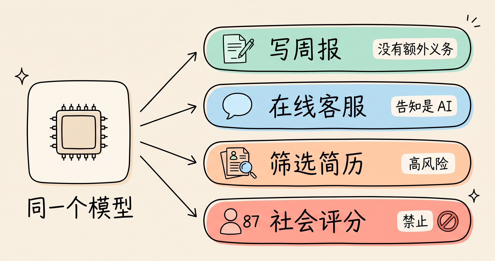
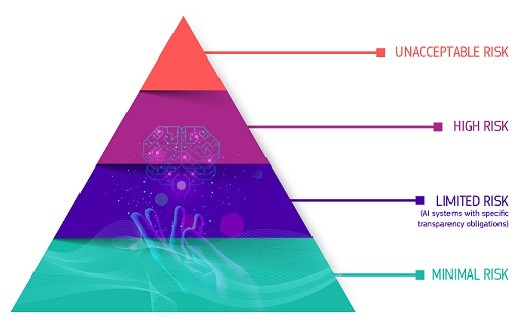
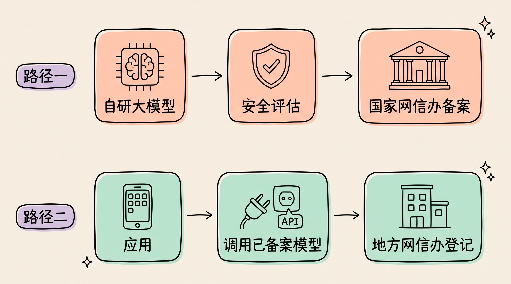
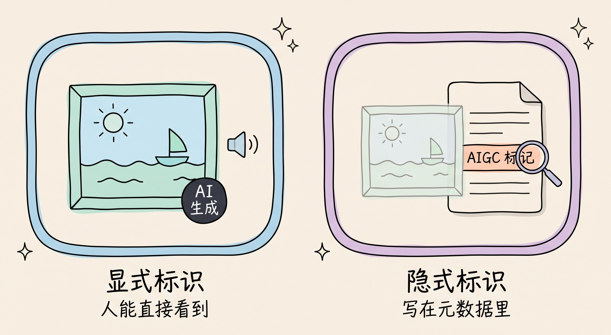
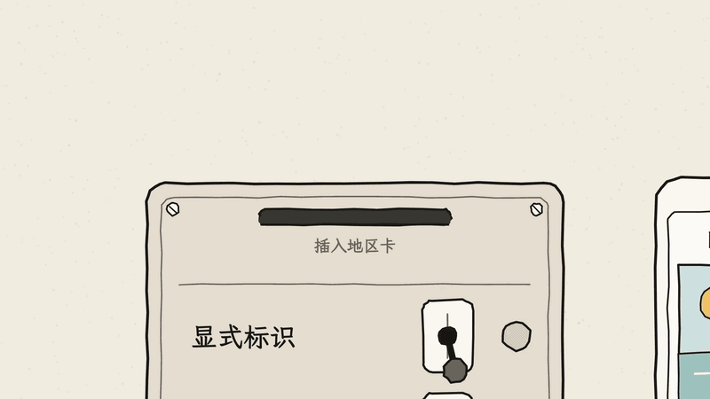

# 3分钟搞懂AI监管政策

> ⭐⭐中级 · 阅读时间 3分钟 · 更新于 2026-11-25
>
> 欧盟把高风险 AI 义务推迟到 2027 年底，标识义务照常落地；美国联邦想用行政令压下州法，仍没有全国性法律；中国已备案 1245 款生成式 AI 服务，并开出标识违规的首批罚单。本文讲清三条路的差别、趋同之处，以及做产品如何开始合规。

## 一句话定义

**AI 监管** = 政府用法律和行政规则，规定 AI 产品能用在哪些场景、上线前要做哪些备案和评估、生成的内容要怎么标识，以及出了问题由谁来承担责任，目的是在不把创新卡死的前提下，管住诈骗、歧视、侵权和虚假信息这些风险。

全球目前没有一部统一的 AI 法。欧盟、美国、中国各走了一条不太一样的路，但到了 2026 年，三条路在「AI 生成的内容要标出来」这件事上，已经开始越走越近了。

## 监管管的主要是用途和角色，而不是模型本身

很多人以为 AI 监管是在给模型打分：哪个模型安全、哪个模型危险。实际上大部分规则管的是**同一个模型被拿去做什么、由谁拿去做**。

举个例子，同样是一个大模型：

- 拿来帮你写周报，在欧盟属于风险最低的那一档，基本没有额外义务
- 拿来做在线客服，就要告诉用户「你正在和 AI 对话」
- 拿来筛简历、决定谁能进面试，就进入了高风险的范围，要做风险管理、留存日志、安排人工监督
- 拿来给员工做情绪识别、给公民做社会评分，在欧盟是直接禁止的

角色也一样会分开算。开发模型的公司叫**提供者**，把模型接进自己产品里的公司叫**部署者**，两者承担的义务并不相同。所以如果你只是调用别人的 API 做一个招聘工具，也不能因为「模型不是我训练的」就认为合规跟自己没关系。

这也是理解各国规则的一个前提：**先问清楚你做的是什么场景、在链条上处于哪个位置、用户在哪里**，然后再去对照具体的条款。

## 欧盟：按风险分四档，风险越高管得越严

欧盟《AI 法案》是目前全球最完整的一部综合性 AI 立法，它把 AI 系统按风险高低分成了四档：

| 风险等级 | 典型场景 | 要求 | 什么时候生效 |
|------|------|------|------|
| 不可接受 | 社会评分、利用弱点操纵用户、在职场和学校做情绪识别、无差别抓取人脸建库 | 直接禁止 | 2025 年 2 月 2 日 |
| 高风险 | 招聘筛选、教育评分、信贷评估、关键基础设施、执法 | 风险管理、数据治理、日志留存、人工监督、上市前合规评估 | 推迟到 2027 年 12 月 2 日（嵌入医疗器械等受监管产品的推迟到 2028 年 8 月 2 日） |
| 有限风险 | 聊天机器人、深度伪造内容、AI 生成的图文音视频 | 告知用户在和 AI 互动，生成内容要做机器可读的标记 | 2026 年 8 月 2 日 |
| 低风险 | 垃圾邮件过滤、游戏 AI、写作辅助 | 没有额外义务 | 不适用 |

*图注：欧盟委员会在 AI 法案官方说明页使用的风险金字塔。从上到下依次是不可接受风险（Unacceptable risk）、高风险（High risk）、有限风险（Limited risk，括号里注明这一档主要是透明度义务）和低风险（Minimal risk），越往上要求越严，数量也越少。*

除了这四档，欧盟还单独给**通用 AI 模型**（GPAI，也就是 GPT、Claude、Gemini、千问这类基础大模型）定了规则：要提供技术文档，制定版权政策，并公开一份训练数据的内容摘要。训练算力超过 10²⁵ 次浮点运算的模型被视为有「系统性风险」，还要额外做模型评估、对抗测试和重大事故报告。这部分义务从 2025 年 8 月 2 日起就已经适用，欧盟委员会对模型提供者的处罚权则从 2026 年 8 月 2 日开始生效。

**2026 年最大的变化是 Digital Omnibus 简化方案。** 欧盟委员会在 2025 年 11 月提出这个方案，理由是高风险部分配套的技术标准还没有准备好，企业不知道该照着什么去做合规。经过谈判，方案在 2026 年 7 月 27 日正式生效，主要改了这几件事：

- **高风险义务整体推迟**：独立的高风险系统从原定的 2026 年 8 月推迟到 2027 年 12 月，嵌入受监管产品的推迟到 2028 年 8 月。这是推迟，不是取消
- **透明度义务基本没动**：告知用户正在和 AI 互动、标识深度伪造内容的义务，按原计划在 2026 年 8 月 2 日生效。只有生成内容加机器可读标记这一项，给 8 月之前已经上市的系统留了一段过渡期，到 2026 年 12 月 2 日截止
- **新增了两项禁令**：禁止用 AI 生成未经同意的私密图像和儿童性虐待内容，也就是常说的「一键脱衣」类应用，从 2026 年 12 月 2 日起适用

罚款的力度也是企业重视它的原因：违反禁令最高可以罚 3500 万欧元，或者全球年营业额的 7%，两者取高的那个。而且只要产品面向欧盟用户提供服务，就算公司总部不在欧盟，也同样会被管到。所以很多跨国公司干脆按欧盟的标准来设计全球统一的产品，这就是常说的**布鲁塞尔效应**。

## 美国：联邦想统一口径，州已经先动手了

美国到现在都没有一部覆盖全国的综合性 AI 法律，监管的主线一直是**联邦和州之间的拉锯**。

联邦层面的方向在 2025 年发生了明显转向。特朗普上任当天撤销了拜登时期的 AI 安全行政令，随后签署行政令 14179，要求清除「妨碍美国 AI 领先地位」的政策；2025 年 7 月又发布了《AI 行动计划》，整体思路是少管、多建设，优先保证产业竞争力。

但州议会并没有停下来。截至 2025 年底，已经有一批州法落地：

- **加州 SB 53**：要求前沿大模型的开发者公开安全框架、报告重大安全事故，并保护内部举报人，2026 年 1 月 1 日生效
- **得州 TRAIGA**：禁止用 AI 故意操纵他人自残、实施违法歧视等行为，同样在 2026 年 1 月 1 日生效
- **科罗拉多 AI 法案**：最早把招聘、信贷、住房等场景的「算法歧视」纳入监管，原定 2026 年 6 月 30 日生效

州法越来越多，联邦就开始出手压制。2025 年 12 月，特朗普签署行政令 14365，要求司法部成立 **AI 诉讼工作组**，专门以违宪、妨碍州际贸易等理由起诉「过于繁重」的州 AI 法律；2026 年 3 月，白宫又把一份全国统一 AI 框架的立法建议提交给了国会，核心诉求是用联邦法律排除州法，也就是所谓的**联邦优先权**。

科罗拉多是第一个被正面冲击的州。2026 年 4 月，xAI 起诉科罗拉多州，司法部随后介入，法院批准暂停执行这部法案；5 月，科罗拉多州自己通过了 SB 26-189，把生效日期推迟到 2027 年 1 月 1 日，并大幅缩减了原来的要求。

不过需要注意的是，**行政令本身并不能直接废除州法**。截至 2026 年 11 月，国会还没有通过任何全面排除州 AI 法律的法案，加州等州的法律仍然有效。所以对在美国做业务的公司来说，短期内还是要按业务所在的州逐个对照，未来联邦和州最后会怎么分工，还需要看国会和法院后续的进展。

## 中国：先管服务和内容，综合立法已经提上日程

中国没有选择先写一部大而全的法律，而是针对具体问题出台专项规则，再一块块拼起来：

- 2022 年的《互联网信息服务算法推荐管理规定》，管推荐算法
- 2023 年 1 月的《互联网信息服务深度合成管理规定》，管换脸、仿声这类深度合成技术
- 2023 年 8 月的《生成式人工智能服务管理暂行办法》，管面向公众的大模型服务
- 2025 年 9 月 1 日起施行的《人工智能生成合成内容标识办法》，管 AI 内容的标识
- 2026 年 7 月 15 日起施行的《人工智能拟人化互动服务管理暂行办法》，管 AI 陪伴、虚拟角色这类拟人化产品

这套规则里，和做产品的人关系最大的是下面三件事。

**第一是备案和登记。** 面向公众提供生成式 AI 服务，需要通过安全评估并在国家网信办备案。截至 2026 年 10 月 31 日，全国累计有 1245 款生成式 AI 服务完成了备案。另外还有一条更轻的路径：如果你的应用只是通过 API 调用已经备案的大模型，就不需要自己再走一遍完整的模型备案，而是到地方网信办做**登记**，这类应用和功能已经登记了 955 款。对大部分基于国产大模型做应用的中小团队来说，要走的通常是登记这条路。

**第二是内容标识。** 标识办法要求 AI 生成的文字、图片、音频、视频同时做两种标识：一种是**显式标识**，用户能直接看到或听到，比如图片角落的「AI 生成」字样、音频开头的语音提示；另一种是**隐式标识**，写进文件的元数据里，方便平台识别和追溯。传播平台也要承担检测和提示的责任。这条规定已经开始真正执法了：2026 年 4 月，网信办通报了剪映、猫箱 App 和即梦 AI 网站未有效落实标识规定，属地网信部门对它们采取了约谈、责令改正、警告等措施，这也是标识办法施行以来第一次公开点名处罚。

**第三是拟人化互动的特殊要求。** 新出台的拟人化互动办法要求，服务提供者要明确提示用户正在和 AI 而不是真人互动；发现用户过度依赖或者沉迷时要主动提醒；用户连续使用超过 2 小时，也要提醒注意使用时长。如果你在做 AI 陪伴、AI 恋人、虚拟主播这类产品，这些都要在产品设计阶段就考虑进去。

在更上层的法律层面，修改后的《网络安全法》从 2026 年 1 月 1 日起施行，第一次把人工智能写进了法律条文；国务院 2026 年度立法工作计划也提出要推进人工智能健康发展方面的立法，全国人大常委会已经把它列为预备审议项目。专项规则拼图之上，综合性的 AI 立法已经提上了日程，不过具体什么时候出台，目前还没有确定的时间表。

还有一个常见的误会：看到国内用不了某些海外聊天机器人，就以为中国在限制 AI。实际情况是，这些产品没有完成备案等合规流程，所以不能面向国内公众提供服务；而完成备案的国产大模型和应用，截至目前已经有上千款在正常运营了。

## 其他国家：韩国已经生效，日本走促进路线

除了中美欧，另外两个邻国的做法也值得了解一下：

- **韩国**：《人工智能基本法》在 2026 年 1 月 22 日正式生效，是亚洲第一部综合性的 AI 法律。它要求生成式 AI 的内容做标识，对医疗、招聘、能源等「高影响 AI」提出风险管理的要求，海外大公司还要在韩国指定一名本地代理人。罚款上限是 3000 万韩元，并且政府给了至少一年的过渡期，期间原则上不处罚
- **日本**：2025 年通过的《人工智能促进法》以推动产业发展为主，几乎没有设置罚则，更多是靠政府指导和企业自律

可以看出，各国的差别更多在于「管得多硬」，而不是「管不管」。

## 标识和深度伪造：三条路最先趋同的地方

如果只记住一个趋势，那就是：**AI 生成的内容必须标出来，正在变成全球通用的要求。**

- 中国：2025 年 9 月起强制显式加隐式双重标识，2026 年 4 月已经开出了第一批罚单
- 欧盟：2026 年 8 月起，深度伪造内容必须披露；生成内容加机器可读标记的过渡期到 2026 年 12 月截止
- 韩国：2026 年 1 月起要求生成式 AI 内容做标识
- 美国：没有统一的标识法，但 2025 年签署的《TAKE IT DOWN 法案》把发布未经同意的私密图像（包括 AI 生成的）定为联邦犯罪，并要求平台在收到受害者通知后 48 小时内删除

推动这个趋同的，往往是具体的事件。2026 年 1 月，xAI 旗下的 Grok 被大量用来生成真实人物的性化图片，欧盟随即依据《数字服务法》对 X 平台展开调查，英国、爱尔兰、美国加州的监管机构也陆续介入，马来西亚和印度尼西亚还临时封禁了 Grok。几个月后，欧盟就在 Omnibus 方案里加上了禁止「一键脱衣」类应用的条款。

对做产品的人来说，这意味着**内容标识已经不是某一个市场的特殊要求**。如果你的产品有生成图片、音频、视频的功能，最好从一开始就把显式标识和元数据写入做成默认能力，而不是等到进入每个新市场时再单独返工。

## 版权和训练数据：法院还在给答案

版权是目前争议最大、也最没有定论的一块。核心问题有两个：用受版权保护的书、图片、歌词训练模型，算不算合理使用？模型如果「背出」了原作，责任算谁的？

从已有的判决来看，答案并不统一：

- **美国**：2025 年 6 月，两起案件的法官都认为，用书籍训练大模型本身可以构成合理使用；但在 Anthropic 一案中，法官同时认定，从盗版网站下载并保存书籍不属于合理使用，Anthropic 最后以 15 亿美元和作者达成了和解。另一方面，在 Thomson Reuters 诉 Ross 一案中，法院认定 Ross 用 Westlaw 的判例摘要训练法律检索工具不属于合理使用，2026 年这一判决又在上诉中得到了维持
- **德国**：2025 年 11 月，慕尼黑地区法院在德国音乐著作权协会 GEMA 诉 OpenAI 一案中认定，模型记住并能输出受保护的歌词，构成了侵权
- **欧盟**：AI 法案要求通用模型的提供者遵守欧盟版权法，尊重权利人「不允许用于训练」的声明，并公开训练数据的内容摘要

从这些案子大致可以看出一个方向：**训练这个动作本身，美国法院目前更倾向于放行；但数据怎么来的、模型会不会原样输出原作，是越来越被看重的两个点。** 对企业来说，训练数据的来源记录和输出端的版权过滤，后面可能会变成和标识一样的基础功能。当然，美国还有《纽约时报》诉 OpenAI 等一批案件没有判决，最终的规则如何，还需拭目以待。

## 做产品的人，合规要从哪一步开始想？

把上面的规则落到实际的产品上，可以按这几个问题依次过一遍：

1. **用户在哪里？** 合规看的是用户所在地，而不是公司注册地。面向欧盟用户就要对照 AI 法案，面向国内公众就要考虑备案或登记，在美国就要看具体是哪几个州
2. **用在什么场景？** 招聘、信贷、教育评分、医疗这类直接影响人的权益的场景，在欧盟、韩国、美国部分州都属于重点监管对象，立项时就要当作高合规成本的项目来规划，预留人工复核和申诉的环节
3. **你是提供者还是部署者？** 调用别人的模型做应用，模型层的义务主要在提供者身上，但应用层的告知、标识、人工监督，通常是你自己的责任
4. **有没有生成内容？** 有的话，显式标识和元数据标记最好一开始就做进去，这是目前各国要求重合度最高的部分
5. **是不是拟人化产品？** AI 陪伴、虚拟角色类产品，在国内要额外考虑身份提示、防沉迷和未成年人保护

如果产品要同时进入多个市场，比较现实的做法是**一套产品，多套合规开关**：核心功能统一，按地区打开或关闭对应的标识、告知、数据存储方式。

对普通用户来说，也有两件事值得记住。第一，规则要求标识，并不代表所有 AI 内容都会被标出来，尤其是涉及转账、借钱的语音和视频，一定要先通过其他渠道核实对方身份。第二，当你被算法拒绝了贷款或简历时，可以留意一下当地是否提供了说明和申诉的渠道，在欧盟和美国部分州，这已经是法律赋予你的权利。

## 时效性提醒

AI 监管目前还处在快速变化的阶段，下面这些内容最容易发生变化：

- 欧盟高风险义务配套的技术标准和指南，以及 2027 年之前会不会再次调整时间表
- 美国国会是否通过联邦优先权立法，以及 AI 诉讼工作组针对各州法律的诉讼结果
- 中国的生成式 AI 备案数量（每两个月更新一次），以及综合性 AI 立法的进展
- 美国和欧洲还没有判决的 AI 版权案件

**建议**：涉及具体合规决策时，以官方公报和专业律师的意见为准，以上内容只作为了解全局的参考，不构成法律建议。

💬 **互动话题**：如果你在做一款面向海外用户的 AI 产品，你会一开始就按欧盟的标准来设计，还是先在规则比较熟悉的市场跑通，再逐步补合规？

📖 **相关阅读**：

- [3分钟搞懂AI对齐](../../04-advanced/12-alignment/README.md) - 从技术上让 AI 守规矩
- [3分钟搞懂AI声音克隆](../../06-applications/06-ai-voice-cloning/README.md) - 深度伪造最常见的场景，以及国内的判例和标识要求
- [3分钟搞懂AI商业模式](../01-ai-business-models/README.md) - 合规成本会影响 AI 公司怎么赚钱
- [3分钟搞懂AI就业影响](../04-ai-and-jobs/README.md) - 招聘算法为什么是监管的重点

**资料来源**：

- 欧盟 AI 法案官方文本（Regulation (EU) 2024/1689）：https://eur-lex.europa.eu/eli/reg/2024/1689/oj
- 欧盟委员会，AI 法案监管框架说明（文中风险金字塔图出处）：https://digital-strategy.ec.europa.eu/en/policies/regulatory-framework-ai
- White & Case，EU AI Omnibus enters into force, amending the AI Act（2026-07）：https://www.whitecase.com/insight-alert/eu-ai-omnibus-enters-force-amending-ai-act
- Sidley，EU Lawmakers Reach Provisional Agreement to Delay Key EU AI Act Obligations（2026-06-22）：https://datamatters.sidley.com/2026/06/22/eu-lawmakers-reach-provisional-agreement-to-delay-key-eu-ai-act-obligations/
- Latham & Watkins，AI Executive Order Targets State Laws and Seeks Uniform Federal Standards：https://www.lw.com/en/insights/ai-executive-order-targets-state-laws-and-seeks-uniform-federal-standards
- Ropes & Gray，The White House Legislative Recommendations: National Policy Framework for AI（2026-03）：https://www.ropesgray.com/en/insights/alerts/2026/03/the-white-house-legislative-recommendations-national-policy-framework-for-artificial-intelligence-an
- Norton Rose Fulbright，xAI sues, DOJ intervenes, enforcement of Colorado's AI Act suspended：https://www.nortonrosefulbright.com/en-us/knowledge/publications/de3ad9de/xai-sues-doj-intervenes-enforcement-of-colorado-ai-act-suspended
- 国家网信办，关于发布生成式人工智能服务已备案信息的公告（2026 年 9 月至 10 月）：https://www.cac.gov.cn/2026-11/20/c_1796918603542950.htm
- 新华网，9 月 1 日起 AI 生成合成内容必须添加标识：https://www.news.cn/legal/20250901/a12108b0b10249e5bae4435269e40c91/c.html
- 第一财经，网信办通报剪映、猫箱、即梦 AI 未落实标识规定（2026-04）：https://www.yicai.com/news/103158458.html
- 中国政府网，《人工智能拟人化互动服务管理暂行办法》：https://www.gov.cn/gongbao/2026/issue_12806/202606/content_7072472.html
- 新华网，网络安全法完成修改：https://www.news.cn/politics/20251028/b3400522666a4b3f8c844b9fa6c31131/c.html
- 中国政府网，国务院 2026 年度立法工作计划：https://www.gov.cn/zhengce/content/202605/content_7068345.htm
- Cooley，South Korea's AI Basic Act: Overview and Key Takeaways（2026-01-27）：https://www.cooley.com/news/insight/2026/2026-01-27-south-koreas-ai-basic-act-overview-and-key-takeaways
- NBC News，EU opens investigation into X and Grok over sexual deepfakes（2026-01）：https://www.nbcnews.com/tech/social-media/eu-investigates-x-musks-ai-chatbot-grok-sexual-deepfakes-rcna255925
- Norton Rose Fulbright，An update on AI copyright cases in 2026：https://www.nortonrosefulbright.com/en/knowledge/publications/ce8eaa5f/ai-in-litigation-series-an-update-on-ai-copyright-cases-in-2026
- Jackson Walker，Third Circuit Affirms Westlaw Headnotes Decision in AI Copyright Fair Use Case：https://www.jw.com/news/insights-ai-copyright-fair-use-case/

---

⬅️ 上一篇：[3分钟搞懂OPC](../05-opc/README.md) ｜ [📚 返回目录](../README.md)
