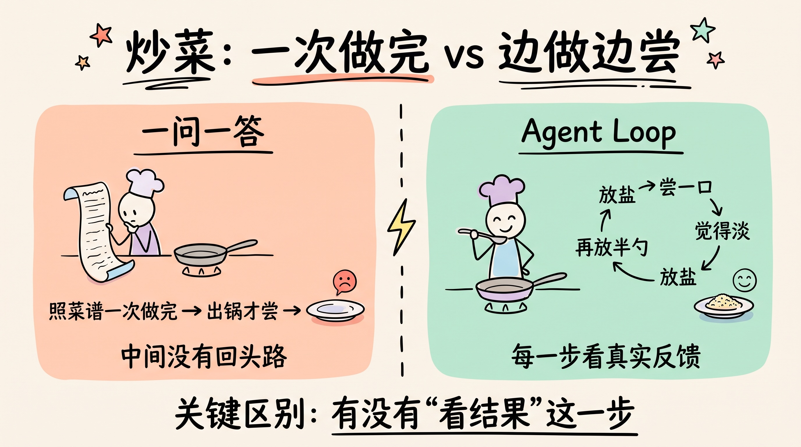
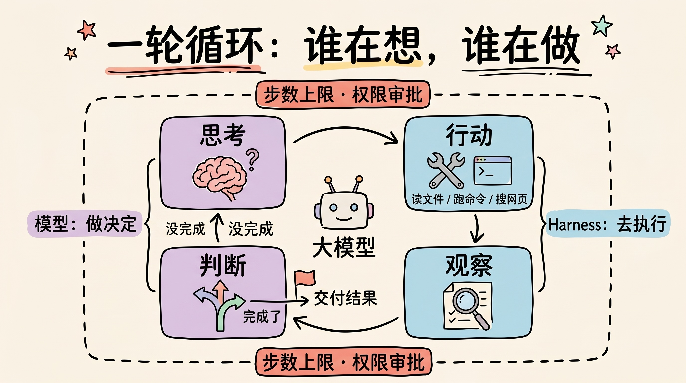
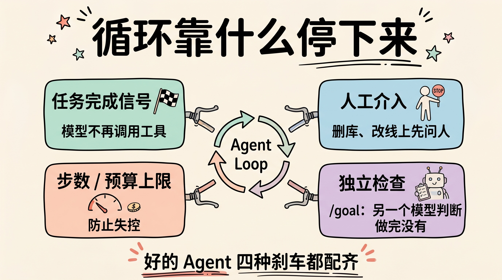
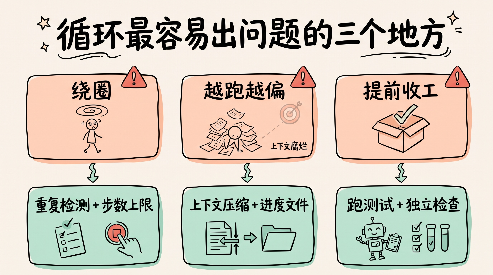
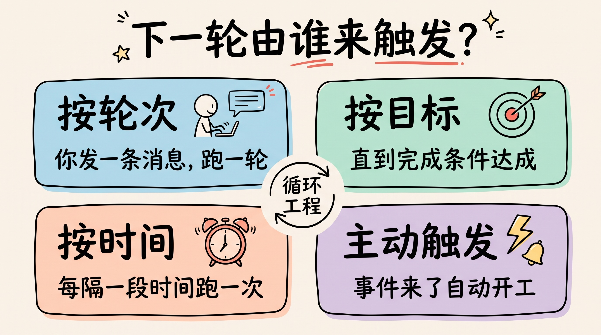

# 3分钟搞懂Agent Loop

> ⭐⭐中级 · 阅读时间 3分钟 · 更新于 2026-10-12
>
> Agent Loop 就是 AI 干活时“想一步、做一步、看结果、再决定下一步”的循环。本文讲清循环里模型和外层程序各管什么、循环靠哪几种方式停下来、最容易在哪里出问题，以及 2026 年新出现的 /goal 这类按目标跑循环的做法。

## 一句话定义

Agent Loop（智能体循环）= AI 干活时“想一步 → 动一步 → 看一眼结果 → 再想下一步”的反复循环，直到任务做完或者被外部主动叫停。

## 打个比方

**Agent Loop 就像炒菜时不停地尝味道**：

新手做菜，是把菜谱里给的步骤一次性做完，盐放多少、火候多久，全按菜谱来，出锅了才知道菜的咸淡。这就是普通的“一问一答”式 AI：你给指令，它给答案，整个过程中没有任何交互，在它完成之前没有回头路。

老手做菜就不一样了：放一勺盐 → 尝一口 → 觉得淡 → 再放半勺 → 再尝。每一步都是拿真实的反馈来决定下一步，这就是 **Agent Loop**。

**关键区别在于“看结果”这一步**：

- 普通对话：AI 说完就结束了，对错要你自己去判断
- Agent Loop：AI 做完一个动作，会拿到真实的返回结果（文件内容、命令输出、网页内容），再根据这个结果，由Agent自己决定下一步要怎么做

这就是为什么 Agent 能修 Bug：它会先跑一遍测试，看到报错后去改代码，然后再跑一遍，如此反复直到bug修复。而“一问一答”的 AI 只能猜测代码对不对，最终结果还是要靠你来运行判断，如果不对还需要再把结果给AI再处理，效率就非常低了。



## 核心要点（3个）

### 1. 循环里到底在循环什么

一轮循环通常包含四个动作：

```
① 思考(Reason)   → 现在该干什么?
② 行动(Act)      → 调用某个工具: 读文件 / 执行命令 / 搜网页
③ 观察(Observe)  → 拿到工具返回的真实结果
④ 判断           → 任务完成了吗? 没完成就回到 ①
```

这四步转一圈叫一次“迭代”，有的产品也叫一个“轮次”（turn）。一个稍复杂的编程任务，可能要转几十上百圈。

**注意**：大模型本身并不会这样“循环”，它和外面那层程序是分工合作的：

- **模型负责做决定**：想下一步做什么、要调用哪个工具、传什么参数，以及什么时候不再调用工具、直接给出最终回答
- **外面的程序负责动手和兜底**：真正去执行工具，把结果塞回给模型，再发起下一轮；同时负责步数上限、权限审批这些重要处理步骤

外面这层程序就是我们常说的 **Harness**。模型只会“提出”要调用工具，真正执行命令、读写文件的是 Harness，所以哪些操作能做、哪些节点要先问你，也是由 Harness 来把关的。



### 2. 循环靠什么停下来

这是 Agent 工程里最实际和重要的问题。常见的刹车有以下几种：

| 停止方式 | 触发条件 | 典型问题 |
|---------|---------|---------|
| **任务完成信号** | 模型不再调用工具，直接给出最终回答 | 可能提前收工，活还没干完 |
| **步数/预算上限** | 迭代次数或花费超过设定值 | 任务中途被截断，留下半成品 |
| **人工介入** | 遇到危险操作，暂停等你批准 | 需要人盯着，没法全自动 |
| **独立检查** | 另一个模型或脚本检查完成条件，没达成就继续跑 | 条件要写得能验证，否则即使检查也可能会被糊弄过去 |

需要留意的是，步数和预算上限不一定是默认开着的。比如 Anthropic 的 Claude Agent SDK，步数上限和预算上限默认都是“不限制”，官方文档也建议上生产环境时设置一个预算上限。**如果你自己搭 Agent，这两个值一定要记得配上。**

还有一种“独立检查”是 2026 年才开始普及的做法。Claude Code 和 Codex 都推出了 `/goal` 命令：你先写一个完成条件或设定一个目标任务，比如“test/auth 目录下的测试全部通过”，Agent 就会一轮接一轮地干下去，直到条件达成。Claude Code 的做法是每轮结束后由一个单独的小模型来判断条件有没有达成，这样“做完没有”就不再只由干活的模型自己说了算，可以减少 Agent 提前收工的情况。

好的 Agent 会把这几种刹车都配齐：正常走完靠完成信号和独立检查，防止失控靠上限，碰到删库、改线上这类操作就靠人来审批决定。



### 3. 循环最容易出问题的三个地方

- **绕圈**：同一个错误反复用同样的解法去试，转了十几圈还在原地，甚至陷入死循环。工程上要加“重复检测”和步数上限。
- **越跑越偏**：每一轮都会往上下文里塞新内容，比如命令输出、文件内容。研究发现，即使是很简单的任务，输入越长，模型的表现也越不稳定，这种现象叫**“上下文腐烂”**。跑到后期，大模型容易忘了最初的目标，或者重复已经做过的事。常见的解法是上下文压缩，把前面的历史总结成一段摘要；任务特别长的时候，还可以让 Agent 每干完一段就把进度写进文件、提交代码，下一轮换一个全新的上下文窗口，读进度文件接着干。
- **提前收工**：模型误以为任务已经完成，返回一个看起来完整、实际上并没验证过的结果。所以靠谱的 Agent 都会要求把“跑测试、查验证”作为收尾动作，有条件的会再加上前面说的独立检查。



## Agent Loop 为什么这么重要

2023 年大家比的是模型能不能答对，2026 年大家比的是 Agent 能不能把活干完。而“干完活”这件事，不光取决于模型有多聪明，很大程度上也取决于这个循环设计得好不好。

**实际应用场景**：

- 💻 **AI 编程**：读代码 → 改代码 → 跑测试 → 看报错 → 再改，这个闭环就是 Agent Loop。Claude Code、Codex，以及国内的 Qwen Code、Trae 等编程工具跑的都是这个循环
- 🔍 **深度研究**：搜一批网页 → 发现信息不够 → 换关键词再搜 → 汇总成报告
- 🤖 **自动化运维**：查日志 → 定位异常 → 提出修复方案 → 等人批准 → 执行

到了 2026 年，大家讨论的已经不只是“一个循环”，而是怎么设计循环本身，Claude Code 团队把这件事叫做“循环工程”。他们按“下一轮由谁来触发”把循环分成了几类：

| 循环类型 | 下一轮怎么开始 | 适合的任务 |
|---------|--------------|-----------|
| 按轮次 | 你每发一条消息，开始一轮 | 短小、探索性的任务 |
| 按目标 | 上一轮结束后自动继续，直到完成条件达成 | 有明确验收标准的任务，比如测试全部通过 |
| 按时间 | 每隔一段时间跑一次 | 定期检查、盯着外部系统的变化 |
| 主动触发 | 由事件或定时任务触发，不需要人实时在场 | 重复、边界清楚的工作，比如 Bug 分类、依赖升级 |



开发者社区里还流行过一种更“简单粗暴”的做法，叫 Ralph 循环：用一个死循环脚本，把同一份任务说明反复喂给 Agent，直到它把活干完。这相当于在 Agent Loop 的外面再套一层循环，后来 Anthropic 也把这个做法做成了 Claude Code 的官方插件。

这对普通用户来说意味着：**你能交给 Agent 的任务，正在从“几分钟的一问一答”变成“几个小时、自己跑完的一整件事”**，而能不能放心交出去，关键就看任务的完成条件写得清不清楚、能不能验证。

## 常见误解

**误解1**：Agent Loop 就是“让 AI 多想几轮”

**真相**：多想几轮是思维链（CoT），全在模型脑子里进行。Agent Loop 的关键是每轮之间有**真实世界的反馈**，命令真的执行了，文件真的读了。没有外部反馈的循环只是自言自语，甚至可能出现AI幻觉。

**误解2**：循环次数越多，结果越好

**真相**：循环次数和效果并不成正比。上下文越长越贵，也越容易跑偏，很多任务转三五圈就该收尾了。如果转了三十圈还没结果，通常说明方向错了，而不是快成功了。

**误解3**：Agent Loop 是某个框架的功能

**真相**：它是一种通用机制，不绑定任何框架。用几十行代码就能手写一个最小的 Agent Loop（文末技术补充里有示例），各家框架只是把周边配套（工具管理、错误恢复、日志、上下文压缩）做全了。

**误解4**：模型说“做完了”，任务就真的做完了

**真相**：“不再调用工具”只代表模型自己觉得可以收尾了，并不代表结果是对的。Anthropic 在做长任务实验时就发现，模型经常过早宣布完成，或者只跑了单元测试就把功能标成“已完成”，没有像真实用户那样从头到尾验证一遍。**尤其是重要的任务，一定要让 Agent 跑测试或者由独立的检查来确认，而不是只看它的总结或结论。**

## 对比：一问一答 vs Agent Loop

| 维度 | 一问一答 | Agent Loop |
|------|---------|-----------|
| 交互轮次 | 1 次 | 几次到上百次 |
| 是否用工具 | 一般不用 | 核心就是用工具 |
| 能否自我纠错 | 不能 | 能，靠真实反馈 |
| 谁决定停下 | 回答完就停 | 模型判断、步数上限、人工或独立检查 |
| 耗时 | 秒级 | 分钟到小时级 |
| 成本 | 低 | 高（每轮都消耗 Token） |
| 适合任务 | 问答、写作 | 编程、调研、多步操作 |

## 3秒总结

记住这3点就够了：

- ✅ Agent Loop = 思考 → 行动 → 观察 → 再思考的反复循环，模型做决定，Harness 负责执行
- ✅ 灵魂是“观察”：每一步都拿真实反馈来修正下一步
- ✅ 工程难点不在开跑，而在什么时候该停、怎么不绕圈、怎么确认真的做完了

## 时效性提醒

Agent Loop 这几年的变化，按时间顺序捋一遍：

- **2022 年 10 月**：ReAct 论文提出“边思考边行动”的方法，成为 Agent Loop 的基本思路
- **2025 年**：开发者社区流行起 Ralph 循环，在 Agent 外面再套一层死循环；11 月 Anthropic 公开了长任务的做法，用进度文件和 Git 提交让 Agent 跨多个上下文窗口接力干活
- **2026 年**：Claude Code 和 Codex 都推出了 `/goal`，按完成条件持续跑循环；6 月 Claude Code 团队发文系统讲解“循环工程”

以下内容变化很快，可能已经更新：

- 各家产品对循环步数、预算的默认限制
- `/goal` 这类目标模式的具体命令和判断方式
- 停止策略和人工审批的交互方式

**建议**：以你实际使用的 Agent 产品官方文档为准

## 技术补充（开发者可选阅读）

一个最小的 Agent Loop 大概长这样（伪代码）：

```python
messages = [{"role": "user", "content": task}]

for step in range(MAX_STEPS):              # 刹车: 步数上限
    reply = model(messages, tools)         # 模型思考, 决定要不要调用工具
    messages.append(reply)
    if not reply.tool_calls:               # 刹车: 不再调用工具, 视为完成
        return reply.text
    for call in reply.tool_calls:
        result = run_tool(call)            # Harness 真正执行工具 (可在这里加权限审批)
        messages.append(result)            # 观察: 把真实结果放回上下文

raise RuntimeError("超过步数上限, 任务未完成")
```

主流框架里的循环本质上都是这个结构：

- **Claude Agent SDK**：模型输出里没有工具调用时，循环结束；可以用 `max_turns` 限制轮数、用 `max_budget_usd` 限制花费，两者默认都不设限，超出后会返回 `error_max_turns` 或 `error_max_budget_usd`
- **OpenAI Agents SDK**：每轮判断模型输出是最终结果、转交给其他 Agent（handoff），还是工具调用；超过 `max_turns` 会抛出 `MaxTurnsExceeded` 异常

💬 **互动话题**：你见过 AI 在一个问题上反复绕圈吗？它最后是怎么跳出来的？

📖 **相关阅读**：

- [3分钟搞懂工具调用](../02-function-calling/README.md) - Agent 是怎么“动手”的
- [3分钟搞懂Harness](../07-harness/README.md) - 驱动循环转起来的那层程序
- [3分钟搞懂上下文工程](../03-context-engineering/README.md) - 怎么解决循环越跑越偏
- [3分钟搞懂AI Agent](../../02-core-capabilities/05-ai-agent/README.md) - Agent 到底是什么
- 3分钟搞懂思维链 - 和 Agent Loop 最容易混淆的概念
- [3分钟搞懂MCP](../../01-basics/08-mcp/README.md) - Agent 连接工具的统一接口

**资料来源**：

- Anthropic，Claude Agent SDK：How the agent loop works：https://code.claude.com/docs/en/agent-sdk/agent-loop
- Anthropic，Claude Code：Keep Claude working toward a goal（/goal）：https://code.claude.com/docs/en/goal
- Anthropic，Effective harnesses for long-running agents（2025-11-26）：https://www.anthropic.com/engineering/effective-harnesses-for-long-running-agents
- Claude 博客，Getting started with loops（2026-06-30）：https://claude.com/blog/getting-started-with-loops
- OpenAI，Agents SDK：Running agents：https://openai.github.io/openai-agents-python/running_agents/
- OpenAI，Codex：Follow a goal：https://learn.chatgpt.com/use-cases/follow-goals
- Chroma，Context Rot（2025-07）：https://research.trychroma.com/context-rot
- ReAct 论文：https://arxiv.org/abs/2210.03629
- VentureBeat，Ralph 循环的来龙去脉：https://venturebeat.com/ai/how-ralph-wiggum-went-from-the-simpsons-to-the-biggest-name-in-ai-right-now

---

[📚 返回目录](../README.md) ｜ 下一篇：[3分钟搞懂工具调用(Function Calling)](../02-function-calling/README.md) ➡️
