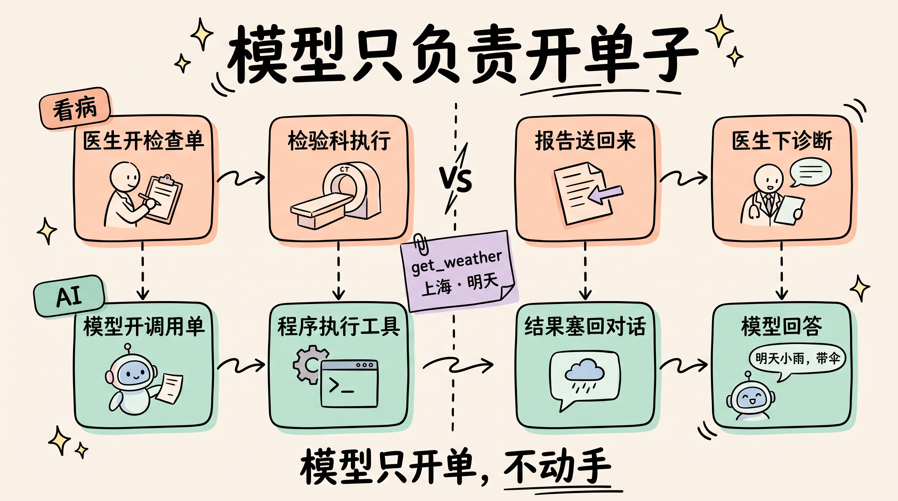
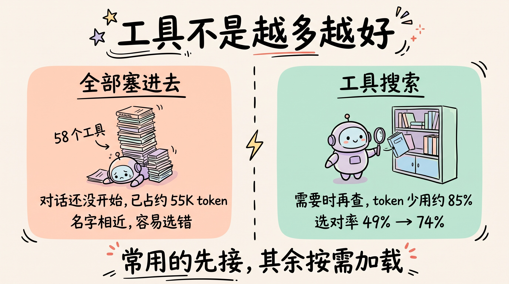
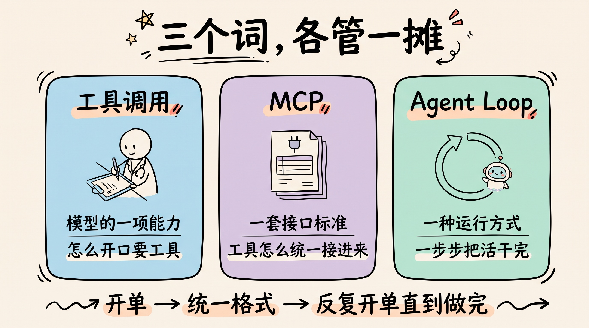
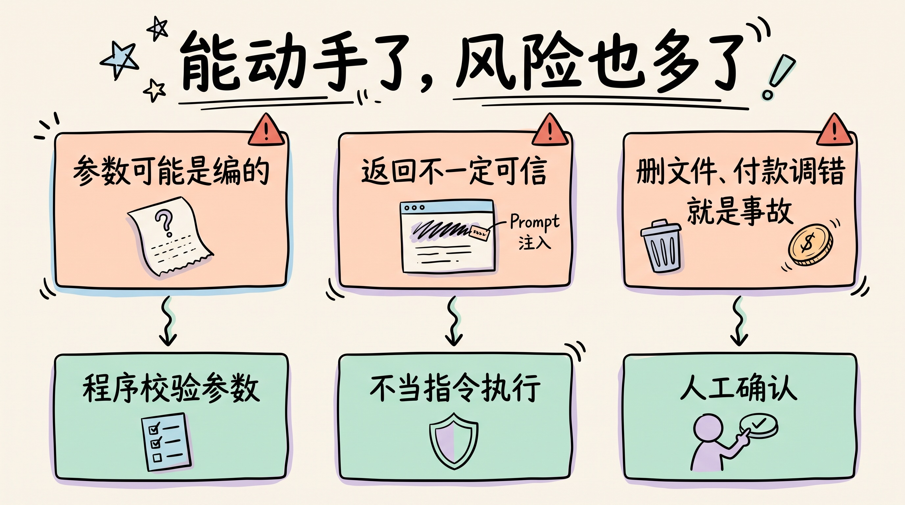

# 3分钟搞懂工具调用(Function Calling)

> ⭐⭐中级 · 阅读时间 3分钟 · 更新于 2026-10-13
>
> 工具调用是 AI 从“只会说”到“能动手”的基础：模型只负责开一张调用单，真正执行的是背后的程序。本文讲清它的完整流程、工具说明书怎么写、工具为什么不是越多越好，以及它和 MCP、Agent Loop 的关系。

## 一句话定义

**工具调用**（Function Calling / Tool Use）= 模型遇到自己答不了或做不了的事时，按约定的格式开出一张“调用单”，写明要用哪个工具、传什么参数，由背后的程序去执行，再把结果交回给模型继续分析。

举个例子：问 AI“明天上海下不下雨”，模型本身其实是答不上来的。训练数据里没有明天的天气，它能做的是说一句：“我需要查一下天气接口，参数是上海、明天。”然后等程序把结果递回来，它再用人话告诉你。

这里最容易搞错的一点是：**模型自己从来不执行任何东西**。它只负责写调用单，真正去查天气、读文件、发请求的，是模型背后的程序。

## 模型只负责开单子

这件事很像去医院看病。医生不会亲自去操作 CT 机，他要做的是判断需不需要做检查、做哪一项，然后开一张检查单。检验科照着单子执行，然后把报告送回来，医生看完报告再下诊断。如果报告不够清楚，不足以让医生下结论，他还可以再开一张。

换到 AI 这边，一次完整的工具调用是这样的：

```
1. 你的程序: 把用户问题 + 工具说明书一起发给模型
2. 模型: 返回一张调用单
   {"name": "get_weather", "arguments": {"city": "上海", "date": "明天"}}
3. 你的程序: 真的去调天气接口, 拿到结果
4. 你的程序: 把结果塞回对话, 再发给模型
5. 模型: 回答 "明天上海小雨, 出门带伞"
```



第 2 步是关键。模型输出的不是一段随意的文字，而是符合约定格式的 JSON，程序可以直接解析。这个能力是 OpenAI 在 2023 年 6 月 13 日的 API 更新里正式推出的，它的作用是：开发者向模型描述函数，模型会判断什么时候需要调用，并输出一个包含调用参数的 JSON 对象。此后主流模型厂商都提供了类似的接口，国内的 DeepSeek、千问、Kimi、智谱等模型 API 也都支持工具调用，而且大多兼容 OpenAI 的写法，**所以你写好的一套工具代码，换个模型通常也能用。**

实际使用时还有几个细节值得知道：

- **一次可以开好几张单子**：模型可以在同一轮里同时调用多个工具，比如一次查上海和北京两个城市的天气，这叫并行调用。
- **可以规定它用不用工具**：开发者可以设置成让模型自己决定、必须调用工具、只能调用某个指定工具，或者干脆不调用。
- **可以要求格式严格对齐**：早期模型偶尔会输出格式不对的 JSON。现在 OpenAI 和 DeepSeek 等都提供了“严格模式”（strict），开启后模型输出的参数会严格符合你定义的格式，不再只是“尽量遵守”。

把第 1 到第 5 步不断重复，让模型一张接一张地开单子，直到任务做完，就是 **Agent Loop**。可以说，工具调用是 Agent 能够动手干活的基础。

## 模型只能看见说明书

模型并不认识你的天气接口。它能看到的只有三样东西：工具叫什么、这个工具是干什么的、需要哪些参数。一份工具说明书大概是这样的（注意：这里做了简化，实际要按 JSON Schema 的格式来写）：

```json
{
  "name": "get_weather",
  "description": "查询指定城市某一天的天气预报。只支持未来7天内的日期。",
  "parameters": {
    "city": "城市中文名, 如 上海",
    "date": "日期, 格式 YYYY-MM-DD, 或 今天/明天"
  }
}
```

所以说明书写得好不好，直接决定了模型能不能用对。Anthropic 在 2025 年 9 月的工程博客《Writing effective tools for agents》里总结过几条经验：

- **描述里的小改动，效果可能差很多**。参数格式、专有名词、工具之间的关系都要写清楚，不要让模型去猜。
- **返回有意义的信息**。如果工具返回的是一串 UUID 这样的随机编号，模型很难用；换成人能看懂的名字之后，检索的准确率明显提升了，胡编的情况也变少了。
- **控制返回内容的长度**。工具一次返回太多内容会占满上下文，要用分页、筛选、截断这些办法。比如 Claude Code 默认把单次工具返回限制在 25,000 个 token 以内。
- **少而精，比多而散好**。与其给 `list_users`、`list_events`、`create_event` 三个工具让模型自己去拼，不如直接做一个 `schedule_event`，一步完成查空闲时间和创建日程。
- **加前缀分组**。工具多了以后，`asana_search`、`jira_search` 这样的命名能帮模型分清每个工具管哪一块。

除了写文字描述，还可以直接在说明书里给几个调用示例。按 Anthropic 2025 年 11 月公布的内部测试，加上示例之后，模型处理复杂参数的准确率从 72% 提高到了 90%。

写工具说明书，其实就是在给一个很聪明、但对你的系统一无所知的新同事写操作手册，**写得越清楚，它犯的错就越少。**


## 工具不是越多越好

直觉上，给 AI 接的工具越多，它能干的事就越多。但实际情况是，工具说明书本身也要占用上下文。

Anthropic 在 2025 年 11 月的《Introducing advanced tool use》里举过一个例子：同时接入 GitHub、Slack、Sentry 等 5 个 MCP 服务，一共 58 个工具，**对话还没开始，这些工具说明书就已经占掉了大约 55K token**。他们内部还遇到过优化前占到 134K token 的情况。

工具多占用上下文只是一方面，更麻烦的是模型容易选错工具。名字相近的工具，比如“发通知给用户”和“发通知到频道”，模型很容易搞混。他们给出的解法是**工具搜索**：先不把所有说明书都塞进去，而是让模型需要的时候再按关键词去查。按官方数据，这种方式让工具相关的 token 消耗减少了约 85%，选对工具的准确率也提高了，在他们的测试里，Claude Opus 4 从 49% 提高到 74%，Opus 4.5 从 79.5% 提高到 88.1%。

现在这个做法已经不只是 Anthropic 在用了。OpenAI 也在 Responses API 里提供了工具搜索，开发者把不常用的工具标记成“延迟加载”，模型需要时再搜出来，目前只有 GPT-5.4 及之后的模型支持。

Anthropic 还提出了另一种思路，叫**程序化工具调用**：不再让模型一个一个地调工具、每次都把结果读一遍，而是让模型写一段代码，在代码里批量调用工具、处理中间结果，最后只把需要的结论交给模型。按他们的测试，复杂研究任务的平均 token 用量从 43,588 降到了 27,297，减少了 37%。

这对开发者来说意味着：**接工具之前先想清楚哪些是常用的、哪些可以按需加载**，而不是一股脑全接上去。



## 工具调用和 MCP、Agent Loop 是什么关系

这三个词经常一起出现，它们的分工其实很清楚：

| | 工具调用 | MCP | Agent Loop |
|---|---|---|---|
| 是什么 | 模型的一项能力 | 一套接口标准 | 一种运行方式 |
| 解决什么 | 模型怎么“开口要工具” | 工具怎么统一接进来 | 怎么一步步把活干完 |
| 类比 | 医生开检查单 | 全院统一的检查单格式 | 看病、开单、看报告、再开单的全过程 |

没有 **MCP** 也能做工具调用，只是每接一个工具，都要自己写一遍对接代码。有了 MCP 之后，同一个工具就可以被不同的 AI 应用复用。MCP 本身也还在更新，2026 年 7 月 28 日发布的新版规范把协议改成了无状态的设计，服务端更容易大规模部署，客户端也可以把工具列表缓存起来，不用每次都重新获取。



## 能力边界和风险

工具调用让 AI 从“只会说”变成了“能动手”，风险也随着增加了：

- **参数可能是编的**。模型可能填一个不存在的城市、一个格式不对的日期，甚至在该调工具的时候不调，直接凭印象回答。严格模式只能保证格式对，保证不了内容对，所以程序端一定要校验参数。
- **工具返回的内容不一定可信**。网页、邮件、文档里可能藏着“忽略之前的指令”这类文字，模型读到后可能会被带偏，这就是 **Prompt 注入**。
- **有副作用的工具要设关卡**。查天气调错了无所谓，但删文件、发邮件、付款调错了就是事故。这类工具应该默认需要人来确认，这部分在《3分钟搞懂Agent沙箱与权限》里有展开。



还有一个常见的误会：看到 AI 能查实时天气、搜网页，就以为“模型联网了”。实际上模型本身没有变，联网的是它背后的程序。这里的“程序”有两种：一种是你自己写的代码；另一种是厂商平台内置的工具，比如 ChatGPT 的联网搜索、代码解释器，是由 OpenAI 的平台替你执行的。但不管是哪一种，模型都只负责开单子。**同一个模型，接不接工具、接哪些工具，表现可以天差地别。**

## 时效性提醒

工具调用的基本机制已经很稳定了，变化比较快的是周边的东西：

- 各家 API 的参数写法、工具数量上限和严格模式的支持范围
- 工具搜索、程序化工具调用这类按需加载的方案，目前还在快速迭代
- MCP 的规范版本，2026 年 7 月刚发布了一次比较大的更新

**建议**：动手之前，以各家官方文档为准。

💬 **互动话题**：如果让你给 AI 写一份工具说明书，你觉得最容易被它误解的一个参数会是什么？

📖 **相关阅读**：

- [3分钟搞懂Agent Loop](../01-agent-loop/README.md) - 让模型一张接一张开单子的循环
- [3分钟搞懂MCP](../../01-basics/08-mcp/README.md) - 工具统一接入的标准
- [3分钟搞懂Harness](../07-harness/README.md) - 替模型执行工具的那层程序
- [3分钟搞懂Agent沙箱与权限](../08-sandbox-and-permissions/README.md) - 怎么防止工具被乱用
- [3分钟搞懂上下文工程](../03-context-engineering/README.md) - 工具说明书和返回结果怎么省上下文

**资料来源**：

- OpenAI，Function calling and other API updates（2023-06-13）：https://openai.com/index/function-calling-and-other-api-updates/
- OpenAI，Function calling 文档：https://developers.openai.com/api/docs/guides/function-calling
- OpenAI，Tool search 文档：https://developers.openai.com/api/docs/guides/tools-tool-search
- Anthropic，Writing effective tools for agents（2025-09-11）：https://www.anthropic.com/engineering/writing-tools-for-agents
- Anthropic，Introducing advanced tool use（2025-11-24）：https://www.anthropic.com/engineering/advanced-tool-use
- DeepSeek，Tool Calls 文档：https://api-docs.deepseek.com/zh-cn/guides/tool_calls
- MCP 官方博客，2026-07-28 规范发布：https://blog.modelcontextprotocol.io/posts/2026-07-28/

---

⬅️ 上一篇：[3分钟搞懂Agent Loop](../01-agent-loop/README.md) ｜ [📚 返回目录](../README.md) ｜ 下一篇：[3分钟搞懂上下文工程](../03-context-engineering/README.md) ➡️
