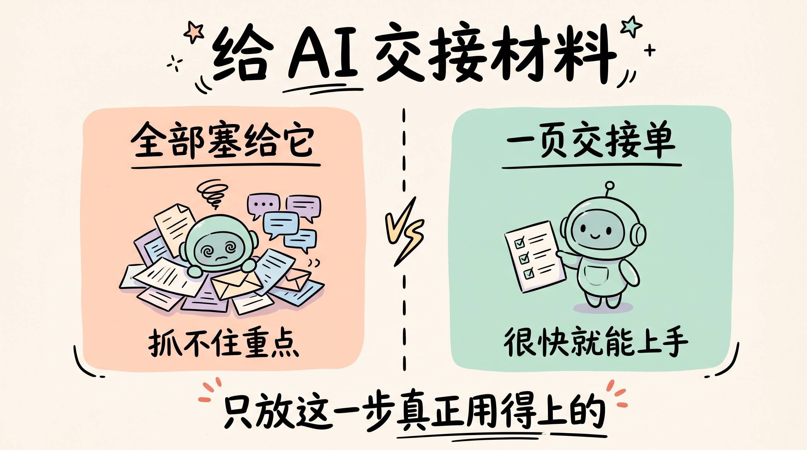
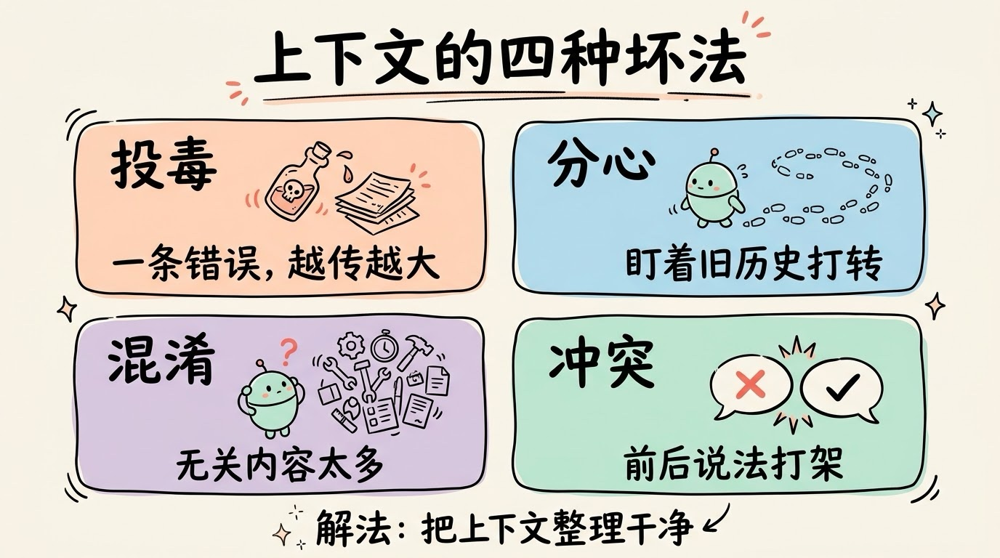
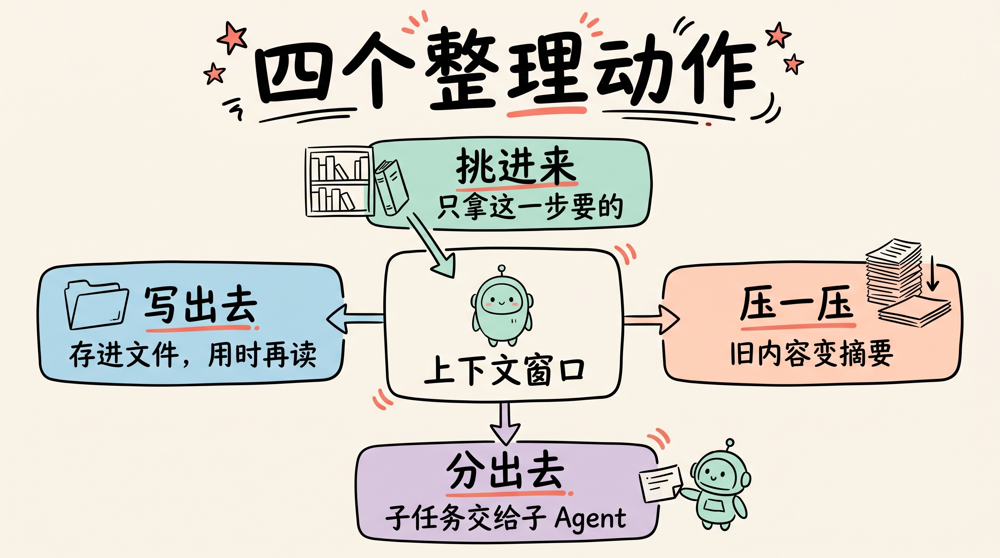
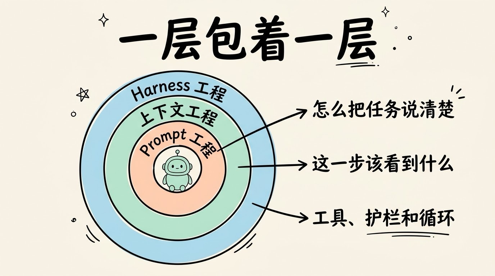

# 3分钟搞懂上下文工程

> ⭐⭐中级 · 阅读时间 3分钟 · 更新于 2026-10-13
>
> 上下文工程是在 AI 每一步行动前，挑选和整理放进上下文窗口的信息。本文讲清窗口再大也不能随便塞的原因、上下文会以哪四种方式“坏掉”、业内常用的四个整理动作，以及 2026 年各家产品已经自动替你做了哪些事。

## 一句话定义

**上下文工程**（Context Engineering）= 在 AI 每一次回答、每一步行动之前，挑选、整理并控制放进上下文窗口里的信息，让它用尽量少的内容，拿到完成任务最需要的那部分。Prompt 工程管的是**你怎么问**，上下文工程管的是**它看到什么**。

这个说法是 2025 年 6 月火起来的。Shopify 的 CEO Tobi Lütke 说，他更喜欢用“上下文工程”而不是“Prompt 工程”，因为真正的难点是把完成任务所需的上下文都准备好；Andrej Karpathy 随后也公开表示赞同。之后 Anthropic、LangChain、Manus 等团队都专门写文章总结过自己的做法。

## 模型看到什么，比你怎么问更重要

这件事很像给新同事准备交接材料。同一个任务，你有两种交法：

- **交法 A**：把部门五年来的所有文档、邮件、聊天记录打包发过去，说“你自己看”。新同事得先花三天翻资料，而且很可能抓错重点。
- **交法 B**：给新同事一页纸的交接单，写清楚任务目标、三份关键文档、两条注意事项，以及上次踩过的坑等等。新同事很快就能上手。

很多人用 AI 的方式是交法 A：把整个文件、整段聊天记录一股脑塞进去，觉得“给得越多越好”。

而上下文工程做的是交法 B：**在有限的窗口长度里，只放大模型真正需要的东西。**

而且模型拿到的信息，甚至大部分并不是你给的：系统提示词、之前的对话、工具返回的结果、检索到的资料、读进来的文件，都会一起塞进上下文窗口。所以上下文工程不是“Prompt 工程的新叫法”，它管理的是整个窗口。

到了 Agent 身上，这个问题会更明显。Agent 每调用一次工具，返回结果都会堆进上下文，跑几十轮之后，窗口里就塞满了过期的中间结果，这也是为什么长任务容易越跑越偏。

## 窗口再大，也不能随便塞

现在大模型支持的上下文窗口越来越大了。比如 Anthropic 从 2026 年 3 月起，让 Claude 的 100 万 token 窗口按标准价格计费，不再收长上下文的附加费。但窗口大，不等于可以随便用，它同时受到三方面的限制：

| 限制 | 具体表现 |
|------|------|
| **容量** | 塞满了就装不下新的信息 |
| **成本** | 每一轮请求都要把整个上下文重新发一遍，聊得越久越贵 |
| **注意力** | 内容越多越杂，模型越容易漏掉关键信息 |

对于成本问题，可以靠**提示词缓存**来降低：每次请求里不变的开头部分，命中缓存后就按更低的价格计费。Manus 团队提到，Claude Sonnet 命中缓存的输入价格是每百万 token 0.30 美元，没命中是 3 美元，差了 10 倍，所以他们把缓存命中率当成线上 Agent 最重要的指标。国内的 DeepSeek 也默认开启了上下文硬盘缓存，命中缓存的部分计费明显更低。

你可能会很奇怪模型**注意力**这一项：**给模型的信息越多，效果反而可能变差**。Chroma 在 2025 年 7 月测试了 18 个主流模型，发现即使是很简单的任务，输入越长，模型的表现也越不稳定，这种现象叫**上下文腐烂**。Anthropic 的解释是，模型的注意力就像一笔有限的预算，每多放一段内容，分给关键信息的注意力就会少一点。

所以上下文工程的核心动作不是“往里加”，而是“往外筛”，用 Anthropic 的话说，就是找到**最少、但信息量最高**的那些关键内容。

## 上下文会以四种方式“坏掉”

开发者 Drew Breunig 在 2025 年 6 月总结了长上下文最常见的四种失败方式，后来被很多团队引用：

- **上下文投毒**：前面一条错误信息，比如一次幻觉或者读错的文件内容，留在了上下文里，后面每一步都基于它往下推，错误被不断放大。
- **上下文分心**：上下文太长，模型开始盯着自己之前的历史记录，而不是思考新的办法。同一个 Gemini Agent 在上下文超过大约 10 万 token 之后，就开始重复之前做过的动作。
- **上下文混淆**：塞进了太多无关的内容，把模型带偏了。有测试发现，一个小模型在同时拿到 46 个工具时会失败，只给 19 个工具时就能完成，而这些工具说明加起来其实也没有超出窗口大小。
- **上下文冲突**：上下文里前后的信息互相矛盾，最常见的来源是模型自己早先给出的错误答案。微软和 Salesforce 的研究把一个完整的问题拆成几条消息，一轮一轮地补充给模型，就像我们平时先随口问一句、不满意再补充细节一样。结果模型在信息还不全的时候就抢先作答，这些错误答案留在上下文里，和后面补充的信息互相打架，模型又往往会顺着自己前面的答案往下走。最终平均表现下降了 39%，o3 的得分从 98.1 降到了 64.1。

这四种问题的共同解法，都不是“换一个更强的模型”，而是**把上下文整理干净**。这对普通用户来说也很实用：提需求时尽量一次说完整，不要挤牙膏式地一点点补充；如果你发现 AI 聊得越久越糊涂，与其反复纠正它，不如开一个新对话，把完整的需求和关键结论重新交代一遍。

## 四个常用的整理动作

LangChain 在 2025 年 7 月把常见的做法归成了四类，这也是现在最常用的分法：

- **写出去（Write）**：把内容存到上下文外面，比如写进文件、笔记或数据库，上下文里只留一个文件路径或索引，需要的时候再读回来。Manus 的 Agent 干活时会维护一个 `todo.md` 待办清单，一边做一边更新，相当于不断提醒自己整体目标是什么。
- **挑进来（Select）**：只把和这一步相关的内容放进去。RAG 就是在做这件事：先检索，再把找到的少量片段交给模型。现在更常见的做法是“用到时再取”：Agent 只记住文件名、链接这样的线索，真正需要时才去读内容。
- **压一压（Compress）**：对话变长以后，把前面的内容总结成一段摘要，替换掉原文。最轻量的做法是把已经用不上的旧工具结果清掉，Anthropic 认为这是最安全的一种压缩。
- **分出去（Isolate）**：把独立的子任务交给子 Agent，让它在自己干净的上下文里做完，只把结论带回来。按 Anthropic 的经验，子 Agent 交回来的摘要通常只有 1,000 到 2,000 个 token，主 Agent 的窗口就能一直保持清爽。

还有一个实用的经验：**出错的记录不要急着删**。Manus 团队发现，把失败的操作和报错留在上下文里，模型反而能吸取教训，不再重复同样的错误。

## 这些动作，很多工具已经自动帮你做了

2026 年，上面这些做法已经陆续变成了现成的功能：

- **自动压缩**：Anthropic 和 OpenAI 的 API 都提供了服务端压缩，对话长到一定程度时，由平台自动把旧内容总结成摘要，开发者不用自己写总结的代码。Claude Code、Codex 这类编程工具也会在窗口快满时自动压缩。
- **清理旧的工具结果**：Anthropic 的 API 可以按规则自动清掉旧的工具返回结果，只保留最近的几条。
- **按需加载**：工具说明、技能说明不再一开始就全部塞进去，而是需要时再加载，具体可以看《3分钟搞懂工具调用》里的工具搜索。

这对普通用户来说意味着：**很多整理工作产品会自动帮你做，但它不知道什么是你最在意的。** 压缩后的摘要可能丢掉你早期交代的某条要求，所以长期有效的规则，最好写进项目说明文件（比如 Claude Code 的 `CLAUDE.md`），而不是只在对话开头说一次。

## 上下文工程和 Prompt 工程、Harness 是什么关系

从 2023 年的 Prompt 工程，到 2025 年的上下文工程，再到 2026 年常说的 Harness 工程，其实是同一个问题在一层层往外扩：**怎么让模型稳定地把活干对。**

| | Prompt 工程 | 上下文工程 | Harness 工程 |
|---|---|---|---|
| 管什么 | 你写的那段指令 | 模型眼前的整个窗口 | 模型运行的整套系统 |
| 关心的问题 | 怎么把任务说清楚 | 这一步该看到哪些信息 | 有哪些工具、护栏和循环 |
| 类比 | 交代任务的那句话 | 交接单上放哪些材料 | 整个部门的工作流程和规章制度 |

三者不是替代关系，而是一层包着一层。其中上下文工程的性价比最高：不用换模型，也不用重构整个系统，只要调整信息的组织方式，效果往往就能明显改善。

## 时效性提醒

上下文工程的基本思路已经比较稳定，变化比较快的是这些：

- 各个模型的上下文窗口大小、长上下文的计费方式和缓存价格
- 各家产品自动压缩、清理工具结果、按需加载的具体策略
- 服务端压缩相关的 API，目前还有不少处在测试阶段

**建议**：以模型官方文档公布的窗口上限和计费规则为准。

💬 **互动话题**：你有没有遇到过“聊得越久，AI 越糊涂”的情况？你是怎么处理的？

📖 **相关阅读**：

- [3分钟搞懂提示词缓存](../05-prompt-caching/README.md) - 怎么让重复的上下文更便宜
- [3分钟搞懂Token和上下文](../../01-basics/06-token-and-context/README.md) - 上下文窗口的基础概念
- [3分钟搞懂Prompt工程](../../01-basics/07-prompt-engineering/README.md) - 上下文工程的前一层
- [3分钟搞懂RAG检索增强](../../02-core-capabilities/04-rag/README.md) - “挑进来”最常见的做法
- [3分钟搞懂Agent Loop](../01-agent-loop/README.md) - 为什么长任务越跑越偏
- [3分钟搞懂Agent记忆系统](../06-agent-memory/README.md) - 把信息“写出去”之后怎么记住
- [3分钟搞懂Harness](../07-harness/README.md) - 上下文工程的外面一层

**资料来源**：

- Anthropic，Effective context engineering for AI agents（2025-09-29）：https://www.anthropic.com/engineering/effective-context-engineering-for-ai-agents
- LangChain，Context Engineering for Agents（2025-07-02）：https://www.langchain.com/blog/context-engineering-for-agents
- Drew Breunig，How Long Contexts Fail（2025-06-22）：https://www.dbreunig.com/2025/06/22/how-contexts-fail-and-how-to-fix-them.html
- Manus，Context Engineering for AI Agents: Lessons from Building Manus（2025-07-18）：https://manus.im/blog/Context-Engineering-for-AI-Agents-Lessons-from-Building-Manus
- Chroma，Context Rot（2025-07）：https://research.trychroma.com/context-rot
- Laban 等（微软、Salesforce），LLMs Get Lost in Multi-Turn Conversation（2025-05）：https://arxiv.org/abs/2505.06120
- Simon Willison，关于“上下文工程”一词的讨论（2025-06-27）：https://simonwillison.net/tags/tobias-lutke/
- Anthropic，1M context is now generally available for Opus 4.6 and Sonnet 4.6：https://claude.com/blog/1m-context-ga
- Anthropic，Compaction 文档：https://platform.claude.com/docs/en/build-with-claude/compaction
- OpenAI，Compaction 文档：https://developers.openai.com/api/docs/guides/compaction
- DeepSeek，上下文硬盘缓存：https://api-docs.deepseek.com/zh-cn/guides/kv_cache

---

⬅️ 上一篇：[3分钟搞懂工具调用(Function Calling)](../02-function-calling/README.md) ｜ [📚 返回目录](../README.md) ｜ 下一篇：[3分钟搞懂Skills](../04-skills/README.md) ➡️
