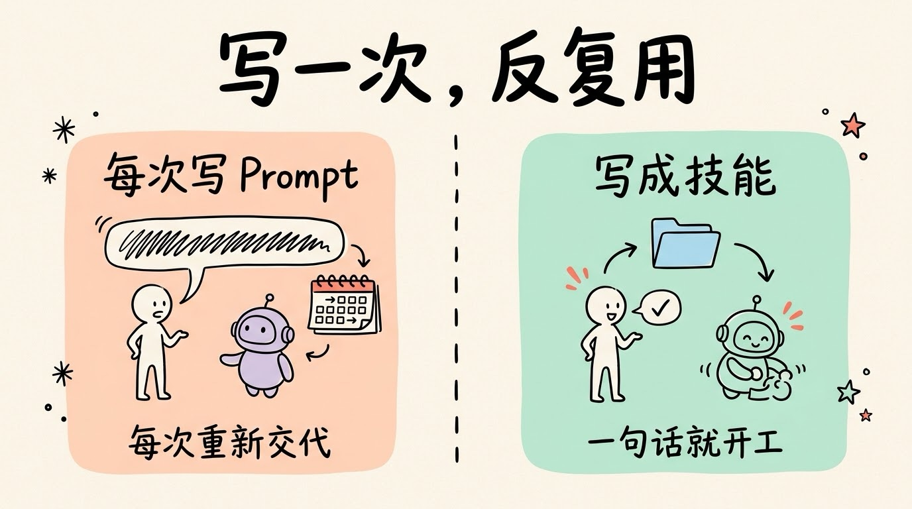
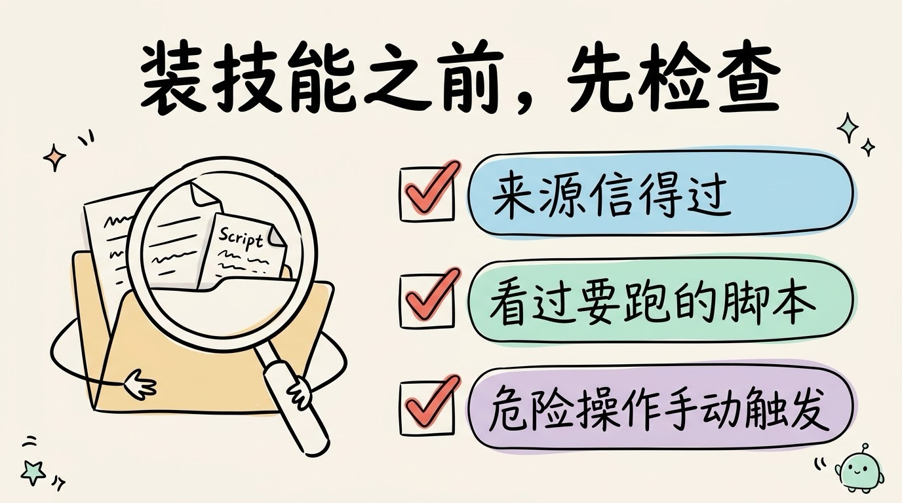

# 3分钟搞懂Skills

> ⭐⭐中级 · 阅读时间 3分钟 · 更新于 2026-10-13
>
> Skills 是把一套做事方法装进文件夹、让 AI 用到时才读取的技能包。本文讲清一个技能由什么组成、AI 怎么做到装几十个也不占地方、它和直接写 Prompt 差在哪，以及哪些工具已经支持、装别人的技能要注意什么。

## 一句话定义

**Skills**（技能，全称 Agent Skills）= 把做某件事的一整套方法，包括操作步骤、参考资料和要用到的脚本，装进一个文件夹里；AI 平时只记住每个技能的名字和用途，遇到对应的任务时，才把完整内容读进来照着做。

它是 Anthropic 在 2025 年 10 月推出的，同年 12 月作为开放标准公开了格式。现在 Claude、ChatGPT 和 Codex、Cursor、GitHub Copilot，以及国内字节的 TRAE 等工具都已经支持。

## 一个技能就是一个文件夹

很多人第一次听说 Skills，会以为它是某种复杂的插件。其实它简单得多，一个技能就是一个文件夹：

```
cover-image/
├── SKILL.md        # 必需: 开头写名字和用途, 下面写操作步骤
├── scripts/        # 可选: 需要执行的脚本
├── references/     # 可选: 参考资料, 比如配色方案、风格说明
└── assets/         # 可选: 模板、图片等素材
```

核心只有一个 `SKILL.md` 文件，用的是 Markdown 格式，人能直接打开修改，AI 也很容易读懂。文件开头写两样东西：**名字**和**描述**，描述要写清楚这个技能是干什么的、什么时候该用；下面的正文就是一份操作手册，告诉 AI 第一步做什么、第二步做什么、遇到什么情况怎么处理。


拿我自己写公众号用的封面图技能来说，`SKILL.md` 里写的是：先分析文章主题，再从几种配色和画风里选一个，然后按固定格式写出画图提示词。配色方案放在 `references/` 里，AI 需要选配色时才会去翻。

这里有一个常见的误解：**技能本身并不能调用工具**。它更像一本写给 AI 的操作手册，真正去读文件、跑脚本、调用接口的，还是 AI 本身的工具调用能力。技能做的是告诉 AI：这件事按什么顺序做、用哪个脚本、注意哪些坑等。

## 检索只使用名字，用到时才读全文

一个人可能会装几十个技能，如果每次都把所有技能的内容塞给 AI，上下文窗口很快就会被占满。所以技能是**按需加载**的，加载时分为三步：

1. **启动时**：AI 只读每个技能的名字和描述，每个只占很少的 token，装几十个也不会把上下文塞满。
2. **对上号时**：AI 发现你的需求和某个技能的描述对得上，才去读完整的 `SKILL.md`。
3. **执行时**：步骤里用到了脚本或参考资料，才去打开对应的文件。


这就带来一个很实用的功能：**用技能不一定要记命令**。在 Agent 里，你可以输入 `/cover-image` 直接调用，也可以只说一句「帮我给这篇文章做个封面」，AI 根据描述判断出该用这个技能，就会自己去加载它。

所以描述写得清不清楚，决定了这个技能能不能在该用的时候被用上。如果是发布、删除这类不希望 AI 自己判断就执行的技能，有的 Agent 工具（比如 Claude Code）也可以设置成只能由你手动调用。

## 和直接写 Prompt 比，差在哪

直接写 Prompt 也能让 AI 做事，技能的区别主要在这几个地方：

| | 每次直接写 Prompt | 写成技能 |
|---|---|---|
| 怎么复用 | 每次重新写，或者翻聊天记录复制 | 写一次，之后一句话或一个命令就能调用 |
| 能放多少东西 | 只有一段文字 | 步骤、参考资料、脚本、模板都能放 |
| 结果稳不稳定 | 看这次写得好不好 | 每次按同一套流程走，结果更一致 |
| 占不占上下文 | 写多少就占多少 | 用到才加载，平时几乎不占 |
| 能不能分享 | 复制粘贴 | 整个文件夹直接发给同事，或者放进项目里一起管理 |

比如我每周写 GitHub 热门项目推荐，以前要先让 AI 给框架，再自己去搜项目、把信息复制给 AI、反复调整格式。写成技能之后，「去哪里抓数据、怎么筛选、文章按什么结构写、链接怎么排版」都写进了 `SKILL.md`，每次只要说一句「写本周的 GitHub 周刊」就够了，**省下来的主要是每次重复交代要求、来回修改的时间**。



另外，技能也不是只给开发者用的。`SKILL.md` 本质上就是一份用大白话写的操作手册，会写工作流程文档的人，就能写技能；只是用到脚本的技能，才需要一点编程基础。

## 和工具调用、MCP、上下文工程是什么关系

这几个概念经常一起出现，它们各管一件事：

| 概念 | 解决的问题 |
|------|---------|
| 工具调用 | AI 能执行哪些动作 |
| MCP | AI 怎么接上外部系统和数据 |
| Skills | 怎么把一套成熟的做法打包，下次直接复用 |
| 上下文工程 | 在什么时候把什么信息放进上下文 |

技能的按需加载，本身就是上下文工程的一种做法：用不到的东西先不放进来，用到了再读。技能里也经常会写「这一步用某个 MCP 工具查数据」，所以它们是互相配合的关系，不是互相替代。

## 一份技能，很多工具都能用

Skills 刚推出时只在 Claude 里能用。2025 年 12 月 18 日，Anthropic 把它的格式作为开放标准公布了出来，现在由 agentskills.io 维护，之后各家陆续跟进：

- **OpenAI**：Codex 在 2025 年 12 月正式支持技能，ChatGPT 的代码执行环境里也已经内置了处理表格、Word、PDF 的技能
- **编辑器和编程工具**：Cursor、GitHub Copilot、VS Code、Gemini CLI 等都已经支持
- **国内**：字节的 TRAE 已经支持；面向 DeepSeek 模型的开源编程助手 Deep Code 也支持

这对读者来说意味着：**同一个技能文件夹，往往不用改就能在不同的 AI 工具里使用**。这也是它比各家私有的插件更有优势的原因。


想找现成的技能，可以先看 Anthropic 官方在 GitHub 上开源的技能库，里面有处理 PDF、Word、PPT、Excel 等的官方技能；Claude Code 里还可以通过插件市场一次装一组技能。

## 装技能之前，先检查

技能里可以带脚本，有的还能给自己开通工具权限，比如运行命令时不再询问你。所以 Claude Code 的官方文档专门提醒：**放在项目里的技能，用之前要先检查一遍**，尤其是里面会执行哪些命令。

比较稳妥的做法是：

- 优先用官方或者你信得过的作者发布的技能
- 装之前打开 `SKILL.md` 和 `scripts/` 看一眼，确认它会做什么
- 涉及发布、删除、付款这类操作的技能，设置成只能由你手动调用



## 怎么开始用

如果你用的是 Claude Code：

1. 输入 `/` 或 `/skills`，就能看到已经装好的技能
2. 自己写一个技能，只要在 `~/.claude/skills/` 下新建一个文件夹，放一个 `SKILL.md` 进去；放在项目的 `.claude/skills/` 下，就能和同事共享
3. 不知道从哪里开始的话，可以把你每周都要重复交代给 AI 的那件事，写成第一个技能

其他工具的技能目录和调用方式不太一样，比如 Codex 的个人技能放在 `~/.agents/skills/` 下，调用时输入 `$技能名`；ChatGPT 里则是输入 `@` 来选择技能，具体以各自的文档为准。

## 时效性提醒

Skills 的基本格式已经比较稳定，变化比较快的是这些：

- 支持 Skills 的工具越来越多，各家的技能目录位置和调用方式不完全一样
- ChatGPT 里的技能功能还在逐步开放，不同套餐能用的范围可能不同
- Claude Code 等工具的技能管理命令和权限设置更新很快

**建议**：以你使用的工具的官方文档为准，支持列表可以看 agentskills.io。

💬 **互动话题**：如果让你给 AI 写第一个技能，你会把哪件重复做的事情交给它？

📖 **相关阅读**：

- [3分钟搞懂工具调用](../02-function-calling/README.md) - 技能里的步骤，最终靠工具调用来执行
- [3分钟搞懂上下文工程](../03-context-engineering/README.md) - 为什么技能要按需加载
- [3分钟搞懂MCP](../../01-basics/08-mcp/README.md) - 技能和 MCP 怎么配合
- [3分钟搞懂AI Agent](../../02-core-capabilities/05-ai-agent/README.md) - 使用技能的主体是谁
- [3分钟搞懂Agent沙箱与权限](../08-sandbox-and-permissions/README.md) - 怎么防止技能里的脚本乱来

**资料来源**：

- Anthropic，Introducing Agent Skills（2025-10-16，2025-12-18 更新开放标准）：https://claude.com/blog/skills
- Agent Skills 开放标准官网（规范与支持工具列表）：https://agentskills.io
- Anthropic，Claude Code Skills 文档：https://code.claude.com/docs/en/skills
- Anthropic 官方技能库：https://github.com/anthropics/skills
- Simon Willison，OpenAI are quietly adopting skills（2025-12-12）：https://simonwillison.net/2025/Dec/12/openai-skills/
- OpenAI，Codex / ChatGPT Skills 文档：https://learn.chatgpt.com/docs/build-skills
- TRAE，Agent Skills 使用教程：https://www.trae.ai/blog/trae_tutorial_0115

---

⬅️ 上一篇：[3分钟搞懂上下文工程](../03-context-engineering/README.md) ｜ [📚 返回目录](../README.md) ｜ 下一篇：[3分钟搞懂提示词缓存(Prompt Caching)](../05-prompt-caching/README.md) ➡️
