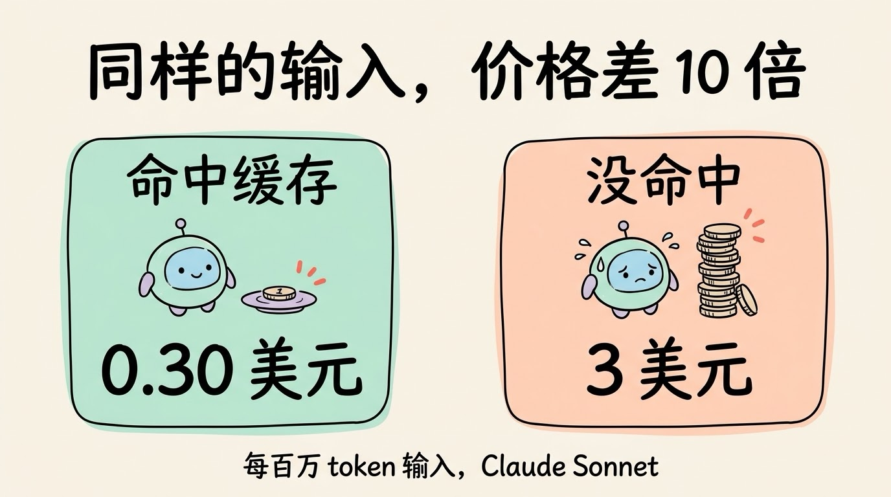
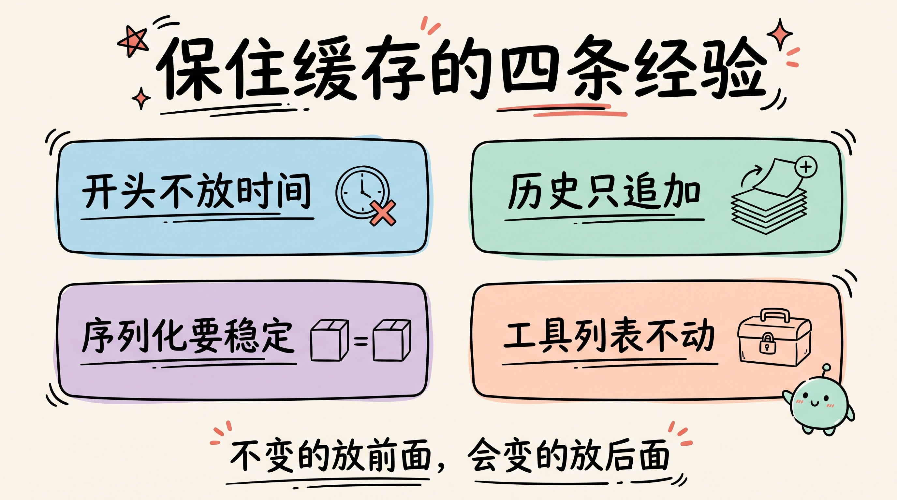
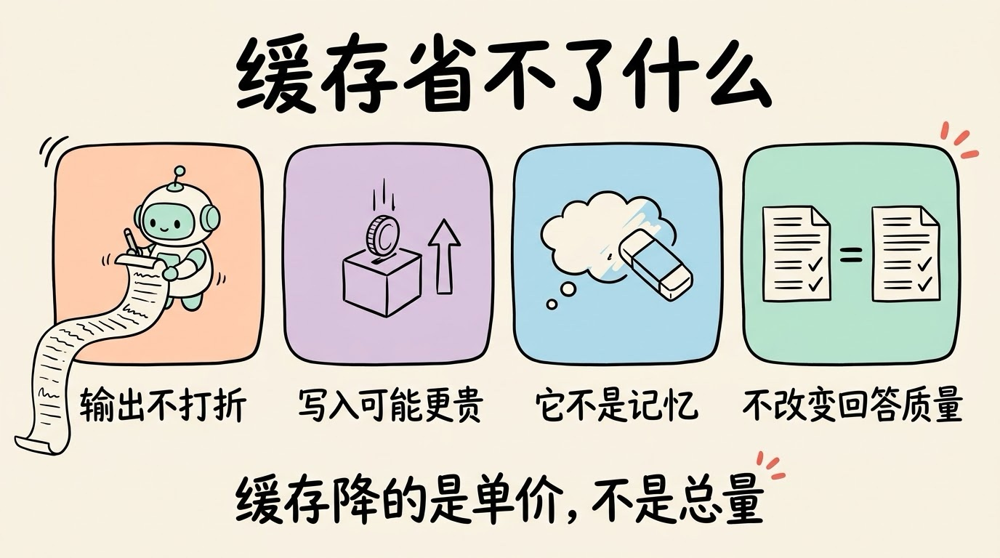

# 3分钟搞懂提示词缓存(Prompt Caching)

> ⭐⭐中级 · 阅读时间 3分钟 · 更新于 2026-10-13
>
> 提示词缓存是把每次重复发送的开头部分暂存起来、下次直接复用的省钱机制。本文讲清 Agent 的花费为什么大头在“读”、缓存为什么只认开头一模一样、四家厂商怎么收费，以及写 Agent 时怎么才不会把缓存弄丢。

## 一句话定义

**提示词缓存**（Prompt Caching）= 服务商把你每次请求里重复的开头部分，比如系统提示词、工具说明、之前的对话，算过的结果等暂存起来；当下一次请求的开头一模一样时，就直接复用这部分结果，让它算得更快，还可以按更低的价格计费。

为什么需要它？因为大模型 API 本身是不记事的，它并不会记住上一次你跟它说过什么。每调用一次，都要把系统提示词、工具说明书、之前所有的对话从头到尾再发一遍，模型再从头读一遍。这个在聊天场景里不算什么，但我们知道 Agent 干一个活往往要循环来回几十次，如果每次都要重读越来越长的上下文历史，钱和时间就这么耗掉了。

## Agent 的账单，大头在“读”

很多人以为 AI 的花费主要在它写出来的字上。但放到 Agent 身上，情况正好反过来了。

Manus 团队在 2025 年 7 月的博客里披露过一个数字：他们的 Agent 平均**输入和输出的 token 比例大约是 100:1**。原因不难理解：Agent 每走一步，只输出一小段调用指令，但要重新读入之前所有的步骤和工具返回结果，随着执行轮次增多，越往后，Agent 每一步要读的内容就越长。

另外他们把“KV 缓存命中率”称为线上 Agent **最重要的单一指标**。KV 缓存就是模型读每个字时算出来的中间结果，提示词缓存中存的正是它。

## 缓存只认“开头一模一样”

这里有个关键规则：**缓存是按前缀匹配的**。

可以想象一个译员，每周都会收到同一个客户的合同，前 50 页是固定的法律条款，后面几页是新增的内容。聪明的译员会记住前 50 页的译文，只翻译新的部分。但他有个习惯：每次都从第一页开始逐页核对，哪一页和上次不一样，从那一页往后就全部重新翻译。

模型的缓存也是这样。哪怕你只在系统提示词的第一行改了一个字，后面的缓存就全部作废，都要重新计算。以 Anthropic 的实现为例，内容按“工具定义 → 系统提示词 → 对话消息”的顺序排列，**改动了哪一层，那一层和它后面的所有层都会失效**。工具定义排在最前面，改了它，整个缓存就失效了，都要重来。

还有一些不那么显眼的改动也会打掉缓存，比如打开或关闭联网搜索、修改思考相关的参数、调整推理强度，这些都会让对话消息中部分的缓存失效。

## 能省多少：四家的做法

| 厂商 | 怎么开启 | 命中后的价格 | 写入缓存 | 保留多久 |
|---|---|---|---|---|
| **Anthropic（Claude）** | 请求里加一个顶层的 `cache_control` 就会自动缓存，也可以手动标记缓存位置 | 正常输入价的 0.1 倍，最新的 Opus 5.5、Sonnet 5.5 是 0.05 倍 | 5 分钟档按 1.25 倍计，1 小时档按 2 倍计 | 默认 5 分钟，每次用到会重新计时；可选 1 小时 |
| **OpenAI** | 支持的模型默认开启 | GPT-5.6 及以后多数模型是 0.1 倍 | GPT-5.6 及以后按 1.25 倍计；更早的模型不额外收费 | GPT-5.6 及以后是 30 分钟，每次用到会重新计时 |
| **DeepSeek** | 默认开启，缓存存在硬盘上，不用改代码 | 命中和未命中分开定价，命中的部分明显更便宜 | 不额外收费 | 一般几个小时到几天 |
| **千问（阿里云百炼）** | 隐式缓存自动开启；也可以用显式缓存 | 隐式 0.2 倍，显式 0.1 倍 | 隐式不额外收费，显式按 1.25 倍计 | 显式 5 分钟，命中后重新计时；隐式不确定 |

表中数据来自各家的官方文档，各家对缓存内容的最小长度也有要求，比如 Claude 最新模型至少 512 个 token、GPT-5.6 及以后至少 1,024 个 token，太短的提示词是缓存不了的。

换算成具体价格，Manus 的博客给过一个例子：用 Claude Sonnet 时，命中缓存的输入是每百万 token 0.30 美元，没命中是 3 美元，**差了 10 倍**。在输入占大头的 Agent 场景里，缓存命中率的高低，基本就决定了你的账单是几十块还是几百块。

## 写 Agent 时，怎么才不会把缓存弄丢

既然缓存只认前缀，做法就很明确了：**把不变的放前面，把会变的放后面，已经写下的内容不要去改**。下面是几条常见的经验：

- **不要在系统提示词开头放精确时间**。“当前时间：14:03:27”这种写法，每次请求都不一样，开头一变，缓存就全部作废了。
- **历史只追加，不修改**。如果回头修改之前某一步的内容，那一步之后的内容就要全部重算。
- **序列化要稳定**。同样的数据，如果 JSON 里键的顺序变了，对模型来说就是不同的文字。
- **不要动态增删工具**。工具定义排在最前面，随手加一个、删一个，等于把缓存整个清空。比较好的做法是工具列表保持不变，靠别的手段限制模型在某一步能用哪些工具。

这里和上下文工程有个取舍：上下文太长时，常见做法是压缩或删掉旧内容，但这会改写前缀、打掉缓存。所以什么时候压缩、压缩到哪里，要在“省上下文”和“保缓存”之间找平衡。

## 缓存省不了什么

提示词缓存很好用，但它的边界要清楚：

- **输出不打折**。缓存只针对输入，模型写出来的每个字照常计费。
- **写入可能更贵**。以 Claude 为例，第一次写入缓存比正常输入还贵；OpenAI 从 GPT-5.6 起也是这样。如果两次调用的间隔超过了保留时长，写进去的缓存还没用上就过期了，反而会多花钱。
- **它不是记忆**。缓存是服务商那边临时的加速手段，过一段时间就会清掉，模型并没有因此“记住”你。让 Agent 跨会话记事，靠的是记忆系统。
- **它不改变回答质量**。无论命中与否，模型读到的内容完全一样，区别只在速度和价格。

另外，缓存降低的是单价，不是总量。如果上下文本身越堆越长，就算打一折也会越来越贵。所以真正的省钱，是把缓存和上下文管理一起做好。

## 时效性提醒

各家几乎每次发新模型都会调整，同一家不同模型的规则也不一样：

- 命中缓存的价格倍数、写入缓存的价格倍数
- 缓存的保留时长和最小长度
- 哪些参数的改动会让缓存失效

**建议**：算成本之前，一定以各家官方的定价页和文档为准。

💬 **互动话题**：你用过的 AI 工具或者自己写的 Agent 里，有没有哪些“每次都会变”的内容，其实可以挪到后面去？

📖 **相关阅读**：

- [3分钟搞懂上下文工程](../03-context-engineering/README.md) - 省上下文和保缓存怎么取舍
- [3分钟搞懂Token和上下文](../../01-basics/06-token-and-context/README.md) - 输入、输出 token 怎么算
- [3分钟搞懂Agent记忆系统](../06-agent-memory/README.md) - 缓存不是记忆，记忆靠什么
- [3分钟搞懂Agent Loop](../01-agent-loop/README.md) - 为什么 Agent 要反复重读历史
- [3分钟搞懂Harness](../07-harness/README.md) - 缓存策略由哪一层来管

**资料来源**：

- Manus，Context Engineering for AI Agents: Lessons from Building Manus（2025-07-18）：https://manus.im/blog/Context-Engineering-for-AI-Agents-Lessons-from-Building-Manus
- Anthropic，Prompt caching 文档：https://platform.claude.com/docs/en/build-with-claude/prompt-caching
- OpenAI，Prompt caching 文档：https://developers.openai.com/api/docs/guides/prompt-caching
- DeepSeek，上下文硬盘缓存：https://api-docs.deepseek.com/zh-cn/guides/kv_cache
- 阿里云百炼，上下文缓存（Context Cache）：https://help.aliyun.com/zh/model-studio/context-cache

---

⬅️ 上一篇：[3分钟搞懂Skills](../04-skills/README.md) ｜ [📚 返回目录](../README.md) ｜ 下一篇：[3分钟搞懂Agent记忆系统](../06-agent-memory/README.md) ➡️
