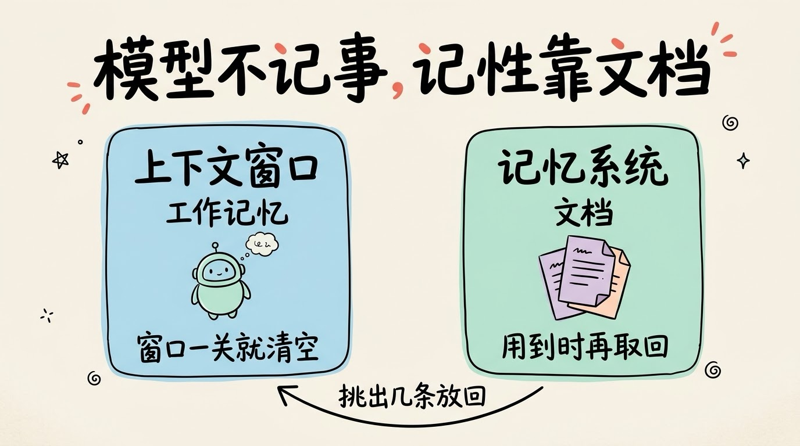
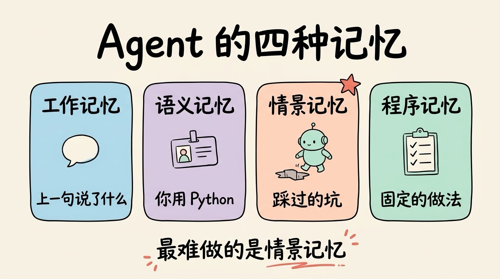
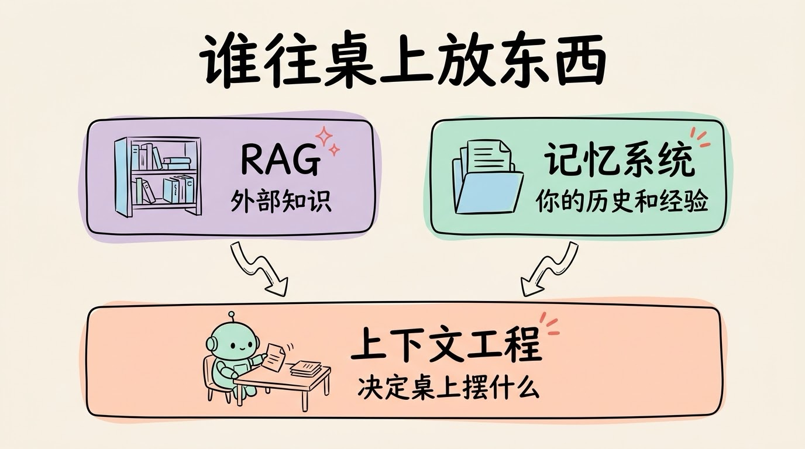
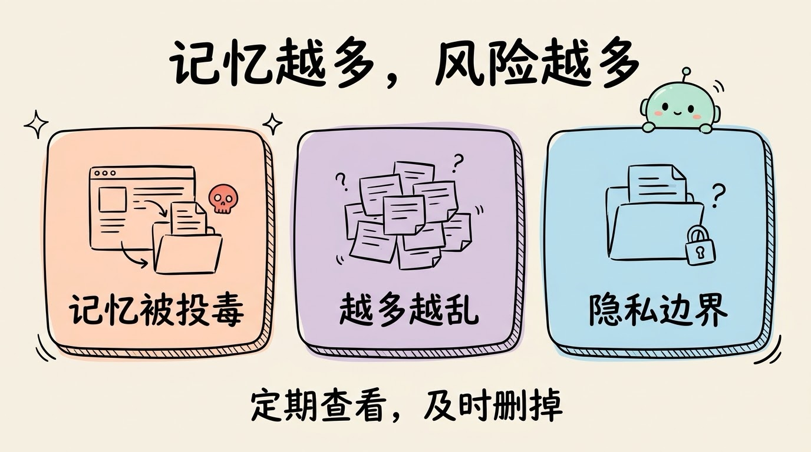

# 3分钟搞懂Agent记忆系统

> ⭐⭐中级 · 阅读时间 3分钟 · 更新于 2026-10-13
>
> 模型本身不会记住你，AI 的“记性”来自外面的一套记忆系统。本文讲清记忆分哪几种、怎么写入和取回、过时的记忆怎么处理，2026 年各家产品的记忆做到了哪一步，以及记忆被投毒的风险。

## 一句话定义

**Agent 记忆系统** = 在对话或任务结束后，把值得长期保留的信息提炼出来存到模型外面，下次开始干活时再按需取回、放进上下文，并随着情况变化不断更新或删除，让 AI 不用每次都从零开始认识你和你的项目。

这里最容易搞错的一点是：**模型本身从来不记事**。关掉窗口之后，模型那边什么都不剩。你感觉到的“它记得我”，其实是每次对话开始前，系统悄悄把之前记下的笔记翻了出来，塞回了上下文里。

## 上下文是工作记忆，记忆系统是文档

我们开会的时候，脑子里能同时记住的事情很有限，比如对方刚报的一个电话号码、刚说完的一句话，会一开完、转头去忙别的事，可能就忘了，这叫工作记忆。所以对于重要的事情我们会记下来存到文档中，比如项目进展、客户的要求、上次踩过的坑。哪怕过了一年，需要的时候找到那个文档，也能把这些信息重新装回脑子里。

AI 也是一样的：

- **上下文窗口**就是工作记忆，这一轮对话里能看到的全部内容都在这里，但窗口一关就清空了。
- **记忆系统**就是文档，存在模型外面，用的时候挑出相关的几条，放回上下文。

所以 AI 的“记性”好不好，跟模型聪不聪明关系不大，主要看文档记得好不好、找得准不准。



## Agent 要记的，不只是“你是谁”

学术界常用的分法来自 2023 年的论文《Cognitive Architectures for Language Agents》，它借用了认知科学里的说法，把长期记忆分成三类，再加上工作记忆一共四种：

| 类型 | 存什么 | 例子 |
|------|--------|------|
| **工作记忆** | 当前这一轮的上下文 | 你上一句话说了什么 |
| **语义记忆**（事实） | 关于你和世界的稳定信息 | 你用 Python、在做电商项目 |
| **情景记忆**（经历） | 做过的事和踩过的坑 | 上次这个接口超时，改成异步才解决 |
| **程序记忆**（做法） | 可以反复使用的流程 | 提交代码时要用固定格式写说明 |

聊天产品里的“记忆”功能，主要做的是语义记忆，记住你的职业、偏好和习惯。而对 Agent 来说，更有价值也更难做的是情景记忆，**让它别在同一个坑里摔第二次**。一个要跑几个小时的编程 Agent，如果不能把“这个方案试过了，不行”记忆记下来，后面再执行同样任务时就会反复撞同一堵墙。

程序记忆现在也有了比较成熟的载体：项目说明文件和 Skills，都是把“这件事该怎么做”写成文件，让 Agent 每次照着做。



## 记什么、怎么取、什么时候改

一套记忆系统，平时就在做三件事：

```
写入: 对话或任务结束 → 提炼出值得记的结论 → 存起来
取回: 新任务开始 → 按当前话题找出相关的几条 → 放进上下文
更新: 发现旧记忆过时或矛盾 → 修改、合并或删除
```


**写入时要先提炼，不能原样照存**。很多人以为记忆就是把聊天记录全存下来，真做起来会发现行不通：聊天记录里大部分是来回确认的过程，真正有用的结论只有几句，如果将对话都全部存下来，当取回给模型时只会把上下文塞满无关内容。所以成熟的做法是从对话里抽出偏好、事实、约定这类结论再存下来。Claude Code 的自动记忆就是这么做的，它只记四类笔记：你的角色和偏好、你给过的纠正意见、项目里的进展和决定、外部资料在哪里，而能直接从代码里看出来的东西就不记了。

**取回时，不一定要用向量数据库**。早期的记忆系统大多是把记忆转成向量，按语义相似度取回最相关的几条，和 RAG 的做法基本一样。但到了 2026 年，越来越多的 Agent 改用了更简单的办法：**把记忆直接写成文件**。比如 Claude Code 给每个项目建一个记忆目录，里面有一份 `MEMORY.md` 索引，每条记忆在索引里只占一行，每次开工时只读这份索引的前 200 行（或者前 25KB），具体的内容放在单独的文件里，用到时再去读。Anthropic 给开发者的 Memory 工具和托管 Agent 的记忆功能，也都是“文件夹 + 文件”的形式。这样做的好处是，**人也能直接打开查看和修改**，记错了随手改掉就行了。

**更新是三件事里最难的**。过时的记忆比没有记忆更糟：你三个月前说过“我们用 MySQL”，现在早就换了，AI 却还照着旧信息给建议。各家现在的办法大致有两种：一种是让 Agent 在写入时顺手合并、删掉旧的条目，比如 Claude Code 会给每条记忆记下最后修改的时间，让人和 AI 都能看出这条信息新不新；另一种是在后台定期整理，比如 OpenAI 在 2026 年 6 月给 ChatGPT 上线的新记忆系统，取名叫 **“Dreaming”**，会在对话结束后在后台回顾聊天记录，重新归纳出记忆，并在情况变化时自动更新。

## 2026 年各家的记忆做到了哪一步

记忆已经是主流 AI 产品的标配，区别主要在于记得多主动、你能不能看到和修改：

| 产品 | 现在的做法 |
|------|------|
| **ChatGPT** | 2024 年先有“保存的记忆”，2025 年 4 月可以参考全部历史对话，2026 年 6 月换成在后台自动整理的 Dreaming，可以在记忆摘要页里查看和纠正 |
| **Claude** | 付费用户 2025 年秋天开始可以用，2026 年 3 月起免费用户也能用了，还提供了从 ChatGPT、Gemini 等导入记忆的工具 |
| **Gemini** | 2025 年 8 月推出“个人背景”，可以参考过去的对话，2026 年 2 月开始向全球免费用户开放（欧洲稍晚） |
| **国内产品** | 千问、豆包、Kimi 都已经上线了记忆功能。千问的记忆需要你主动让它记，记之前会先弹窗确认；豆包可以在“记忆管理”里查看、删除单条记忆，或者整个关掉 |

开发者这边的选择也多了：

- **编程 Agent**：Claude Code 有两层记忆，一层是你自己写的 `CLAUDE.md` 项目说明，另一层是它自己记的自动记忆，两层记忆在每次开工前都会先加载。其他编程工具大多也支持类似的 `AGENTS.md` 说明文件。
- **API 层**：Anthropic 提供了 Memory 工具，模型只负责发出“读、写、改、删”记忆文件的请求，文件实际存在哪里由你的程序决定。2026 年 4 月，Anthropic 又给托管 Agent 加了内置记忆，多个 Agent 可以共用一份记忆，每次修改都有记录，还能回滚。按 Anthropic 公布的客户案例，乐天用上之后，Agent 首次提交就出错的情况减少了 97%。
- **开源方案**：Mem0、Letta（前身是 MemGPT）、Zep 等专门做记忆层，适合自己搭 Agent 时接入。

## 记忆和 RAG、上下文工程是什么关系

这三个词经常一起出现，分工其实很清楚：

| | RAG | 记忆系统 | 上下文工程 |
|---|---|---|---|
| 取回什么 | 外部的文档和知识 | 你自己的历史、偏好和经验 | 这一步需要的所有信息 |
| 会不会自己写 | 一般不会，知识库由人维护 | 会，Agent 边干活边记 | 不写，只负责挑选和整理 |
| 类比 | 去图书馆查资料 | 查自己的文档 | 决定这次桌面上摆哪些东西 |

记忆系统可以看成上下文工程里“写出去、再挑进来”这个动作的长期版本：信息先写到上下文外面，等用到的时候再放回来。不同的是，任务里的草稿用完就可以扔掉，而记忆要长期保存，所以还得不断更新，把过时的内容改掉或删掉。



## 记忆越多，风险也越多

记忆让 AI 用起来更顺手，但也带来了几个新问题：

- **记忆可能被投毒**。如果 AI 读到的网页、文档里藏着恶意指令，它可能会把这条指令当成“值得记住的事”存进记忆，之后的每一次对话都会被影响。2024 年 9 月，安全研究员 Johann Rehberger 就在 ChatGPT 的 macOS 应用上演示过：通过一个恶意网页往记忆里写入指令，让之后所有的对话内容都被悄悄发到了外部服务器。OpenAI 随后修复了这个问题，但这类攻击并没有消失，Agent 能接触的外部内容越多，风险就越大。
- **记忆越多，不一定越懂你**。一堆过期、重复、互相矛盾的记忆，反而会让 AI 给出更差的回答。记忆的质量远比数量重要。
- **隐私边界要自己把握**。记忆存在哪里、会不会被用来训练模型、能不能彻底删除，各家的规则都不一样。

对普通用户来说，比较实用的做法是：隔一段时间去设置里看看 AI 都记了你哪些事，记错的、过时的及时删掉；尤其是涉及到健康、财务这类敏感话题时，可以用 ChatGPT 的临时对话、Claude 的无痕模式这类功能，这样聊过的内容就不会被写进记忆。



## 时效性提醒

记忆的基本思路已经比较稳定，变化比较快的是这些：

- 各家产品的记忆开放范围、默认是否开启，以及能不能查看和修改
- 记忆的整理方式，从“手动保存”到“后台自动整理”还在快速演进
- 开发者侧的记忆工具和接口，有不少仍处在测试阶段

**建议**：开启记忆前，先确认它存在哪里、能不能删，敏感信息谨慎写入。

💬 **互动话题**：你希望 AI 记住你的哪些事？又有哪些事你希望它永远别记？

📖 **相关阅读**：

- [3分钟搞懂上下文工程](../03-context-engineering/README.md) - 把信息“写出去、挑进来”的整套方法
- [3分钟搞懂提示词缓存](../05-prompt-caching/README.md) - 缓存不是记忆，两者有什么区别
- [3分钟搞懂Skills](../04-skills/README.md) - 把“怎么做”写成文件的程序记忆
- [3分钟搞懂RAG检索增强](../../02-core-capabilities/04-rag/README.md) - 检索外部知识的常用做法
- 3分钟搞懂向量数据库 - 按语义找回记忆的底层工具
- [3分钟搞懂Agent沙箱与权限](../08-sandbox-and-permissions/README.md) - 怎么防止 Agent 被恶意内容带偏

**资料来源**：

- Sumers 等，Cognitive Architectures for Language Agents（2023-09）：https://arxiv.org/abs/2309.02427
- Claude Code 文档，How Claude remembers your project：https://code.claude.com/docs/en/memory
- Anthropic，Memory tool 文档：https://platform.claude.com/docs/en/agents-and-tools/tool-use/memory-tool
- Anthropic，Memory for Claude Managed Agents（2026-04-23）：https://claude.com/blog/claude-managed-agents-memory
- OpenAI，Dreaming: Better memory for a more helpful ChatGPT（2026-06-04）：https://openai.com/index/chatgpt-memory-dreaming/
- OpenAI，Memory and new controls for ChatGPT：https://openai.com/index/memory-and-new-controls-for-chatgpt/
- MacRumors，Anthropic Adds Free Memory Feature and Import Tool（2026-03-02）：https://www.macrumors.com/2026/03/02/anthropic-memory-import-tool/
- 9to5Google，Gemini personal context（2025-08-13）：https://9to5google.com/2025/08/13/gemini-personal-context/
- 9to5Google，Gemini past chats for free users（2026-02-26）：https://9to5google.com/2026/02/26/gemini-past-chats-free/
- IT之家，通义千问 Qwen Chat Memory 上线（2025-10-16）：https://finance.sina.com.cn/tech/digi/2025-10-16/doc-infuakcs9791309.shtml
- 新浪，国产 AI 终于“长记性”：https://k.sina.cn/article_7879848900_1d5acf3c401902twam.html
- The Hacker News，ChatGPT macOS Flaw Could've Enabled Long-Term Spyware via Memory Function（2024-09）：https://thehackernews.com/2024/09/chatgpt-macos-flaw-couldve-enabled-long.html

---

⬅️ 上一篇：[3分钟搞懂提示词缓存(Prompt Caching)](../05-prompt-caching/README.md) ｜ [📚 返回目录](../README.md) ｜ 下一篇：[3分钟搞懂Harness](../07-harness/README.md) ➡️
