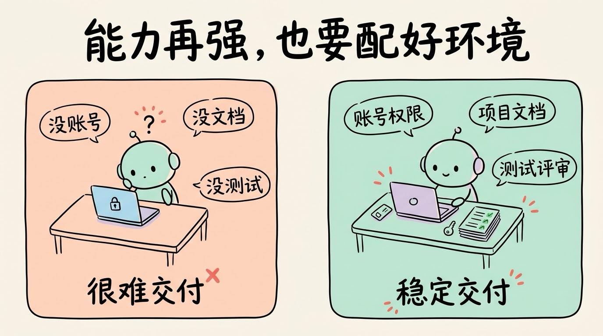
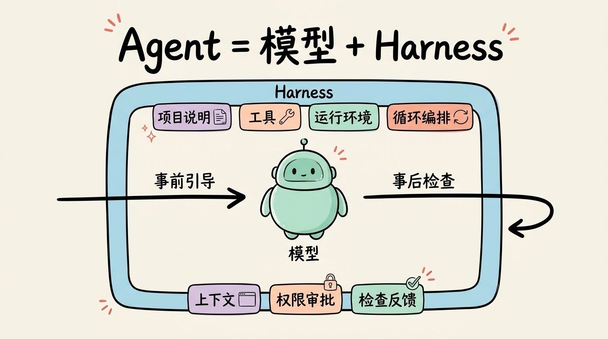
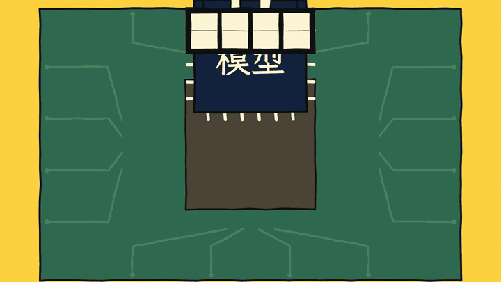
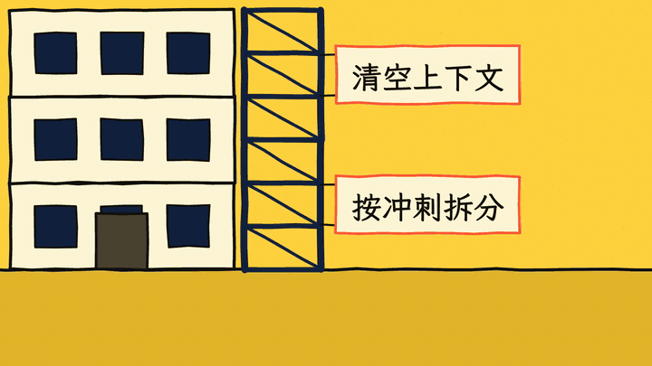
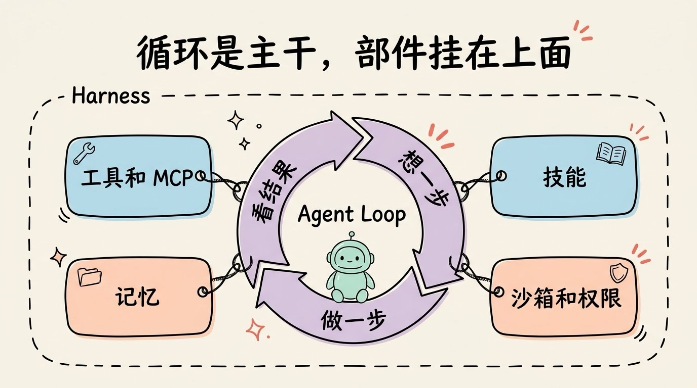

# 3分钟搞懂Harness

> ⭐⭐⭐进阶 · 阅读时间 3分钟 · 更新于 2026-10-15
>
> Harness 是包在大模型外面、让它真正能干活的那一整套程序：工具、运行环境、循环、权限和检查。本文讲清它由哪些部分组成、为什么同一个模型换一套 Harness 成绩能差十几分、这个词在 2026 年是怎么火起来的，以及模型变强以后它会怎么变。

## 一句话定义

**Harness** = 包在大模型外面、让它能真正把活干完的那一整套程序和配置：系统提示词、工具、运行环境、循环和编排逻辑、上下文管理、权限，以及各种检查和反馈。最直白的理解：**Agent = 模型 + Harness**，只要不是模型本身，就都属于 Harness。

Harness 的原意是套在马身上的挽具。马的力气再大，没有挽具也拉不了车，挽具还要管住方向，不让它乱跑。软件行业里也早就有 test harness（测试脚手架）的说法。放到 AI 这里，模型就是那匹马，Harness 负责把它的能力接到具体的活上，同时把它约束在该待的范围里。这个词目前还没有统一的中文译法，有人叫“驾驭工程”，本文直接用英文。

## 能力再强的新人，也得先把工作环境配好

公司新招来一位能力很强的程序员。如果第一天既没有电脑账号，也没有代码仓库权限，没人告诉他项目规范和需求在哪，提交的代码也不跑测试、不做 Code Review，那他再厉害也很难交付东西，甚至可能一不小心就改坏了线上环境，引发生产事故。

真正让他能稳定产出的，是公司给他配好他需要的一整套东西：开发环境、权限、文档、流程、测试和评审。大模型也是一样，**模型负责理解和做决定，其余所有让它能稳定把活干完的东西，都属于 Harness**。

我们知道，模型本身只会做一件事：读进一段文字，再输出一段文字。它不会自己去读文件、跑命令，也记不住昨天做过什么。真正能读写文件、执行命令的是 Harness；决定把哪些信息放进上下文的也是 Harness；跑完一步要不要接着跑、碰到删库这类操作要不要先问你，也都是 Harness 说了算。

## 一套 Harness 里有哪些东西

各家的划分不完全一样，但大体都包括下面这几块：

| 组成部分 | 负责什么 | 对应到新员工 |
|------|------|------|
| **系统提示词和项目说明** | 交代角色、规范和注意事项，比如 AGENTS.md、CLAUDE.md | 入职手册 |
| **工具** | 读写文件、执行命令、搜网页，以及通过 MCP 接进来的外部服务 | 电脑和各个系统的账号 |
| **运行环境** | 沙箱、容器、虚拟机，决定 Agent 能碰到什么、碰不到什么 | 测试环境和生产环境分开 |
| **循环和编排** | 驱动 Agent Loop，拆任务、派子 Agent、给不同任务选不同模型 | 工作流程和分工 |
| **上下文管理** | 压缩历史、按需加载技能和工具、读写记忆 | 交接文档和知识库 |
| **权限和审批** | 危险操作先拦下来，等人确认 | 上线审批 |
| **检查和反馈** | 钩子、测试、Lint、评测、日志和轨迹记录 | Code Review、CI、复盘 |

我们把这些东西分成了更好记的两类：

- **事前引导**（guides）：在 Agent 动手之前，告诉它该怎么做，提高第一次就做对的概率，比如项目说明、规范文档、技能。
- **事后检查**（sensors）：在 Agent 动手之后，发现它哪里做错了，让它自己改，比如测试、类型检查、Lint，或者让另一个模型来评审。

两类缺一不可。如果只有检查没有引导，Agent 会一遍又一遍地犯同样的错；如果只有引导没有检查，规则写了一大堆，它到底照做了没有、做得对不对，却没人知道。两类里面又各分两种：一种是确定性的代码，比如 Lint 和测试，每次跑出来的结果都一样，又快又便宜；另一种靠模型来判断，比如让评审 Agent 看代码写得好不好，更灵活，但更慢、更贵，结果也不一定每次都一样。所以能用确定性检查的地方，优先用确定性检查。

## 同一个模型，换一套 Harness 能差出一大截

LangChain 在 2026 年 2 月做过一个很有说服力的实验：模型固定用 gpt-5.2-codex，一点都不换，只改外面的 Harness。结果他们的编程 Agent 在 Terminal Bench 2.0（89 个命令行任务的评测）上，得分从 52.8% 提高到了 66.5%，排名从 30 名开外升到了前 5。

他们改了什么呢？先翻执行记录找原因。最常见的失败是：Agent 写完代码，自己重读一遍，觉得没问题就收工了，其实根本没跑测试。针对这类问题，他们做了这几处改动：

- **要求先验证再收工**：提示词里要求按“计划 → 实现 → 验证 → 修复”的顺序干活；Agent 准备结束时，Harness 会强制拦一下，让它对照任务要求再检查一遍。
- **防止绕圈**：同一个文件改了很多次之后，提醒 Agent 换个思路，而不是在原地反复改。
- **开工前先交代环境**：一开始就把目录结构、能用哪些工具告诉它，省得它自己花好几轮去摸索。
- **推理强度分段使用**：做计划和最后验证时用最高档，写代码时用高一档。如果全程都开最高档，反而因为太慢、经常超时，结果只拿到了 53.9%的分数。

需要注意的是：这些改动没有一项碰到模型本身。

产品里也是同样的道理。OpenAI 在 2026 年 2 月介绍过，Codex 的网页版、命令行、IDE 插件和 Mac 应用，背后共用的是同一套 Harness。国内的 Qwen Code 最早是在 Google 开源的 Gemini CLI 基础上改出来的，相当于在一套现成的 Harness 上换上了千问模型，后来才独立发展，针对千问做了深度适配，也支持接入其他模型。

这对普通用户来说意味着：**选 AI 编程工具时，只看它用的是哪个模型是不够的。** 同样调用一个模型，不同产品在上下文管理、验证、权限上的做法不一样，实际用起来的差别会很大。

## “Harness 工程”这个说法是怎么火起来的

2026 年 2 月 5 日，HashiCorp 联合创始人、Terraform 的作者 Mitchell Hashimoto 写了一篇博客《My AI Adoption Journey》，讲自己从怀疑 AI 到离不开 AI 的过程。其中第 5 步他叫做 **Engineer the Harness**：每发现 Agent 犯一个错，就花时间做一个工程上的解决办法，确保它以后不会再犯。

他用的办法有两种：

- **更新 AGENTS.md**：比如 Agent 老是跑错命令、找错接口，就把正确的做法写进项目说明文件里。
- **写成真正的工具**：比如截图脚本、只跑相关测试的脚本，再在 AGENTS.md 里告诉 Agent 有这些工具可以用。

六天之后，OpenAI 发了一篇《Harness engineering》，介绍了一个内部实验：一个小团队花了 5 个月，用 Codex 做出了一个内部测试版产品，代码大约 100 万行，**没有一行是人手写的**，按他们的估计，用时大概只有手写代码的十分之一。团队从 3 名工程师开始，后来扩到 7 人，一共合并了大约 1500 个 PR。工程师的工作从写代码，变成了设计环境、讲清意图、给出反馈。

其中有几条做法很值得参考：

- **AGENTS.md 只当索引目录用**：文件只写 100 行左右，告诉 Agent 去哪里找什么，具体内容放在 docs 目录下的结构化文档里，需要时再去读。他们的原则是，Codex 看不到的东西，对它来说就不存在。写在聊天记录里、只靠口头约定的规矩，Agent 是不会知道的。
- **规矩用代码来管**：架构分层、依赖方向这些规则，用 Lint 和结构测试强制检查，而不是只写在文档里，不要指望 Agent 能自觉遵守。
- **把观测数据接给 Agent**：日志、指标、链路追踪都开放给 Agent，让它能自己复现 Bug，也能自己确认到底修好了没有。

之后 LangChain、Martin Fowler 网站、Anthropic 都专门写过 Harness 相关的文章，这个词在 2026 年上半年很快成了 Agent 圈子里的常用词。

## 模型越来越强，Harness 会变薄吗

答案是：**会删掉一部分，但不会消失。**

Anthropic 在 2026 年 3 月分享过一个例子。他们让 Agent 做一个复古游戏制作器：单个 Agent 直接做，花了 20 分钟、9 美元；换成“规划 + 生成 + 评估”三个 Agent 配合的 Harness，花了 6 个小时、200 美元，贵了 20 多倍，但做出来的质量差别一眼就能看出来。其中的评估 Agent 会用浏览器像真实用户一样去点页面，不达标就打回重做。

更值得我们关注的是这套 Harness 后来的变化。早一些的模型有一种“上下文焦虑”：快到它以为的上下文上限时，就会草草收工，所以 Harness 里要定时清空上下文，换一个新的 Agent 读交接材料接着干。等到了 Opus 4.5，模型的这个毛病基本没有了，再Harness里关于这部分的设计也就整个同步删掉了；到了 Opus 4.6，又删掉了“按冲刺拆分任务”的设计，评估也改成只在最后做一次了。

作者的总结是：**Harness 里的每一个组件，都对应着一个“模型自己做不到什么”的假设**，一旦模型变强以后，这些假设很快就会过时。但他同时也认为，值得尝试的 Harness 组合并不会因此变少，只是换了内容：模型能跑得更久、做更大的任务，就需要新的验证、权限和协作方式。

所以这对我们来说有两个提醒：

- 换了更强的模型之后，值得把 Harness 里的规则挨个检查一遍，删掉已经不需要的。规则越多，占用的上下文就越多，也越容易互相冲突。
- 模型越敢自己动手，权限边界、能不能回滚、有没有操作记录就越重要。能力上去了，权限护栏也要跟着加上去。

## Harness 和 Prompt 工程、Agent Loop、记忆是什么关系

这几个词经常一起出现，很容易搞混。可以这样理解：Prompt 工程、上下文工程说的是**做法**，而 Agent Loop、工具、记忆是 Harness 里的**部件**。

从 2023 年的 Prompt 工程，到 2025 年的上下文工程，再到 2026 年的 Harness 工程，关注的范围是一层层往外扩的：Prompt 工程关心你写的那段指令能不能把任务说清楚；上下文工程关心每一步放进模型窗口里的全部信息；Harness 工程关心模型运行的整个系统，前面的两件事都是包含在harness工程里面的。

再单独看看每个部件都是什么：

| | 是什么 | 在 Harness 里的位置 |
|---|---|---|
| **Agent Loop** | 想一步、做一步、看结果、再决定下一步的循环 | Harness 的主干，其他部件都挂在这个循环上 |
| **工具调用和 MCP** | 模型开出调用单，工具按统一标准接进来 | Harness 替模型执行的那些动作 |
| **记忆** | 跨会话保存下来的信息 | 由 Harness 写进文件，下次开工前再读回来 |
| **技能** | 按需加载的做事说明 | 事前引导的一种 |
| **沙箱和权限** | 限制 Agent 能碰什么、不能碰什么 | Harness 的护栏 |

**和 Agent Loop 的关系最紧密。** 循环本身就是 Harness 在驱动：模型每次只输出下一步的决定，由 Harness 去执行工具、把结果放回上下文，再发起下一轮；什么时候该停下来，比如步数上限、预算上限、完成条件检查，也都写在这一层。前面 LangChain 加的“收工前强制验证”“同一个文件改太多次就提醒换个思路”，其实就是在这个循环的某个节点上插了一道检查。

**记忆也是 Harness 提供的。** 模型本身是不记事的，每次请求都从零开始。所谓“记住”，是 Harness 把信息写进文件或数据库，下次开工前再读进上下文。Anthropic 在 2025 年 11 月分享过一个长任务的做法：第一个 Agent 先把要做的功能列成一份清单，一共 200 多项，全部标成“未完成”；之后每个新会话里的 Agent，都先读进度文件和 Git 提交记录，搞清楚做到哪一步了，再一次只做一项，做完就提交代码、更新进度。这样即使每次都换一个全新的上下文窗口，活也能一段一段接着干下去。

所以 Harness 并不是和这些概念并列的一个新东西，而是把它们组装在一起、让它们配合起来的那个整体。

## 你的 Harness，你也可以微调

如果你在用 Claude Code、Codex、Cursor 或者 Qwen Code，模型本身你改不了，但 Harness 里有不少部分是可以自己调的：

- **写好项目说明文件**：AGENTS.md 现在被 Codex、Cursor 等很多工具支持，Claude Code 用的是 CLAUDE.md，现在也支持AGENTS.md了。把项目怎么跑、怎么测、有哪些坑写进去，并且保持简短，当目录用。
- **让 Agent 能自己验证**：把测试、Lint、类型检查的命令写进说明文件。如果项目里没有测试，Agent 最多只能做到“看起来是对的”。
- **犯一次错，补一处**：学 Hashimoto 的做法，Agent 同样的错犯了第二次，就把正确做法写进说明文件，或者做成一个脚本、一个技能。
- **危险操作设成要确认**：删除文件、推送代码、改线上配置这类命令，在权限设置里设成需要你批准才能执行。
- **如果是自己搭 Agent，先上观测和评测**：先把每一步的日志和轨迹记下来，再准备一组固定的测试任务，然后再去调提示词。否则改了什么、效果是变好还是变坏，你都不知道。

## 时效性提醒

Harness 工程还是一个很新的说法，变化比较快的是这些：

- 各家对 Harness 由哪几部分组成的划分并不统一，叫法也还在变
- 文中的评测分数和排名，会随着模型和 Harness 的更新很快过时
- AGENTS.md、钩子、权限设置这些功能，各家产品的支持程度和写法不完全一样

**建议**：以你所用 Agent 产品的官方文档为准，本文只讲通用的思路。

💬 **互动话题**：你用 AI 编程工具时，有没有哪条规则是被它“坑”过之后才写进项目说明文件里的？

📖 **相关阅读**：

- [3分钟搞懂Agent Loop](../01-agent-loop/README.md) - Harness 里驱动循环的那一部分
- [3分钟搞懂上下文工程](../03-context-engineering/README.md) - Harness 里面的一层
- [3分钟搞懂工具调用](../02-function-calling/README.md) - 模型怎么请 Harness 替它动手
- [3分钟搞懂Skills](../04-skills/README.md) - 按需加载的事前引导
- [3分钟搞懂Agent沙箱与权限](../08-sandbox-and-permissions/README.md) - Harness 的护栏
- [3分钟搞懂Evals](../09-evals/README.md) - 怎么知道 Harness 改得好不好
- [3分钟搞懂MCP](../../01-basics/08-mcp/README.md) - 外部工具怎么统一接进来

**资料来源**：

- Mitchell Hashimoto，My AI Adoption Journey（2026-02-05）：https://mitchellh.com/writing/my-ai-adoption-journey
- OpenAI，Harness engineering: leveraging Codex in an agent-first world（2026-02-11）：https://openai.com/index/harness-engineering/
- InfoQ，OpenAI 的 Harness 工程实践报道（2026-02）：https://www.infoq.com/news/2026/02/openai-harness-engineering-codex
- OpenAI，Unlocking the Codex harness: how we built the App Server（2026-02-04）：https://openai.com/index/unlocking-the-codex-harness/
- LangChain，Improving Deep Agents with harness engineering（2026-02-17）：https://www.langchain.com/blog/improving-deep-agents-with-harness-engineering
- LangChain，The Anatomy of an Agent Harness（2026-03）：https://www.langchain.com/blog/the-anatomy-of-an-agent-harness
- Birgitta Böckeler，Harness engineering（martinfowler.com，2026-04-02）：https://martinfowler.com/articles/harness-engineering.html
- Anthropic，Effective harnesses for long-running agents（2025-11-26）：https://www.anthropic.com/engineering/effective-harnesses-for-long-running-agents
- Anthropic，Harness design for long-running application development（2026-03-24）：https://www.anthropic.com/engineering/harness-design-long-running-apps
- Qwen Code 项目：https://github.com/QwenLM/qwen-code

---

⬅️ 上一篇：[3分钟搞懂Agent记忆系统](../06-agent-memory/README.md) ｜ [📚 返回目录](../README.md) ｜ 下一篇：[3分钟搞懂Agent沙箱与权限](../08-sandbox-and-permissions/README.md) ➡️
