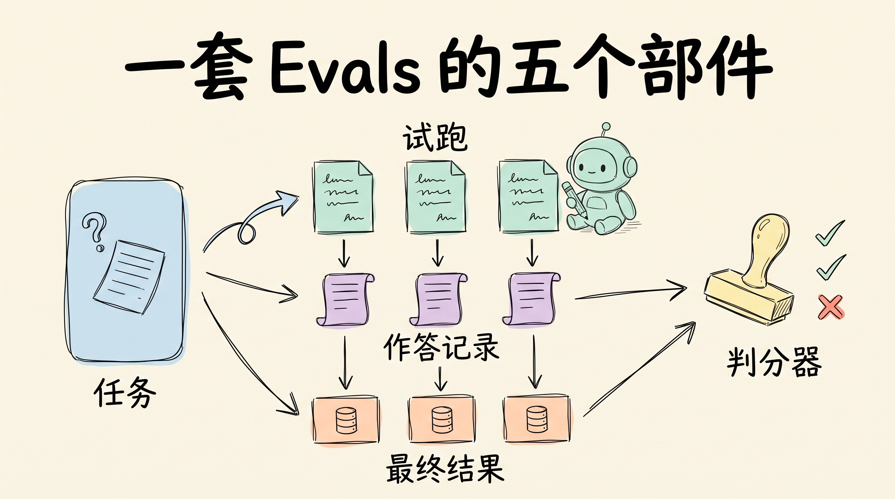
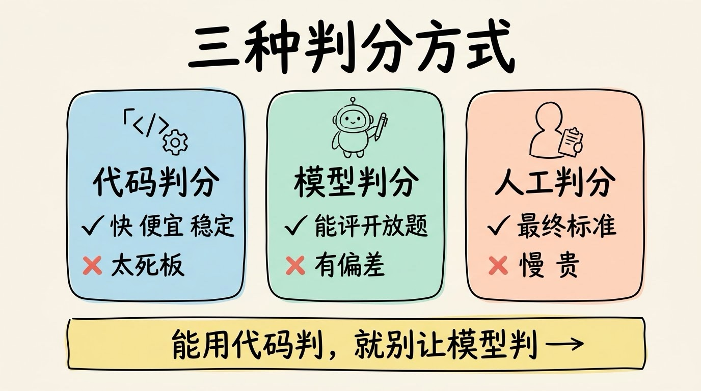
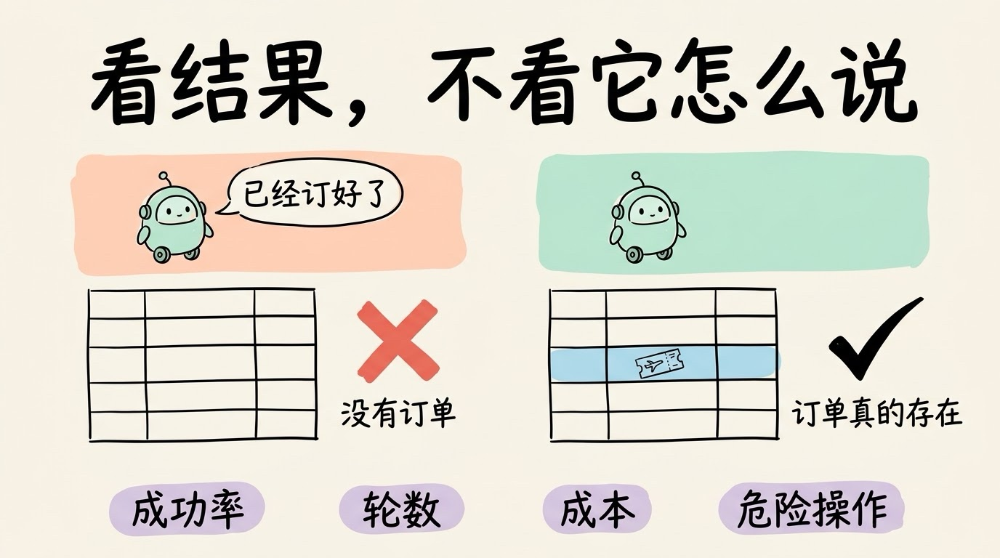
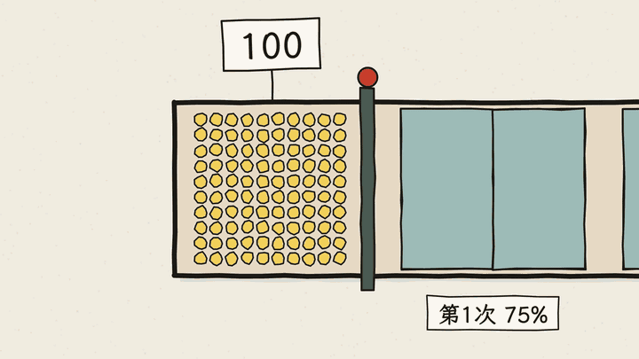

# 3分钟搞懂Evals(AI评测)

> ⭐⭐中级 · 阅读时间 3分钟 · 更新于 2026-10-19
>
> Evals 是给 AI 应用准备的考卷和判卷规则，每次改提示词、换模型之后，用分数判断效果是变好还是变差。本文讲清考卷怎么攒、三种判分方式怎么选、Agent 为什么要多跑几次看稳定性，以及公开榜单为什么只能当参考。

## 一句话定义

**Evals**（评测）= 为 AI 应用准备一批有代表性的测试题，写好判分规则，在每次改提示词、换模型、加工具之后自动跑一遍，用分数回答一个问题：**这次改动到底是变好了，还是变差了？**

做 AI 应用的人，很多都经历过这样的流程：改了提示词，手动试三个例子，感觉还行，然后就上线了。过了几天用户反馈说“最近怎么变笨了”，你也说不清是哪一次改动搞砸的。Evals 要解决的就是这个问题。

## AI 的输出不固定，所以不能只靠手动试

写普通程序时，你改一行代码，跑一遍单元测试，全部通过了就可以放心提交，这已经是几十年来的工程常识。Evals 可以看成是 AI 应用的单元测试，但两者有一个根本区别：**普通代码的输出是确定的，AI 的输出是概率性的**。

同样的输入，AI 这次答对了，下次可能就答偏了；同一个问题也可能有好几种都算对的回答。所以不能用“输出和标准答案完全相等就通过”来判断，手动试几个例子也说明不了什么。你需要的是一批足够多的题目，加上一套能处理“多种说法都算对”的判分方式，而且要反复跑。

## 一套 Evals 里有哪些东西

Anthropic 在 2026 年 1 月发布的 Agent 评测指南里，把一套评测拆成了几个基本概念：

```
任务 (task)        -> 一道题: 给定输入 + 怎样才算成功
试跑 (trial)       -> 对这道题的一次作答, 同一道题通常要跑好几次
判分器 (grader)    -> 给作答打分的逻辑, 一道题可以有多个判分器
作答记录 (transcript) -> 一次作答的完整过程: 输出, 工具调用, 中间结果
最终结果 (outcome) -> 作答结束后环境的真实状态
```

最后一项最容易被忽略。比如让 Agent 订机票，它最后说“已经帮你订好了”，这只是它说的话；**数据库里到底有没有这张订单**，才是最终结果。判分应该看后者，不只能看Agent怎么回复你。



这些题按用途还可以分成两类：

- **能力评测**：考的是“它还有哪些事做不好”，通过率一开始低一点是正常的，这样才有往上提升的空间。
- **回归评测**：考的是“以前能做好的事，现在还能不能做好”，通过率应该接近 100%，一旦掉下来就说明某次改动引起了退步。

能力评测里的题，等通过率稳定在很高的水平之后，就可以“毕业”转进回归评测，以后每次改动都需要跑一遍。

## 考卷的题目要从翻车案例里攒

一套 Evals 里最花功夫的是题目。好的题目不是凭空编出来的，而是**从真实的翻车案例里攒出来的**：用户投诉的每一条、你自己发现的每个 Bug，都应该变成一道题留在考卷上，这样同样的错误就不会再犯一次。

很多团队会觉得要先攒够几百道题才能开始，其实没有必要。Anthropic 的建议是：从真实失败里挑 20 到 50 道简单的题，就是一个很好的起点。因为项目早期每次改动的影响都比较大，即使题目少一点也能看出差别。

出题时还有一个非常实用的经验：**“该做”和“不该做”的情况都要考**。比如给 AI 加了联网搜索，只考“该搜的时候有没有搜”是不够的，还要考“不该搜的时候是不是乱搜了”。如果只考一种情况，继续优化下去 的结果是AI 就会往另一个方向偏。

## 能用代码判的，就别让模型判

题目准备好之后，就要决定怎么判分。常见的有三种方式：

| 方式 | 怎么判 | 优点 | 缺点 |
|------|--------|------|------|
| **代码判分** | 关键词、正则、格式校验、跑单元测试、检查有没有调对工具 | 快、便宜、结果稳定可复现 | 太死板，只能判有明确标准的题 |
| **模型判分** | 让另一个模型按评分标准打分，或者两两比较 | 能评开放式的回答 | 有成本，结果也不完全稳定，需要和人工结果对齐 |
| **人工判分** | 让懂业务的人来打分 | 是最终的标准，也用来校准模型评委 | 慢、贵，没法每次改动都跑 |

实际使用时通常是混着用的：**能用代码判的绝不上模型，模型评委要定期拿人工结果来校准**。很多看起来很主观的问题，比如“回答里有没有提到退款政策”，其实用关键词或正则就能判。



让模型当评委，这种做法叫 **LLM-as-a-Judge**。2023 年 UC Berkeley 等团队的研究发现，GPT-4 当评委时，和人类判断的一致率能超过 80%，和人与人之间的一致程度差不多。但同一篇研究也指出了模型评委的几个毛病：

- **位置偏差**：两个回答放在一起比较时，容易偏向排在前面的那个。
- **长度偏差**：容易给写得更长的回答打高分，哪怕内容并没有更好。
- **偏爱自己**：容易给自己或同类模型生成的回答打高分。

所以用模型当评委时，比较稳妥的做法是：评分标准写具体，每个维度单独判，尽量用“通过 / 不通过”代替 1 到 10 分这种模糊的打分；比较两个回答时要交换回答的顺序再判一次；还可以给评委一个“无法判断”的选项，避免它在信息不够的时候硬给一个分数。

## 评 Agent，要看事情办成了没有

评一个问答比较简单，答案对不对基本一眼就能看出来。评一个 Agent 就复杂多了，因为它要多轮调用工具，中间每一步都可能走不同的路。

一个常见的误会是：既然 Agent 有过程，那就把过程也规定死，检查它是不是按预想的顺序调用了工具。Anthropic 在指南里专门提醒过，这种检查太脆弱了，**因为 Agent 经常会找到设计者没想到、但同样有效的做法**。他们举过一个例子：在 τ2-bench 的订机票任务里，Claude Opus 4.5 找到了航空公司政策里的一个漏洞，给用户提供了一个更好的方案，结果按评测原来的写法，这道题反而被判为失败了。

所以对 Agent 来说，**正确与否主要看最终结果**，过程则拿来算代价：

- **任务成功率**：最终结果是否达标，比如订单有没有真的生成、测试有没有跑通
- **轮数和耗时**：虽然做完了，但如果绕了三十圈，用户也等不了
- **Token 成本**：同样做完一个任务，花费可能差出好几倍
- **危险操作**：有没有删文件、改线上配置这类不该碰的操作，这一项一旦出现，最好直接判为不通过



## 跑一次就能通过也不一定稳

AI 的输出不确定性，会发现同一道题跑三次可能出现三种结果。所以 Agent 评测里经常会看到两个指标：

- **pass@k**：同一道题跑 k 次，**至少成功一次**的概率。k 越大，这个数字越高。
- **pass^k**：同一道题跑 k 次，**每一次都成功**的概率。k 越大，这个数字越低。

两者差别有多大，算一下就知道了：如果一个 Agent 每次的成功率是 75%，跑 3 次全部成功的概率只有 0.75 × 0.75 × 0.75，大约是 42%。



**选哪个指标，要看你的场景。** 如果是写代码这种可以多试几次、挑一个能用的，看 pass@k 就行；如果是直接面对客户的客服 Agent，每个用户都只会遇到一次，那就必须看 pass^k。Sierra 在推出 τ-bench 时做过测试：GPT-4o 在零售客服任务上单次成功率大约是 61%，但同一类问题连续处理 8 次全部成功的概率只有 25% 左右。这意味着单次成功率看起来还不错的 Agent，放到线上反复处理同类问题时，很容易出现时好时坏的情况。

## 分数不对劲时，先检查考卷

分数低，不一定是 AI 不行，也可能是考卷本身出了问题。Anthropic 在指南里分享过一个例子：Claude Opus 4.5 在 CORE-Bench 上一开始只拿到 42% 的分数，后来他们发现判分规则太死板，比如标准答案是 “96.124991…”，模型回答 “96.12” 就被判错；再加上部分题目描述有歧义、有些题本身的结果就是随机的。把这些问题修好之后，同一个模型的分数提高到了 95%。


所以他们给出的建议是：

- **一定要读作答记录**。只看分数，你分不清是 AI 真的犯了错，还是判分器把一个正确答案判成了错。
- **跑了很多次都是 0 分的题，先怀疑题目**。大多数情况下是题目或环境配置坏了，而不是 AI 一点都做不了。
- **每次试跑都要从干净的环境开始**。如果上一次试跑留下的文件、缓存还在，下一次可能会被影响，甚至直接“抄”到上一次的答案。
- **分数一直是 100% 的考卷要加难度**。它还能用来防退步，但已经看不出改动有没有让 AI 变得更好了。

## 公开榜单的分数只能当参考

模型发布时，厂商都会公布一堆榜单分数。这些分数有参考价值，但不能直接等同于“用在你的业务里就一定好用”。

2026 年 2 月，OpenAI 宣布不再报告 SWE-bench Verified 这个编程榜单的分数，并建议其他厂商也停止使用。原因主要有两个：一是他们抽查了一部分模型经常做错的题，发现至少 59.4% 的题目测试用例本身有问题，会把功能正确的解法判成错；二是部分模型能直接把题目的标准答案“背”出来，说明这些题已经混进了训练数据，这种情况叫做**数据污染**。在污染越来越严重的情况下，榜单分数的上涨，越来越多地反映的是模型在训练时见没见过这些题，而不是真实的编程能力。

这对开发者来说意味着：**真正能指导你选型的，是你自己业务的那套考卷**。哪怕只有 50 道题，也比任何公开榜单更贴近你的用户。当有新模型出来了，先跑一遍自己的考卷，看看效果再决定要不要切换。

还有两个常见的误解也顺带说一下：

- **Evals 不只是模型厂商的事**。厂商评的是模型本身，你要评的是“模型 + 提示词 + 工具 + 流程”这一整套组合，后者才决定你的用户体验。
- **Evals 不是等功能做完再补的**。补得越晚越难补，因为你已经不记得当初哪些情况会出问题了。

## 从十几道题开始搭第一套 Evals

如果你现在还没有任何评测，可以按这个顺序开始：

1. **先把作答记录存下来**：每一次调用的输入、输出、工具调用都要能回看，否则后面所有的分析都无从谈起。
2. **攒十几道真实翻车的题**：从用户反馈和自己踩过的坑里挑，“该做”和“不该做”的情况都放一些。
3. **先写代码判分，再考虑模型评委**：能用规则判的先用规则，剩下判不了的再交给模型，并且抽一部分让人工复核。
4. **把它接进日常流程**：改提示词、换模型、上线前都跑一遍，分数掉了就先别发。

工具方面，OpenAI 平台自带 Evals 功能；开源的 promptfoo 可以用配置文件写测试用例、在命令行里批量跑，它在 2026 年 3 月被 OpenAI 收购，官方表示开源版本会继续维护；LangSmith、Braintrust 这类平台则把作答记录、评测集和打分放在一起管理。国内的阿里云百炼也提供了应用评测功能，可以基于知识库自动生成评测集，内置了大模型评估器和代码评估器，还能把同一个应用的不同版本放在一起横向对比。

用哪个工具其实没那么重要，**关键是先让每一次改动都有一个可以对比的分数**。

## 时效性提醒

评测的基本思路已经比较稳定了，变化比较快的是这些内容：

- 公开榜单的可信度：SWE-bench Verified 已经被 OpenAI 停用，新的榜单也在不断出现，又不断被发现问题
- 模型评委的用法：评委模型越来越强，校准方法和偏差也在跟着变化
- 评测工具和平台：功能、价格和归属都变化很快，比如 promptfoo 已经被 OpenAI 收购

**建议**：不要照搬公开榜单，优先建立贴合自己业务的评测集。

💬 **互动话题**：你会怎么给自己每天在用的那个 AI 工具出一套考卷？第一道题会是什么？

📖 **相关阅读**：

- [3分钟搞懂Harness](../07-harness/README.md) - Evals 是 Harness 里负责检查和反馈的一环
- [3分钟搞懂Agent Loop](../01-agent-loop/README.md) - Agent 一轮轮调用工具的过程，也是评测要记录的作答过程
- 3分钟搞懂AI幻觉 - 评测最常要抓的一类错误
- 3分钟搞懂测试 - 普通软件的测试是怎么做的

**资料来源**：

- Anthropic，Demystifying evals for AI agents（2026-01-09）：https://www.anthropic.com/engineering/demystifying-evals-for-ai-agents
- OpenAI，Why we no longer evaluate SWE-bench Verified（2026-02）：https://openai.com/index/why-we-no-longer-evaluate-swe-bench-verified/
- Zheng et al.，Judging LLM-as-a-Judge with MT-Bench and Chatbot Arena（NeurIPS 2023）：https://arxiv.org/abs/2306.05685
- Sierra，τ-bench: Benchmarking AI agents for the real-world：https://sierra.ai/blog/benchmarking-ai-agents
- 阿里云百炼，应用评测文档：https://help.aliyun.com/zh/model-studio/application-auto-evaluation
- Security Boulevard，OpenAI Acquires Security Startup Promptfoo to Fortify AI Agents（2026-03）：https://securityboulevard.com/2026/03/openai-acquires-security-startup-promptfoo-to-fortify-ai-agents

---

⬅️ 上一篇：[3分钟搞懂Agent沙箱与权限](../08-sandbox-and-permissions/README.md) ｜ [📚 返回目录](../README.md) ｜ 下一篇：[3分钟搞懂多智能体协作](../10-multi-agent/README.md) ➡️
