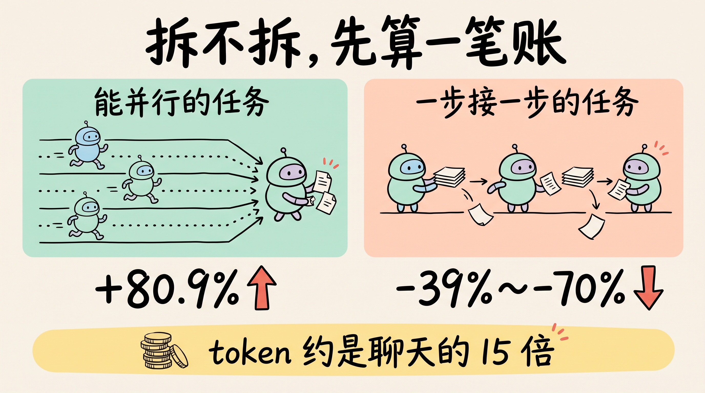
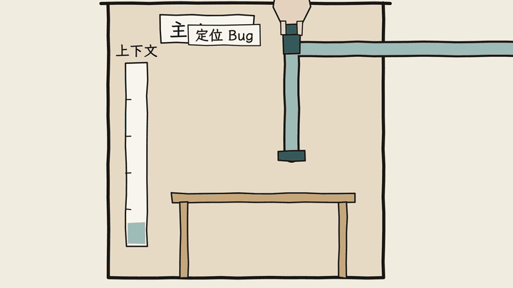
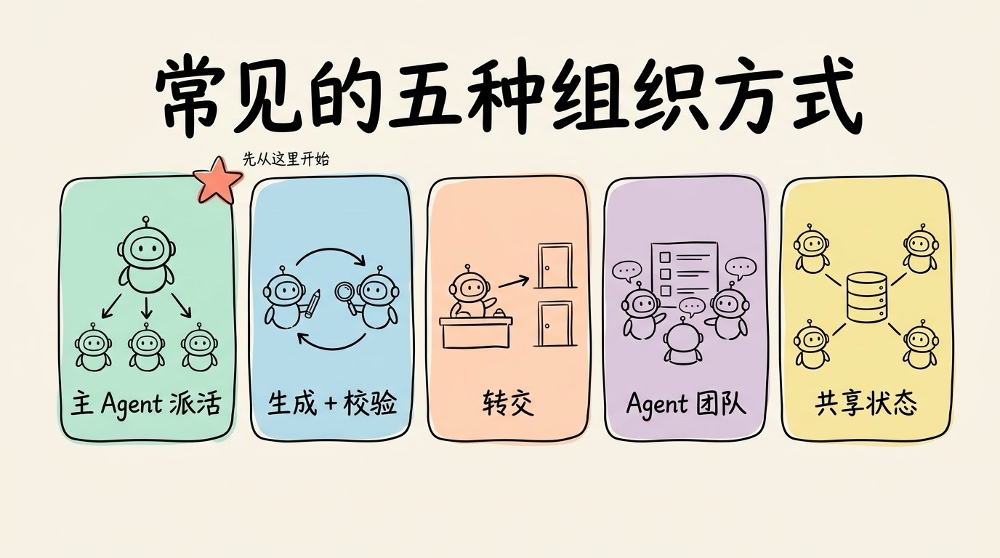
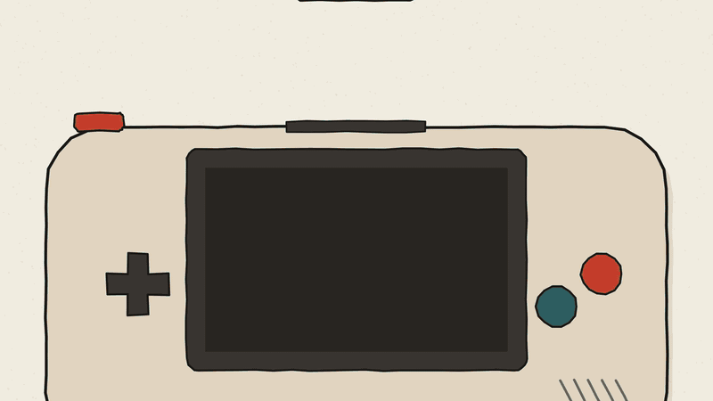
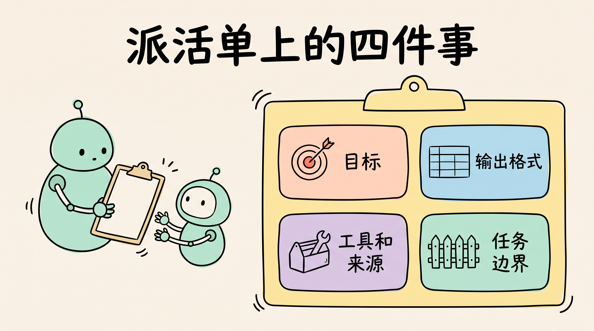

# 3分钟搞懂多智能体协作

> ⭐⭐中级 · 阅读时间 3分钟 · 更新于 2026-10-20
>
> 多智能体协作就是让一个主 Agent 拆任务、派给多个子 Agent 分头做再汇总。它能提速，但 token 消耗大约是聊天的 15 倍，顺序型任务拆开反而会变差。本文讲清什么时候值得拆、几种常见组织方式，以及派活时要交代哪几件事。

## 一句话定义

**多智能体协作**（Multi-Agent）= 由一个主 Agent 把大任务拆成几块，分派给多个子 Agent 在各自独立的上下文里执行，最后再把结果收回来校验、汇总，目的是让单个 Agent 装不下、做不快的任务也能完成。

听上去很完美，但它有一个前提：**任务真的能拆开**。如果拆错了，效果往往还不如一个 Agent 从头干到尾。

## 拆不拆，先算一笔账

这件事很像决定一个活要不要拉人一起干。

一个人两小时就能搞定的活，如果你非要拉五个人来分工一起干，光同步任务讲清楚背景至少要半个小时，然后再商量分工又要半小时，最后把各自做完的东西拼起来，发现风格对不上还得返工，总耗时反而更长。但如果这个活是去“调研十个不同的竞品”，几个人各查几家，最后再汇总，就明显比一个人干要快很多。

AI 这边也是同样的道理，只是在这个场景下的“沟通成本”换成了 token。每个子 Agent 都是一次独立的模型调用，背景要重新交代，中间过程要重新跑，最后还要把结论交回给主 Agent，由主Agent汇总并根据每个子Agent的结论决定下一步怎么做。

Anthropic 在 2025 年 6 月公开过自家研究功能的数据：

- **效果确实更好**：用 Claude Opus 4 做主 Agent、Claude Sonnet 4 做子 Agent 的多智能体系统，在内部研究类评测上比单个 Opus 4 高出 90.2%。复杂问题的调研时间最多缩短了 90%，因为 3 到 5 个子 Agent 是同时开工的。
- **代价也很明显**：单个 Agent 的 token 消耗大约是普通聊天的 4 倍，多智能体系统大约是 15 倍。

所以多智能体本质上是**拿更多的 token 换更快的速度和更大的覆盖面**。如果任务本身价值不高，这笔账就不划算了。

还有一点要注意：不是所有任务拆开都能提速。Google 等机构在 2026 年 1 月发表的一项研究，他们通过测试 180 种 Agent 配置，得出的结论很清楚：

- 在能拆开并行的任务上（比如金融分析，可以分头查不同的数据），由一个主 Agent 统一协调的多智能体方案比单 Agent 提升了 80.9%。
- 在必须一步接一步完成的规划类任务上，所有多智能体方案的表现都**下降了 39% 到 70%**。

原因不难理解：后一步要依赖前一步的结果，拆给几个 Agent 也只能排队等，中间每交接一次，就可能丢一部分信息。

## 子 Agent 最大的用处，是把上下文隔离开

很多人以为多 Agent 的好处主要是“并行快”，但在实际使用中，更常用到的其实是**上下文隔离**。

举个例子：主 Agent 要在一个大项目里定位 Bug，需要翻二十个文件。如果它自己翻，二十个文件的内容会全部堆进主上下文，窗口很快就被塞满了，后面的推理质量也会跟着下降。

如果换成派一个子 Agent 去翻，情况就不一样了：子 Agent 在自己干净的上下文里读完这二十个文件，只把一句结论带回来，比如“问题在 `auth.js` 第 42 行”。主 Agent 的窗口始终都能保持清爽。

OpenAI 在 Codex 的文档里把这个问题总结成了两个词：

- **上下文污染**：有用的信息被日志、报错堆栈这类嘈杂的输出淹没了。
- **上下文腐烂**：对话里无关的细节越积越多，模型的表现越来越差。

子 Agent 正好可以把这些“噪音”挡在主线程之外：主 Agent 负责理解需求、做决定，子 Agent 负责干脏活累活，最后只交回一份摘要。

这也解释了为什么各家工具对子 Agent 的建议都很一致：**读得多、写得少的任务最适合交出去**，比如搜索代码、跑测试、排查问题；而需要多个 Agent 同时改代码的任务要谨慎，因为大家同时改，很容易互相冲突。

## 常见的五种组织方式

Anthropic 在 2026 年 4 月的一篇文章里，把常见的协作方式归纳成了五种，再加上 OpenAI Agents SDK 里常用的“转交”，基本覆盖了现在主流的做法：

| 方式 | 怎么运作 | 适合什么任务 | 主要问题 |
|------|---------|------------|---------|
| **主 Agent + 子 Agent** | 主 Agent 拆任务、派活，子 Agent 做完交回结果，由主 Agent 汇总 | 能明确拆分、各部分互不依赖的任务，比如代码评审分成安全、性能、测试覆盖三块 | 所有信息都要经过主 Agent，细节容易在交接中丢失 |
| **生成 + 校验** | 一个 Agent 负责产出，另一个按标准检查，不通过就打回重做 | 有明确验收标准的任务，比如带测试的代码、事实核查 | 如果校验标准写得不清楚，校验 Agent 就会变成“橡皮图章” |
| **转交（Handoff）** | 前台 Agent 判断问题类型，把整段对话转给对应的专职 Agent 来接手 | 客服、工单分流这类“先分诊、再处理”的场景 | 分错了科室，后面就全错了 |
| **Agent 团队** | 几个长期在线的 Agent 从共享任务列表里认领任务，可以互相发消息 | 需要持续很久、又能分开做的任务，比如每个服务交给一个 Agent 去迁移 | 成本最高，多个 Agent 同时改一个文件会互相覆盖 |
| **消息总线 / 共享状态** | Agent 之间不经过主 Agent，通过订阅事件或读写同一份数据来协作 | 事件驱动的流水线、需要实时共享发现的研究任务 | 出了问题很难追查，容易重复劳动或者陷入循环 |

Anthropic 给出的建议也很直接：**大多数情况下，先从“主 Agent + 子 Agent”开始**，因为它能处理的问题最广、协调成本最低；等真的遇到瓶颈了，再考虑换成更复杂的方式。实际的系统也经常是几种方式混着用。

产品层面，这几种方式也都已经落地了：

- **Claude Code**：子 Agent 是正式功能，Claude 会根据任务自己决定要不要派出子 Agent，可以同时跑多个，也可以放到后台运行，默认最多 20 个并发。平时用 Claude Code 时看到好几个 Agent 同时在干活，大多就是子 Agent。另外还有一种能互相发消息、共享任务列表的 **Agent 团队**，目前还是实验功能，需要手动开启，官方建议一般从 3 到 5 个成员开始。
- **OpenAI Codex**：子 Agent 功能默认开启，但通常只有在你明确要求并行时才会派出子 Agent。
- **Kimi**：K2.5 推出了“Agent 集群”模式，官方的说法是最多能同时调度 100 个子 Agent，相比单 Agent 执行时间最多缩短 4.5 倍。

## 并行写代码最容易出问题

拆任务时最常见的坑，是**每个子 Agent 都在做隐含的决定，但彼此看不到对方的决定**。

Cognition 在 2025 年 6 月的文章《Don't Build Multi-Agents》里举过一个例子：让 AI 做一个 Flappy Bird 小游戏，拆成两块交给两个子 Agent，一个做背景和水管，一个做小鸟。结果一个做出了超级马里奥风格的背景，另一个做出的小鸟长得和动起来都不像 Flappy Bird。两个子 Agent 都没做错，只是对“风格”的理解不一样，最后负责合并的 Agent 根本拼不到一起。

这类问题在研究里也很常见。加州大学伯克利分校等机构分析了 7 个主流多智能体框架的 1,600 多条运行记录，总结出 14 种失败模式，可以归为三类：

- **系统设计问题**：不按任务要求或角色设定来做、反复执行同一步、不知道什么时候该停下来。
- **Agent 之间对不上**：关键信息没传过去、忽略其他 Agent 的输入，甚至在对话中把任务目标带偏了。
- **验证缺失**：还没做完就提前收工，或者做完了没人检查、有人检查但是检查的不对。

Google 的那项研究还发现，错误在多个 Agent 之间是会被放大的：各自独立干活、没人统一把关的方案，错误最多会被放大 17.2 倍；有主 Agent 负责校验的方案，能控制在 4.4 倍左右。

所以如果遇到下面这几种情况，就不建议拆：

- **任务有强依赖**：第二步必须等第一步的结果，拆开了也只能排队，还要多付交接的成本。
- **需要全局一致性**：几个 Agent 各写一部分代码，风格、命名、接口很容易对不上，合并时的返工可能比省下的时间还多。
- **拆完每块都很小**：交接成本占比太高，得不偿失。
- **说不清各自负责什么**：边界模糊时，多个 Agent 会重复劳动，甚至互相覆盖对方的修改。

一个比较实用的判断方法：**如果你自己都说不清这个活该怎么分给两个人干，那也别指望 AI 能分好**。

## 派活时，要交代清楚四件事

子 Agent 看不到主 Agent 之前的对话，它能知道的只有主Agent派活时写给它的那段任务说明。Anthropic 在搭建研究系统时发现，如果说明写得太简单，子 Agent 就会重复干活、漏掉部分内容，或者找不到需要的信息。所以每次派活，至少要写清楚四件事：

- **目标**：要回答什么问题，做到什么程度才算完成。
- **输出格式**：交回来的结论是什么样子，方便主 Agent 汇总分析。
- **可以用的工具和信息来源**：去哪里找、用什么查。
- **任务边界**：哪些不归你管，避免和其他子 Agent 撞车。

另外，派多少个子 Agent 也要按任务难度来定。Anthropic 的经验是：简单的查事实，一个 Agent 调用 3 到 10 次工具就够了；直接对比几样东西，用 2 到 4 个子 Agent；只有真正复杂的研究，才会用到 10 个以上分工明确的子 Agent。

还有一个常见的误会：给每个 Agent 起个“产品经理”“测试工程师”的角色名，它们就会像真实团队一样配合。实际上，角色名只是提示词的一部分，不会自动带来分工纪律。真正决定协作质量的，是**任务边界怎么划、结果由谁来校验、什么时候停下来**，这些都需要在工程上明确写出来。

## 时效性提醒

“先用单 Agent 完成任务，确实撞到瓶颈时再拆成多个Agent”这个原则已经比较稳定了，变化快的是下面这些：

- 各家工具的多 Agent 功能，比如 Claude Code 的子 Agent 已经是正式功能，但 Agent 团队还是实验功能，用法和限制随时可能调整
- 文中引用的效果数据大多来自厂商或研究团队自己的测试，换成你自己的任务，结果可能会有差别
- 新模型的长上下文和工具调用能力越来越强，有些以前必须拆的任务，现在单 Agent 就能做完

**建议**：先用单 Agent 跑通，确认是上下文装不下或者速度太慢，再考虑拆分；拆之前最好用自己的任务做一次对比测试。

💬 **互动话题**：你试过让多个 AI 分工干活吗？是真的更快了，还是更乱了？

📖 **相关阅读**：

- [3分钟搞懂上下文工程](../03-context-engineering/README.md) - 子 Agent 就是上下文“分出去”的做法
- [3分钟搞懂Agent Loop](../01-agent-loop/README.md) - 每个子 Agent 内部都在跑这个循环
- [3分钟搞懂A2A协议](../11-a2a/README.md) - 不同公司、不同框架的 Agent 之间怎么对话
- [3分钟搞懂Evals](../09-evals/README.md) - 拆不拆，最终要用测试结果说话
- [3分钟搞懂AI Agent](../../02-core-capabilities/05-ai-agent/README.md)

**资料来源**：

- Anthropic，How we built our multi-agent research system（2025-06-13）：https://www.anthropic.com/engineering/multi-agent-research-system
- Claude Blog，Multi-agent coordination patterns: Five approaches and when to use them（2026-04-10）：https://claude.com/blog/multi-agent-coordination-patterns
- Cognition，Don't Build Multi-Agents（2025-06-12）：https://cognition.com/blog/dont-build-multi-agents
- Google Research，Towards a science of scaling agent systems（2026-01-28）：https://research.google/blog/towards-a-science-of-scaling-agent-systems-when-and-why-agent-systems-work/
- Cemri 等，Why Do Multi-Agent LLM Systems Fail?：https://arxiv.org/abs/2503.13657
- Claude Code 文档，Agent teams：https://code.claude.com/docs/en/agent-teams
- OpenAI，Codex Subagents 文档：https://developers.openai.com/codex/subagents
- OpenAI Agents SDK，Multi-agent orchestration：https://openai.github.io/openai-agents-python/multi_agent/
- Kimi，Kimi K2.5 官方博客：https://www.kimi.com/blog/kimi-k2-5

---

⬅️ 上一篇：[3分钟搞懂Evals(AI评测)](../09-evals/README.md) ｜ [📚 返回目录](../README.md) ｜ 下一篇：[3分钟搞懂A2A协议](../11-a2a/README.md) ➡️
