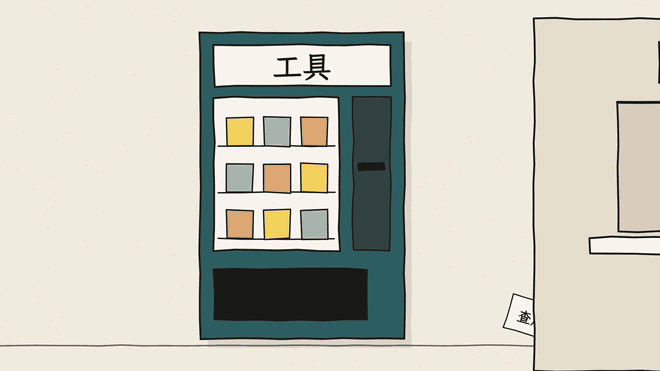
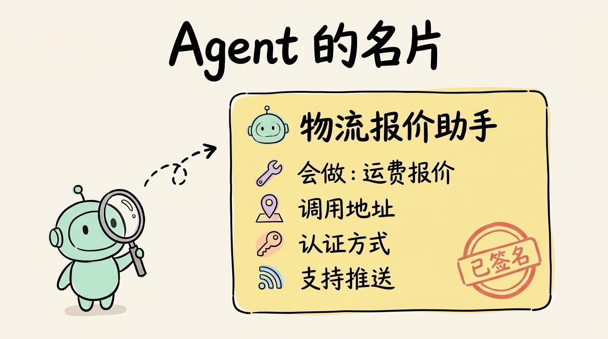
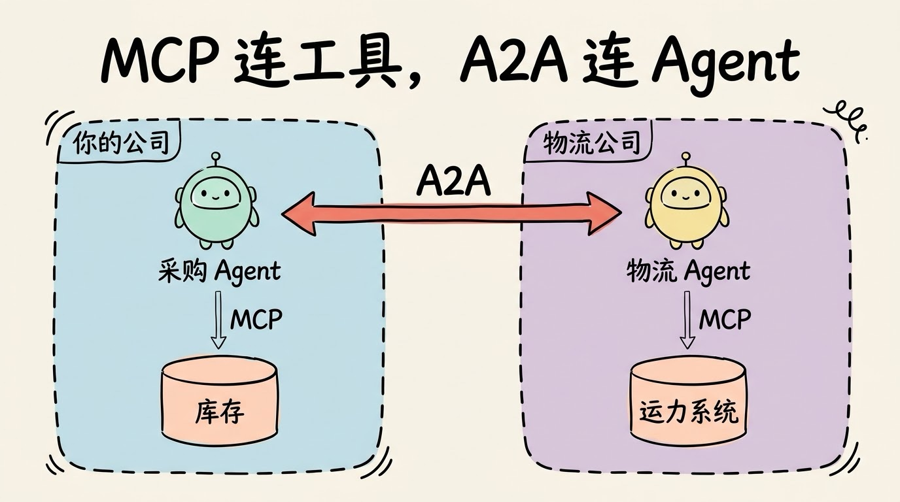
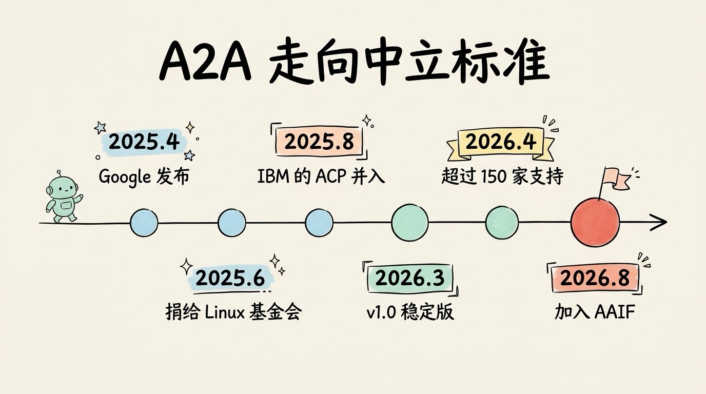
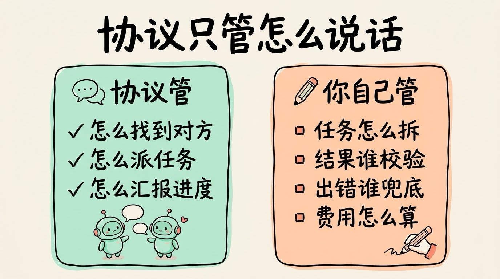

# 3分钟搞懂A2A协议

> ⭐⭐中级 · 阅读时间 3分钟 · 更新于 2026-10-20
>
> A2A 是让不同公司、不同框架的 AI Agent 互相发现、派活和协作的开放协议。本文讲清 Agent Card 怎么让 Agent 找到彼此、任务为什么要设计成可以中途反问的长流程、它和 MCP 怎么分工，以及协议本身解决不了哪些问题。

## 一句话定义

**A2A**（Agent2Agent）= 一套开放协议，规定了 AI Agent 之间怎么公布自己会做什么、怎么接收别人派来的任务、怎么在任务进行中汇报进度和反问，让不同公司、不同框架做出来的 Agent 也能互相协作。

举个例子：你公司的采购 Agent 在处理一笔订单，它需要做两件事：

- **查库存**：这是调用一个**工具**，查一下数据库，返回一个数字就结束了。
- **让物流公司的 Agent 报个价**：这是找一个**同事**帮忙。对方用的是什么模型、什么框架，你都不知道，也不需要知道。

第一件事用 MCP 就能做，第二件事要用的就是 A2A。

## 工具不会反问，同事会

为什么找同事不能像调工具一样处理？因为两者的行为差别很大。

工具是被动的，结果也是确定的：你传参数进去，它执行完返回结果。而 Agent 它是有自己的逻辑和判断的：你让它报价，它可能先反问你“要几天送达”，可能要跑十几分钟才会有结果，也可能干到一半告诉你这单它接不了。



这就像你在公司里找另一个部门帮忙。你不会直接去操作对方的系统，而是先在通讯录里找到负责人，看看对方能不能做这件事，然后把需求发过去。对方可能会回复“收到，在处理”，也可能会问你要更多材料，最后再把结果交给你。

A2A 要做的，就是把这个过程变成一套所有 Agent 都能遵守的规范。**所以它要解决的问题比调用工具复杂，核心是怎么跟一个同样会思考、需要时间、还可能中途会反问的对象协作。**

## 先递一张名片：Agent Card

找同事的第一步，是知道有哪些同事、他们各自能干什么。

在 A2A 里，每个 Agent 都要公开一份 JSON 格式的 **Agent Card**，可以理解成 Agent 的名片，默认放在 `https://{域名}/.well-known/agent-card.json` 这个固定地址上。大概的内容是这样的（这里做了简化，实际字段以官方规范为准）：

```json
{
  "name": "物流报价助手",
  "description": "根据货物重量、起止城市和时效要求给出运费报价",
  "url": "https://agent.example.com/a2a",
  "capabilities": { "streaming": true, "pushNotifications": true },
  "securitySchemes": { "oauth": "..." },
  "skills": [
    { "id": "quote", "name": "运费报价", "description": "支持国内整车和零担" }
  ]
}
```

别的 Agent 读到这张名片，就知道该不该找它、去哪个地址找它、要用什么方式证明自己的身份，以及它支不支持实时推送进度等信息。



这里有一个很重要的设计，规范里叫**不透明执行**（Opaque Execution）：协作双方不需要知道对方内部用的什么模型、什么提示词、接了哪些工具，只按名片上公布的接口来打交道。这和我们平时调用别家的 API 是同一个道理，**各家的实现细节和商业机密都不用暴露出来**。

既然看不到对方内部，怎么确认名片是真的？2026 年 3 月发布的 v1.0 版本加入了**签名名片**（Signed Agent Card），用密码学签名来证明这张名片确实是这个 Agent 的提供方发出来的，避免有人冒充。

## 一次协作是一个任务，不是一问一答

普通 API 默认的是“我调你，你马上返回结果”。但 Agent 干活经常要几分钟甚至几小时，中间还可能需要补充信息，所以 A2A 把一次协作建模成一个**任务**（Task），每个任务都有明确的状态：

| 状态 | 含义 | 类型 |
|------|------|------|
| 已提交 | 任务已经收到 | 进行中 |
| 处理中 | 正在干活，可以持续汇报进度 | 进行中 |
| **需要补充信息** | 卡住了，要发起方补充信息 | 中断，等待回复 |
| **需要认证** | 要发起方先完成身份认证 | 中断，等待回复 |
| 已完成 / 失败 / 已取消 / 已拒绝 | 任务结束 | 终态 |

这里面最关键的是“需要补充信息”这个状态。它表明了一件客观事实：**Agent 之间的协作不可能一次说清楚，所以必须允许来回问**。发起方收到反问后，在同一个任务里补充信息，对方接着往下做，前面的进度不会丢掉。


任务进行中，发起方有三种方式拿到进度：

- **轮询**：隔一段时间主动去查一次任务状态，最简单，但不够及时。
- **流式推送**：保持连接，对方用 SSE 实时推送状态变化，适合几分钟内能完成的任务。
- **回调通知**：发起方留一个接收地址，对方有进展时主动发过来，适合要跑几个小时、发起方不可能一直挂着连接的任务。

任务做完后，对方交回来的成果叫**产出物**（Artifact），可以是一段文字、一个文件，也可以是一份结构化的 JSON 数据。

当然，不是每件事都要走这么完整的流程。如果只是一个简单的问题，比如“你们支持发冷链吗”，对方可以直接回一条消息，不用创建任务。

## A2A 和 MCP 是什么关系

这是最容易搞混的地方。两者其实是搭档，各管一段：

| | MCP | A2A |
|---|-----|-----|
| 连接对象 | AI 和工具、数据源 | AI 和另一个 AI |
| 对方有没有自己的判断 | 没有，按参数执行 | 有，会思考、会反问、会拒绝 |
| 对方内部是否可见 | 工具的参数和用途都要写清楚给模型看 | 不可见，只看名片上公布的能力 |
| 类比 | 工具箱 | 跨部门协作 |

需要说明的是，MCP 在 2025 年 11 月发布的规范里也加入了实验性的“任务”功能，用来处理耗时较长的工具调用。所以两者的区别并不在于“能不能跑长任务”，而在于**对面是一个按指令执行的工具，还是一个有自己判断、需要商量着来的 Agent**。

一个实际的企业 Agent 通常两个都会用：**对内用 MCP 连接自家的数据库和业务系统，对外用 A2A 找别家的 Agent 协作**。比如前面的采购 Agent，查库存走 MCP，找物流公司报价走 A2A，物流公司的 Agent 收到任务后，再用 MCP 去查它自己的运力系统。



## 从 Google 的项目变成中立的行业标准

A2A 最早是 Google 在 2025 年 4 月发布的，同年 6 月捐给了 Linux Foundation，由中立的基金会来管理。8 月，IBM 把自家的智能体通信协议 ACP 也合并进了 A2A，避免出现两套标准各走各的。

2026 年是 A2A 走向成熟的一年：

- **3 月**：发布第一个稳定版本 v1.0，加入了签名名片、多租户、多种传输方式（JSON-RPC、gRPC、REST）和版本协商。
- **4 月**：满一周年时，Linux Foundation 公布支持的组织已经超过 150 家，而刚发布时只有 50 多家。微软把 A2A 接进了 Azure AI Foundry 和 Copilot Studio，AWS 在 Amazon Bedrock AgentCore 里提供了支持，官方 SDK 也从最初只有 Python 扩展到了 Python、JavaScript、Java、Go、.NET 五种语言。
- **8 月**：A2A 加入 Agentic AI Foundation（AAIF），和 MCP 归到了同一个基金会下面。AAIF 同样由 Linux Foundation 托管，专门负责智能体相关的开放标准。



为什么这么多大厂（包括互相竞争的大厂）都愿意一起推一个开放协议？因为**没有人希望自己的 Agent 变成孤岛**。如果每两家的 Agent 之间都要单独写一套对接，接入的家数越多，要写的对接就越多，最后谁都接不过来。有了统一的协议，每家只需要按标准实现一次，就能和所有支持 A2A 的 Agent 协作。

按 Linux Foundation 的公告，A2A 已经在供应链、金融服务、保险和 IT 运维这些行业有了实际部署，比如采购 Agent 找供应商的 Agent 询价下单、监控 Agent 发现异常后把工单派给对应团队的处置 Agent。

国内开发者如果想上手，阿里开源的多智能体框架 **AgentScope** 已经支持 A2A，既可以把自己的 Agent 发布成 A2A 服务，也可以把远程的 A2A Agent 当成本地 Agent 来调用，还能配合 Nacos 做 Agent 的注册和发现。

## 协议能管的，只是“怎么说话”

还有一个常见的误会：觉得接上 A2A，多个 Agent 就能自动配合好了。

实际上协议只解决“怎么说话”，不解决“说什么才对”。任务该怎么拆、哪个 Agent 负责哪一段、对方交回来的结果由谁来校验、出了错谁来兜底、调用别家 Agent 产生的费用怎么结算，这些都要靠具体的业务设计和编排来解决。



另外，也不是所有多 Agent 场景都需要 A2A。如果几个 Agent 都在你自己的系统里、用同一个框架开发，直接用框架自带的子 Agent 或任务分派就够了。**A2A 真正有价值的场景，是跨团队、跨公司、跨框架的协作**，也就是你不知道、也不需要知道对方内部是怎么实现的时候。

最后在安全上，A2A 规定了身份认证和签名名片，但对方 Agent 交回来的内容本身仍然可能有问题，比如结果出错，甚至夹带了诱导你的 Agent 执行其他操作的文字。所以**涉及下单、付款这类有实际后果的操作，一定要在自己这边再加一道校验或人工确认**。

## 时效性提醒

A2A 的核心设计（Agent Card、任务状态、不透明执行）在 v1.0 之后已经比较稳定了，变化比较快的是下面这些：

- 规范的小版本更新和扩展机制，v1.0 和之前的 0.3 版本在字段写法上有不兼容的地方，看旧教程时要留意版本
- 各云平台和开发框架的支持程度、接入方式各不相同
- 加入 AAIF 之后，A2A 和 MCP 之间会不会有更多配合，目前还在发展中

**建议**：动手之前，以 A2A 官方规范和你所用框架的文档为准。

💬 **互动话题**：如果你公司的系统都变成了 Agent，你最想让哪两个“部门”的 Agent 直接对话？

📖 **相关阅读**：

- [3分钟搞懂MCP](../../01-basics/08-mcp/README.md) - Agent 连接工具和数据的标准
- [3分钟搞懂多智能体协作](../10-multi-agent/README.md) - 任务什么时候值得拆给多个 Agent
- [3分钟搞懂工具调用](../02-function-calling/README.md) - 模型怎么调用工具
- [3分钟搞懂Agent界面协议](../12-agent-ui-protocols/README.md) - Agent 怎么和用户界面打交道
- [3分钟搞懂AI支付协议](../13-ai-payment-protocols/README.md) - Agent 之间怎么付钱

**资料来源**：

- Google Developers Blog，Announcing the Agent2Agent Protocol (A2A)（2025-04-09）：https://developers.googleblog.com/en/a2a-a-new-era-of-agent-interoperability/
- Linux Foundation，Linux Foundation Launches the Agent2Agent Protocol Project（2025-06-23）：https://www.linuxfoundation.org/press/linux-foundation-launches-the-agent2agent-protocol-project-to-enable-secure-intelligent-communication-between-ai-agents
- Linux Foundation，A2A Protocol Surpasses 150 Organizations（2026-04-09）：https://www.linuxfoundation.org/press/a2a-protocol-surpasses-150-organizations-lands-in-major-cloud-platforms-and-sees-enterprise-production-use-in-first-year
- Google Open Source Blog，A year of open collaboration: Celebrating the anniversary of A2A（2026-04）：https://opensource.googleblog.com/2026/04/a-year-of-open-collaboration-celebrating-the-anniversary-of-a2a.html
- AAIF，A2A joins AAIF（2026-08-17）：https://aaif.io/blog/a2a-joins-aaif
- A2A 官方规范：https://a2a-protocol.org/latest/specification/
- MCP 规范 2025-11-25 变更日志：https://modelcontextprotocol.io/specification/2025-11-25/changelog
- AgentScope，A2A 文档：https://java.agentscope.io/en/task/a2a.html

---

⬅️ 上一篇：[3分钟搞懂多智能体协作](../10-multi-agent/README.md) ｜ [📚 返回目录](../README.md) ｜ 下一篇：[3分钟搞懂Agent界面协议(AG-UI/A2UI/MCP Apps)](../12-agent-ui-protocols/README.md) ➡️
