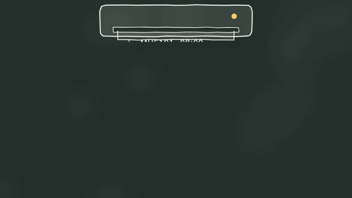
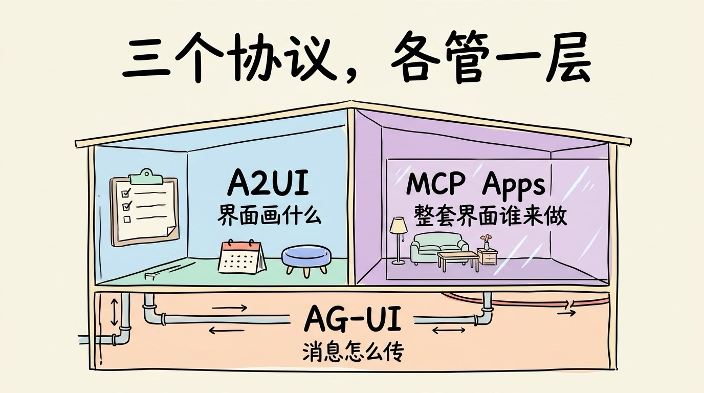
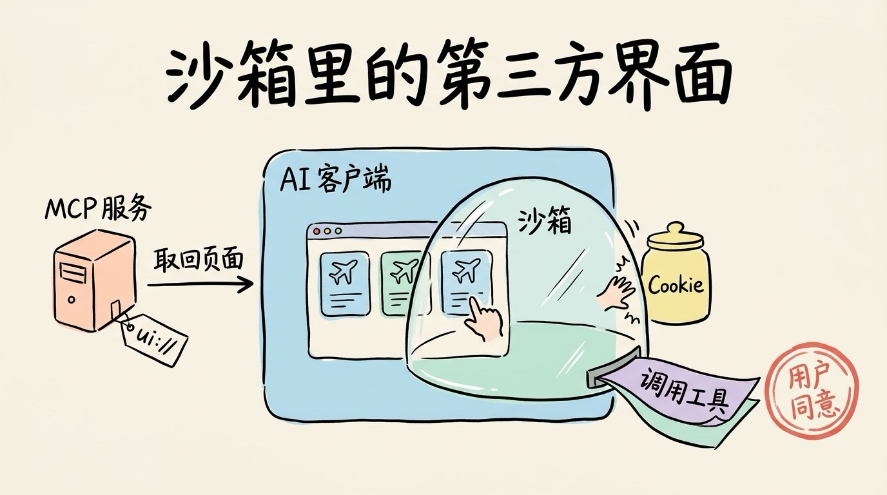
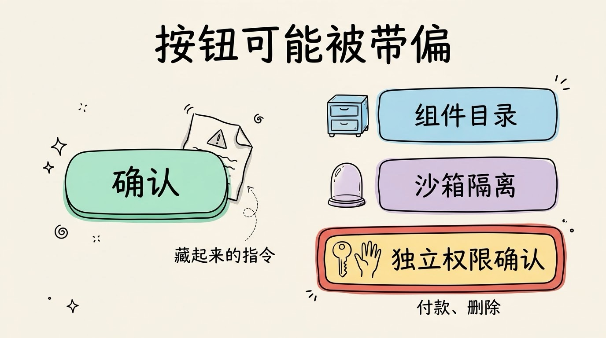

# 3分钟搞懂Agent界面协议(AG-UI/A2UI/MCP Apps)

> ⭐⭐中级 · 阅读时间 3分钟 · 更新于 2026-10-20
>
> Agent 界面协议解决的是 AI 怎么把按钮、表单展示给你，你点完又怎么传回给 AI。AG-UI 管消息传输、A2UI 管界面描述、MCP Apps 管第三方整包界面，本文讲清三者怎么叠着用、怎么选，以及界面交给 AI 生成后的安全问题。

## 一句话定义

**Agent 界面协议** = 一组规定 AI Agent 怎么把按钮、表单、图表这些可以操作的界面展示给用户，以及用户操作完之后怎么把结果传回给 Agent 的规则，让 Agent 不再只能用文字和你来回对话。

举个例子：让 AI 帮你订机票，它回了一大段文字，列出 10 个航班，最后问你：“请回复序号选择。”你数了半天，回了个“3”，它又问你要靠窗还是靠过道。如果 Agent 能直接给你一个航班列表，你点一下就选好了，再弹出一张座位图让你挑，整个过程会顺畅很多。



从2025 年到 2026 年，这个方向出现三个常用的方法：**AG-UI、A2UI、MCP Apps**。它们常被放在一起比较，但其实各管一层，并不是三选一的关系。

## 三个协议，各管一层

拿装修房子打个比方：

- **AG-UI 是水电管线**。它不管房间里摆什么，只保证后端的 Agent 和前端页面之间，消息能实时、按规矩地来回流动。
- **A2UI 是一张家具清单**。Agent 只说“这里放一个日期选择器，那里放一个确认按钮”，家具从你自己的库房里拿，所以风格和你家其他房间是一致的。
- **MCP Apps 是整体搬进来的样板间**。第三方服务把做好的整套界面送进来，放在一间隔着玻璃墙的房间里展示，你能正常使用，但它碰不到你家其他地方。

所以三者分别回答的是三个问题：**消息怎么传、界面画什么、整套界面由谁来做**。



下面分别展开讲一下。

## AG-UI：把 Agent 干活的过程变成一串事件

**AG-UI**（Agent-User Interaction Protocol）是 CopilotKit 在 2025 年 5 月发布的开源协议。在它出现之前，每家做 Agent 前端都要自己定一套格式：用 WebSocket 还是 SSE、怎么表示“正在调用工具”、怎么表示“任务出错了”，前后端换一个框架就要重新对接一遍。

AG-UI 的做法是把 Agent 干活过程中发生的事情，统一成大约 16 种带类型的**事件**。前端只要按事件类型处理，就不用关心后端用的是哪个框架。比如一次订机票的过程，前端收到的事件流大概是这样的（这里做了简化）：

```
RUN_STARTED            -> 任务开始, 前端显示"正在处理"
TEXT_MESSAGE_START     -> 开始输出一段文字
TEXT_MESSAGE_CONTENT   -> "正在帮你查明天上海到北京的航班..." (逐字推送)
TEXT_MESSAGE_END       -> 文字输出结束
TOOL_CALL_START        -> 开始调用 search_flights, 前端显示进度
TOOL_CALL_END          -> 工具调用结束
STATE_SNAPSHOT         -> 推送当前状态: 10 个候选航班
RUN_FINISHED           -> 任务结束
```

有了这套事件，流式输出、显示工具调用进度、前后端同步状态、用户中途打断这些常见的交互，就不用每个团队从头定义一遍了。

目前支持 AG-UI 的框架已经比较多了：微软的 Microsoft Agent Framework、Google 的 ADK、AWS 的 Strands Agents 都内置了支持，LangGraph、CrewAI、Mastra、Pydantic AI、LlamaIndex 这些常用的 Agent 框架也都可以直接对接。

## A2UI：Agent 只开清单，组件用你自己的

AG-UI 只管传消息，并不规定界面长什么样。如果 Agent 想让前端画一个航班列表，要用什么格式来描述呢？这就是 **A2UI**（Agent-to-User Interface）要解决的问题。

A2UI 是 Google 在 2025 年 12 月开源的。Agent 发出去的是一份 JSON，只描述“用哪些组件、填什么数据”，不包含任何可以执行的代码。大概是这样的（这里做了简化，实际字段以官方规范为准）：

```json
{
  "components": [
    { "id": "title", "type": "Text", "text": "明天上海 → 北京" },
    { "id": "list", "type": "List", "items": "/flights" },
    { "id": "ok", "type": "Button", "label": "确认选择", "action": "book" }
  ],
  "data": { "flights": ["MU5101 08:00", "CA1858 09:30", "..."] }
}
```

客户端收到之后，用自己的原生组件把界面画出来。Web 端用 React 或 Angular，移动端用 Flutter，画出来的按钮和列表都是你 App 里本来就有的样式。

这样设计主要是出于安全的考虑。让大模型直接生成代码在用户的设备上运行，风险是很大的。A2UI 规定 Agent **只能从客户端预先批准的组件目录里挑组件**，目录里没有的东西，Agent 再怎么要求也画不出来。


A2UI 在 2026 年 4 月发布了 v0.9，加入了官方的 React 渲染器、双向的数据同步和 Python 版的 Agent SDK。截至 2026 年 10 月，项目里写的生产版本是 v0.9.1，v1.0 还处在候选阶段，早期的 v0.8 已经被标记为旧版本。Google 自家的 Opal、Gemini Enterprise 和 Flutter 的 GenUI SDK 都在用它。

## MCP Apps：第三方把整个界面送进聊天框

前面两个协议，界面都是由你自己的前端来画的。但如果你是 Figma、Canva 这样的服务，想让用户在 Claude 或 ChatGPT 里直接用上你的界面，前端就不在你手里了。**MCP Apps** 解决的就是这种情况。

MCP Apps 是 MCP 的第一个官方扩展，2026 年 1 月 26 日正式发布。它的思路是让 MCP 服务直接提供一个做好的网页，运作过程是这样的：

```
1. MCP 服务: 在工具说明里声明一个界面地址, 如 ui://flights/picker
2. AI 客户端: 调用工具时, 顺便取回这个地址对应的 HTML 页面
3. AI 客户端: 把页面放进一个沙箱 iframe, 显示在对话里
4. 用户: 在页面里点选
5. 页面: 通过 postMessage 通知客户端, 需要时再请求调用 MCP 工具
```

这里的**沙箱 iframe** 就是前面说的“玻璃墙”：页面运行在一个隔离的小窗口里，读不到外面网页的内容和 Cookie，也不能随便跳转。页面想调用哪些工具，由 AI 客户端来控制，代替用户执行操作时还需要用户同意。



MCP Apps 并不是凭空出现的，它吸收了社区项目 MCP-UI 和 OpenAI Apps SDK 的做法，把原本各家私有的“在聊天里嵌应用”变成了一个共同标准。发布当天，Claude 就上线了 Asana、Figma、Canva、Slack 等 9 个可以直接在对话里操作的应用。目前支持 MCP Apps 的客户端有 Claude（网页版和桌面版）、ChatGPT、VS Code 里的 GitHub Copilot、Microsoft 365 Copilot、Goose、Postman 等，**所以你写好一套界面，就可以在这些客户端里通用**，不用为每个 AI 客户端各做一遍。

## 三者其实可以叠在一起用

把三个协议放在一张表里对比一下：

| | AG-UI | A2UI | MCP Apps |
|---|---|---|---|
| 发起方 | CopilotKit，2025 年 5 月 | Google，2025 年 12 月 | MCP 核心团队联合 OpenAI、MCP-UI 社区，2026 年 1 月 |
| 管哪一层 | 传输：Agent 和前端之间的事件流 | 描述：界面由哪些组件构成 | 整包：一个可以交互的小应用 |
| Agent 发出去的 | 带类型的事件 | 组件和数据的 JSON，不含代码 | 指向 `ui://` 页面的引用 |
| 界面谁来画 | 不规定，由你的前端决定 | 客户端用自己的原生组件 | AI 客户端在沙箱里运行第三方页面 |
| 安全思路 | 统一格式，减少各家自定义的解析 | 只能从预先批准的组件目录里挑 | 沙箱隔离，工具调用由客户端控制 |
| 界面风格 | 由你决定 | 和你的 App 一致 | 由第三方决定，可能和客户端风格不统一 |

从这张表可以看出，它们在不同的层上，本来就是可以叠着用的：

- **A2UI 走 AG-UI 这条管道**：Google 发布 A2UI 时就和 AG-UI 团队一起做了兼容，已经支持 AG-UI 的 Agent，可以直接把 A2UI 的界面描述送到前端。
- **A2UI 也可以走 MCP**：Google 在 2026 年 6 月介绍了几种组合方式，比如 MCP 服务直接返回 A2UI 格式的 JSON，支持 A2UI 的客户端用原生组件画出来，不再需要 iframe；反过来，也可以把 MCP Apps 的页面包在 A2UI 的一个组件里，和原生组件放在同一个界面上。
- **AG-UI 也支持 MCP Apps**：在 CopilotKit 这类框架里，可以把 MCP Apps 的界面嵌进自己的 Agent 应用里。

## 该选哪个，看你要做什么

- **如果你在做自己的 Agent 产品，需要一个前端**：先看 AG-UI。它解决的是最基础的问题，让流式输出、工具调用进度、中途打断这些交互不用自己从头定义。
- **如果你希望 Agent 生成的界面和自家 App 长得一样，还要同时支持 Web 和移动端**：看 A2UI。组件是你自己的，Agent 只负责挑选和摆放。
- **如果你是一个 SaaS 服务，想让用户在 Claude 或 ChatGPT 里直接用上你的界面**：看 MCP Apps。你已经有 MCP 服务的话，加一个界面资源就可以了。

国内的情况需要额外说明一下：截至 2026 年 10 月，我们还没有查到豆包、元宝、千问这些国内 AI 客户端官方宣布支持 MCP Apps，国内大厂也还没有正式表态支持 AG-UI 或 A2UI。不过这三个协议都是开源的，协议本身也不绑定模型，国内开发者用 DeepSeek、千问这些模型做后端，前端照样可以接 AG-UI 和 A2UI。

## 界面交互提升了，但风险也增加了

界面交给 Agent 生成，意味着“屏幕上出现什么”不再完全由开发者预先写死，这带来了两类新问题。

第一是安全。Agent 读到的网页、邮件里如果藏着恶意指令，它生成的界面也可能被带偏，比如弹出一个看起来很正常、实际上会执行别的操作的确认按钮。A2UI 限定组件目录、MCP Apps 用沙箱隔离，都是在解决这个问题，但也都不是万无一失的。**尤其是涉及付款、删除这类操作时，一定要在界面之外再加一道独立的权限控制或人工确认**，不能只靠用户在界面上点了一下“确认”。



第二是成熟度。A2UI 的 v1.0 还没有正式发布，MCP Apps 在不同客户端上支持的功能也不完全一样，比如 ChatGPT 在标准之外还保留了自己的扩展接口。三个方案的发起方各不相同，未来是继续分层共存，还是会有一两个被合并，目前还看不清。所以现阶段选型时，最好把界面协议这一层做成可以替换的。

还有一个常见的误会：有了界面协议，就觉得所有交互都该做成界面。实际上一句话就能说清的事，硬塞一个表单反而更慢。界面的价值在选项多、信息密集、需要反复调整的场景，比如挑航班、改日程、看数据报表、审批报销单等场景。

## 时效性提醒

这三个协议都还在快速迭代，变化比较快的是下面这些：

- A2UI 的版本，v1.0 目前是候选版本，正式发布后字段写法可能会有变化
- 支持 MCP Apps 的客户端名单，以及各客户端支持的功能范围
- 支持 AG-UI 的框架和云平台，以及三个协议之间的组合方式

**建议**：动手之前，以各项目的官方文档和 GitHub 仓库为准。

💬 **互动话题**：你最希望哪个 AI 工具把“请回复序号选择”换成一个真正能点的界面？

📖 **相关阅读**：

- [3分钟搞懂MCP](../../01-basics/08-mcp/README.md) - MCP Apps 所扩展的那个协议
- [3分钟搞懂工具调用](../02-function-calling/README.md) - Agent 怎么调用工具
- [3分钟搞懂A2A协议](../11-a2a/README.md) - Agent 和 Agent 之间怎么协作
- [3分钟搞懂Agent沙箱与权限](../08-sandbox-and-permissions/README.md) - 怎么防止 Agent 乱执行操作
- [3分钟搞懂AI支付协议](../13-ai-payment-protocols/README.md) - Agent 替你付钱时怎么证明授权

**资料来源**：

- CopilotKit，Introducing AG-UI（2025-05-12）：https://www.copilotkit.ai/blog/introducing-ag-ui-the-protocol-where-agents-meet-users
- AG-UI GitHub 仓库：https://github.com/ag-ui-protocol/ag-ui
- Google Developers Blog，Introducing A2UI（2025-12-15）：https://developers.googleblog.com/introducing-a2ui-an-open-project-for-agent-driven-interfaces/
- Google Developers Blog，A2UI v0.9（2026-04-17）：https://developers.googleblog.com/a2ui-v0-9-generative-ui/
- Google Developers Blog，A2UI + MCP Apps（2026-06-17）：https://developers.googleblog.com/en/a2ui-and-mcp-apps/
- A2UI GitHub 仓库：https://github.com/a2ui-project/a2ui
- MCP Blog，MCP Apps（2026-01-26）：https://blog.modelcontextprotocol.io/posts/2026-01-26-mcp-apps/
- MCP Apps 官方文档：https://modelcontextprotocol.io/extensions/apps/overview
- Claude Blog，Interactive tools in Claude（2026-01-26）：https://claude.com/blog/interactive-tools-in-claude
- OpenAI，MCP Apps compatibility in ChatGPT：https://developers.openai.com/apps-sdk/mcp-apps-in-chatgpt

---

⬅️ 上一篇：[3分钟搞懂A2A协议](../11-a2a/README.md) ｜ [📚 返回目录](../README.md) ｜ 下一篇：[3分钟搞懂AI支付协议(AP2/x402)](../13-ai-payment-protocols/README.md) ➡️
