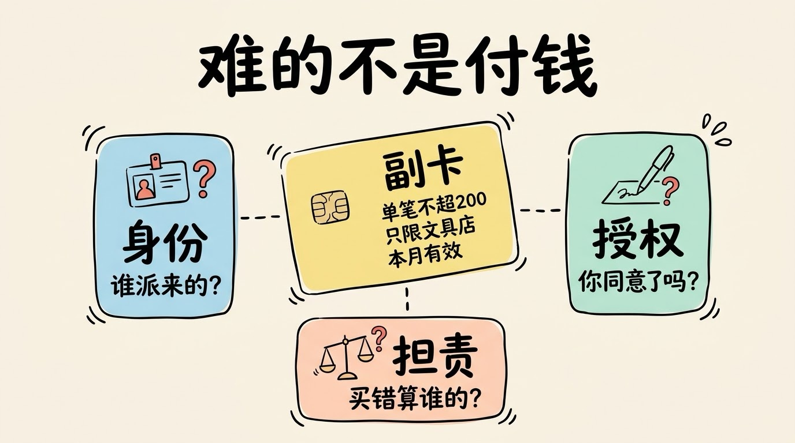
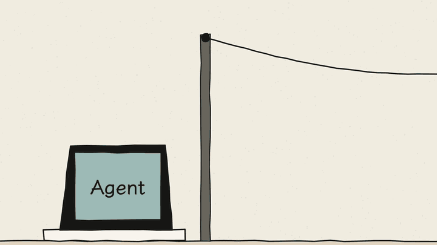
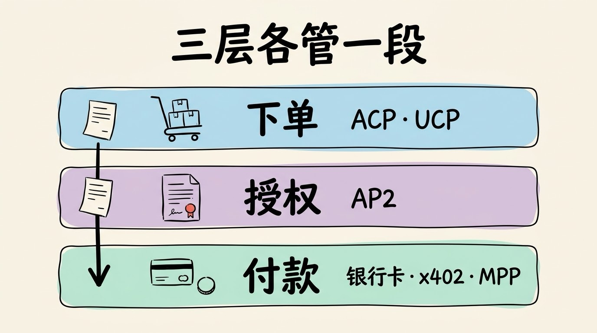
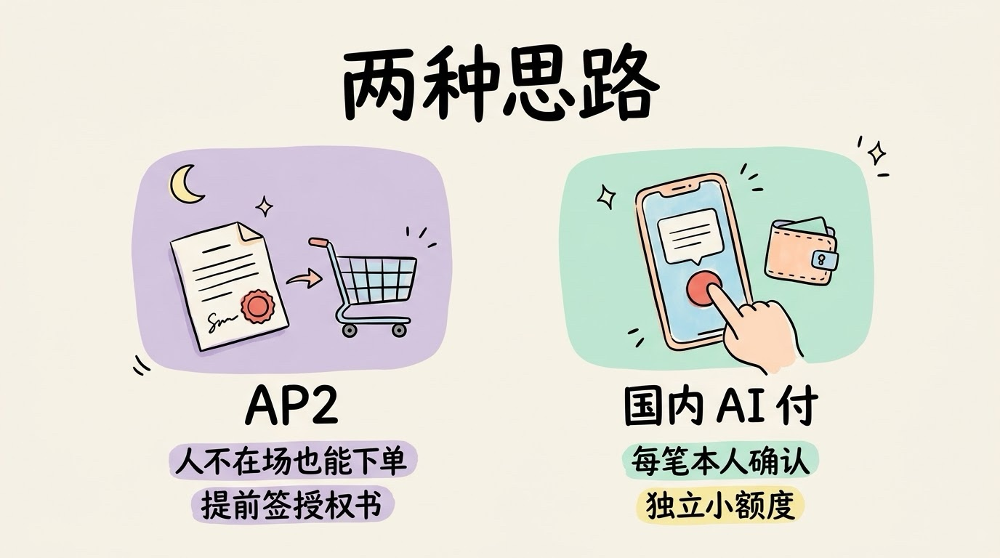

# 3分钟搞懂AI支付协议(AP2/x402)

> ⭐⭐中级 · 阅读时间 3分钟 · 更新于 2026-10-21
>
> AI 替你花钱，难的不是付款，而是证明“这笔钱是你允许它花的”。本文讲清 AP2 怎么把授权写成可验证的凭证、x402 怎么用 HTTP 402 让机器自动付小钱、ACP 和 UCP 管哪一段，以及支付宝、微信支付、银联的国内做法。

## 一句话定义

**AI 支付协议** = 当 AI Agent 要替你付钱时，把“你允许它花多少、在哪花、买什么、什么时候之前有效”写成商家和银行都能验证的凭证，再按约定的方式把钱付出去，并且每一步都能事后追查的一套规则。

举个例子：你让 Agent 帮你盯一张机票，“下周五上海飞北京，1500 块以下就直接买”。等到半夜价格降下来，Agent 去下单时，航空公司会面对几个问题：这个 Agent 真的是你派来的吗？1500 块的上限是你定的，还是它自己编的？如果买错了，这笔钱应该退给谁、损失算谁的责任？

现有的支付系统回答不了这些问题，因为它默认屏幕前操作的是一个真实的人。AI 支付协议要解决的，就是在**人不在场**的时候，这笔交易也能被证明是合法授权的。

## 难的不是付钱，是证明“这是你让它付的”

给 Agent 绑一张信用卡，技术上很容易。真正的问题出在三个地方：

| 卡点 | 现在的支付系统为什么不行 |
|------|-----------------|
| **身份** | 风控系统假设“操作的是人”，Agent 下单很容易被当成机器人拦下来 |
| **授权** | 输密码、刷脸、收短信验证码，全都要求本人在场 |
| **担责** | 买错了、买贵了，现有规则里没有“AI 自主下单”这一类，商家、银行和用户之间说不清 |

这就像给孩子一张副卡去买文具。直接把主卡给他风险太大，合理的做法是给一张副卡，并且给这张卡的限制是**单笔不超过 200 块、只能在文具店用、这个月有效**，文具店在收款时也能看到这些限制。

这三个问题不解决，Agent 就只能停在“帮你把购物车填好，最后一步还要你自己点”，而这最后一步恰恰是整个交易能否完成的关键。



## AP2：把你的授权写成一张能验证的“授权书”

**AP2**（Agent Payments Protocol）是 Google 在 2025 年 9 月 16 日发布的开放协议，发布时有 60 多家机构参与，包括 Mastercard、American Express、PayPal、Coinbase，以及国内读者比较熟悉的蚂蚁国际、银联国际等。它的定位经常被误解，所以需要搞清楚的是：**AP2 不是一条支付通道，它不负责把钱划过去，而是负责证明这笔交易是你授权的。**

它的核心是一种叫 **Mandate（授权书）** 的凭证。授权书是带加密签名的数字凭证，签完之后谁都改不了，商家、支付机构、银行拿到后都可以独立验证。2026 年 4 月发布的 v0.2 把授权书分成两类，每类又分“开放”和“确定”两个阶段：

| | 开放阶段（Open） | 确定阶段（Closed） |
|---|---|---|
| **结账授权书**（交给商家） | 你提的条件：买什么、预算多少、有效期多久 | 具体的那一单：哪个商品、多少钱 |
| **支付授权书**（交给支付机构和银行） | 付款条件：总预算、能用哪张卡 | 这一单具体扣多少钱 |

拿前面的机票例子，整个流程是这样的：

```
1. 你: 签一份"开放"授权书 -> 上海飞北京, 下周五, 1500 元以内, 本周有效
2. Agent: 持续比价, 你可以去睡觉了
3. Agent: 价格降到 1420 元, 生成"确定"授权书 -> 某航班, 1420 元
4. 商家和银行: 核对确定授权书有没有超出开放授权书的范围, 通过才扣款
5. 事后: 两份授权书串在一起, 每一步谁签的、改没改过都查得到
```

关键在第 4 步。如果 Agent 想买 1600 元的票，或者换成了别的日期，它生成的确定授权书和你签的开放授权书对不上，银行这一关就过不去。**这就把“Agent 有没有越权”从事后扯皮，变成了付款前就能自动检查的事情。**


v0.2 的另一个变化是正式支持**人不在场**的交易，也就是上面这种你提前授权、Agent 稍后自己下单的情况。2025 年最早的版本里，授权书分的是意图、购物车、支付三种，如果你看到的是旧资料，名字可能会不太一样。

2026 年 4 月 29 日，Google 把 AP2 捐给了 **FIDO 联盟**，就是制定 Passkey 无密码登录标准的那个组织。后续的标准化在 FIDO 新成立的智能体认证、支付两个工作组里进行，**AP2 也就不再只是 Google 一家的协议了。**

至于钱最后怎么划过去，AP2 协议是不负责的。刷卡、银行转账、链上稳定币都可以接入，其中一种就是下面要讲的 x402。

## x402：让 HTTP 402 状态码真正用起来

HTTP 协议里有个状态码叫 **402 Payment Required**（需要付款），1997 年的 HTTP/1.1 规范里就有了，但一直标着“保留，以后再用”，将近三十年都没有真正用起来。原因很简单：那时候没有机器自己付钱的场景。

**x402** 是 Coinbase 在 2025 年 5 月提出的，它的作用是把 402 变成一套能实际跑通的付款流程：

```
1. Agent: 请求一份数据 GET /api/report
2. 服务器: 返回 402, 附上价格(比如 0.01 美元)、收款地址、支持哪些链和币种
3. Agent: 用自己的钱包签一笔支付, 带在请求里重新发一次
4. 服务器: 把这笔支付交给结算服务验证并上链
5. 服务器: 返回 200 和数据
```

整个过程不用注册账号、不用申请 API Key、也不用人点确认，Agent 在一次 HTTP 往返里就把钱付了。它解决的是过去很难做的一类生意：**金额很小、频率很高的机器付费**，比如调一次接口付一分钱、读一篇文章付两毛钱。用传统的刷卡方式，手续费往往比货款还贵，这笔账就不划算了。



目前 x402 主要用 USDC 这类美元稳定币付款，支持以太坊系的各条链和 Solana 等网络。2026 年 4 月 2 日，Coinbase 把 x402 交给了 Linux 基金会下面新成立的 **x402 基金会**，首批 40 家成员里有 AWS、Google、Cloudflare、Stripe、Visa、Mastercard、American Express、Shopify 等，**从这时开始，x402 也不再是 Coinbase 一家说了算。**

x402 官网 2026 年 8 月最新的数据显示：过去 30 天约 7541 万笔交易、2424 万美元，平均每笔只有 0.3 美元左右。但第三方链上分析机构 Artemis 的结论是，其中超过 95% 是测试和协议自身的信号交易，并不是真实的交易。所以 x402 的技术已经跑通了，**但真实的商业规模还处在很早期。**

另外，用 402 做机器付款的也不只 x402 一家。Stripe 和 Tempo 在 2026 年 3 月推出了 **MPP**（Machine Payments Protocol），流程同样是“服务器返回 402、客户端付款后重试”，区别是它除了稳定币也支持银行卡，钱直接进商家原本的 Stripe 账户。如果你已经在用 Stripe 收款，接 MPP 改动会更小。

## ACP 和 UCP 管的是付钱之前那一段

AP2 和 x402 解决的是“授权算不算数、钱怎么付”。但在付钱之前，还有一大段流程：Agent 怎么知道商家有哪些商品、怎么加购物车、运费和税怎么算、下单后怎么查物流和退货。这些问题行业内现在也有制定对应的规则，目前是由另外两个协议在管理。

**ACP**（Agentic Commerce Protocol）是 OpenAI 和 Stripe 在 2025 年 9 月 29 日联合发布的，采用 Apache 2.0 开源许可。它最早用来支撑 ChatGPT 里的“即时结账”（Instant Checkout），付款时由 Stripe 生成一个只能用于这一单、有金额和时间限制的**共享支付令牌**，商家拿不到你的卡号。不过 OpenAI 在 2026 年 3 月调整了方向，购买改为在商家自己的 ChatGPT 应用里完成，Target、DoorDash、Instacart 等已经上线了自己的应用，原因是库存、价格、销售税这些信息变化太频繁，由商家自己维护其实更合适。ACP 协议本身还在继续更新和完善，目前最新的稳定版是 2026-04-17 发布的版本，可以加入了购物车、查看商品目录、发起订单和 MCP 接入等，不过协议整体上仍然是 Beta 状态。

**UCP**（Universal Commerce Protocol）是 Google 在 2026 年 1 月 11 日的美国零售联合会年度大会（NRF）上发布的，和 Shopify 共同开发，Etsy、Wayfair、Target、Walmart 是首批合作方。它覆盖从发现商品、下单到售后的整个购物流程，付款授权这一层兼容 AP2，商家可以通过 API、A2A 或 MCP 接入。3 月的更新加入了购物车、商品目录和会员账户绑定；9 月成立了支付技术委员会，成员有 Google、Shopify、Stripe、PayPal、Adyen、Coinbase、蚂蚁国际等，同月还合并了酒店预订能力的草案，由 Booking.com、Expedia、万豪、希尔顿、携程等参与制定。

ACP 和 UCP 看起来像是 OpenAI 和 Google 在打擂台，某种程度上也确实是，但它们管的都是“下单”这一段，都不负责证明授权。

## 几个协议怎么关联在一起

把这几个协议放在一起看，分工大致是这样的：

| 环节 | 解决什么 | 对应协议 |
|------|---------|---------|
| 下单 | 商品、购物车、结账、售后怎么对接 | ACP、UCP |
| 授权 | 这笔钱是不是用户允许花的 | AP2 |
| 付款 | 钱怎么真正划过去 | 银行卡、钱包、x402、MPP 等 |

还是拿买机票举例：Agent 通过 UCP 查到航班、生成订单，用 AP2 的授权书证明这一单在你的授权范围内，最后付款走你绑定的信用卡。如果换成 Agent 按次购买一份航班数据报告，就可以直接用 x402 付一笔小钱，不需要走完整的下单流程。**一个完整的 AI 购物流程，通常会同时用到其中好几层。**



银行卡这一层也在跟进中。Visa 和 Mastercard 都推出了给 Agent 用的卡支付方案（Visa Intelligent Commerce、Mastercard Agent Pay），用户的卡号会被换成专门发给某个 Agent 的令牌，额度和用途都可以单独限制。它们也都是 x402 基金会的成员，并参与了 FIDO 里的标准制定。

## 国内：支付宝、微信支付、银联都在做

上面这些协议主要在海外落地，国内用不了 ChatGPT 的结账，也基本没有用稳定币付款的场景。但国内的 AI 支付在 2026 年也很热闹，而且走的路线不太一样：

- **支付宝**：2025 年 9 月推出“AI付”，用户在智能体对话里就能直接下单支付，同时推出面向商家和开发者的“AI收”。2026 年 5 月 26 日发布面向个人的 AI 钱包，可以在付款前后管理智能体的任务和账单。按支付宝的说法，截至 2026 年 5 月末，AI 支付累计已超过 3 亿笔。
- **微信支付**：2026 年 6 月 17 日推出“AI专属卡”，需要先往卡里充值，智能体只能花卡里的钱，和主账户是隔离开的。AI 发起付款后，还要在手机上二次确认才会扣款。目前只能在腾讯的桌面智能体 WorkBuddy 里使用，购买美团的到店餐饮团购券。
- **中国银联**：2026 年 4 月发布《智能体支付开放协议框架》（APOP），和 19 家境内外机构达成合作。6 月，银联商务推出遵循这套规范的 AI 支付产品，先用在园区订餐、云缴费、AI 点餐等场景。
- **京东**：2026 年 6 月 11 日发布智能体自主支付协议 A2P2，先在 API 调用计费、小额工具购买、差旅预订这类场景试点。

对比一下就能看出差别：AP2 已经在推动“人不在场”的自主下单，**而国内目前的产品基本都要求涉及资金变动时由用户本人确认**，再用独立额度把风险框住。对国内开发者来说，如果想让自己的智能体能收钱，现在比较现实的路径是接支付宝的“AI收”或银联的 APOP，而不是去接 AP2 或 x402。



## 协议管不了的事

有了这些协议，也不等于可以放心让 AI 随便花钱：

- **护栏不等于判断力**。授权书能保证 Agent 不超预算、不买范围外的东西，但在范围之内“该不该买、买哪个”，它照样可能判断错。比如你授权的是“1500 元以内的机票”，它买到了一张不能退改的红眼航班，这在授权书侧看来是完全合规的。
- **Agent 本身可能被带偏**。Agent 读到的网页、商品描述里如果藏着恶意指令，它可能会在授权范围内买错东西，这就是 **Prompt 注入**。授权书的范围定得越宽，这类问题的影响就越大。
- **责任划分还没有定论**。协议提供的是证据链，出了问题能查清楚每一步是谁签的。但查清楚之后由谁赔，还要看卡组织规则和各地的法规，这部分目前还在制定当中。

所以，**尤其是大额、不能退款的交易，一定要保留人工确认这一步**，授权的范围也要尽量定得窄一点：限定商家、限定金额、设好有效期，用完就让它过期。

还有一个常见的误解：AP2 和 x402 是竞争关系，只能二选一。实际上它们管的是不同的层，AP2 负责证明授权，x402 是可以接在它后面的一种付款方式，AP2 官方的示例里就有用 x402 付款的例子。

## 时效性提醒

AI 支付涉及合规，变化比一般的 Agent 协议更快，下面这些尤其要留意：

- AP2 已经转到 FIDO 联盟，后续的字段和流程可能会随标准化调整
- x402 和 MPP 的用量数据、支持的网络和币种都在快速变化
- ACP 还是 Beta 状态，UCP 的新能力（如酒店预订）还处在草案阶段
- 国内的 AI 支付产品大多还在邀约测试或小范围试点，能用的场景有限

**建议**：动手之前，以 AP2、x402、ACP、UCP 的官方文档为准，涉及真实资金时一定要先用小额验证。

💬 **互动话题**：你愿意给 AI 多少额度让它自己下单？超过多少你一定要亲自点确认？

📖 **相关阅读**：

- [3分钟搞懂A2A协议](../11-a2a/README.md) - AP2 最早就是作为 A2A 的扩展发布的
- [3分钟搞懂MCP](../../01-basics/08-mcp/README.md) - UCP 和 ACP 都可以通过 MCP 接入
- [3分钟搞懂Agent沙箱与权限](../08-sandbox-and-permissions/README.md) - 付款这类操作怎么设关卡
- [3分钟搞懂Agent界面协议](../12-agent-ui-protocols/README.md) - 确认付款的按钮怎么展示给用户
- 3分钟搞懂AI监管政策 - AI 自主交易背后的监管问题

**资料来源**：

- Google Cloud Blog，Announcing Agent Payments Protocol (AP2)（2025-09-16）：https://cloud.google.com/blog/products/ai-machine-learning/announcing-agents-to-payments-ap2-protocol
- AP2 官方文档：https://ap2-protocol.org/
- FIDO Alliance，Google donates Agent Payments Protocol to FIDO Alliance（2026-04-29）：https://fidoalliance.org/google-donates-agent-payments-protocol-to-fido-alliance/
- x402 官网：https://www.x402.org/
- Coinbase，x402 Foundation 文档：https://docs.cdp.coinbase.com/x402/support/x402-foundation
- Yahoo Finance，The x402 Foundation Activated a 27-Year-Old Internet Code（2026-08-04）：https://finance.yahoo.com/markets/crypto/articles/x402-foundation-activated-27-old-152440828.html
- MPP 规范仓库：https://github.com/tempoxyz/mpp-specs
- Stripe Newsroom，Stripe powers Instant Checkout in ChatGPT（2025-09-29）：https://stripe.com/newsroom/news/stripe-openai-instant-checkout
- ACP GitHub 仓库：https://github.com/agentic-commerce-protocol/agentic-commerce-protocol
- Digital Commerce 360，OpenAI shifts checkout plans（2026-03-06）
- Google Developers Blog，Under the Hood: Universal Commerce Protocol（2026-01-11）
- UCP 公告页：https://ucp.dev/documentation/announcements/
- 新华网，巨头争相入场AI付 支付竞争开辟新战场（2026-05-27）：https://www.news.cn/fortune/20260527/ced18a0da09a42b4bd0ed09d5b596c5e/c.html
- 21世纪经济报道，AI支付登场：说句话就能付款，你愿意开通吗（2026-06-17）：https://m.21jingji.com/article/20260617/herald/7aa72e1dea720abed94a3c6060c12e14.html
- 腾讯新闻，微信、支付宝杠上了，AI支付新战役打响（2026-06-19）：https://news.qq.com/rain/a/20260619A057DB00

---

⬅️ 上一篇：[3分钟搞懂Agent界面协议(AG-UI/A2UI/MCP Apps)](../12-agent-ui-protocols/README.md) ｜ [📚 返回目录](../README.md)
