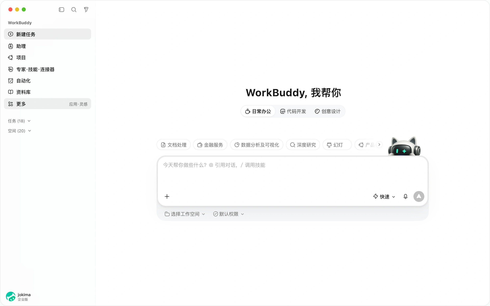
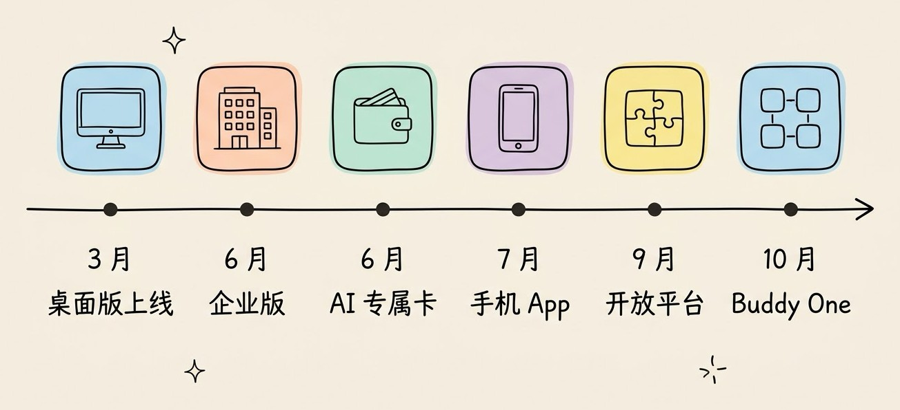
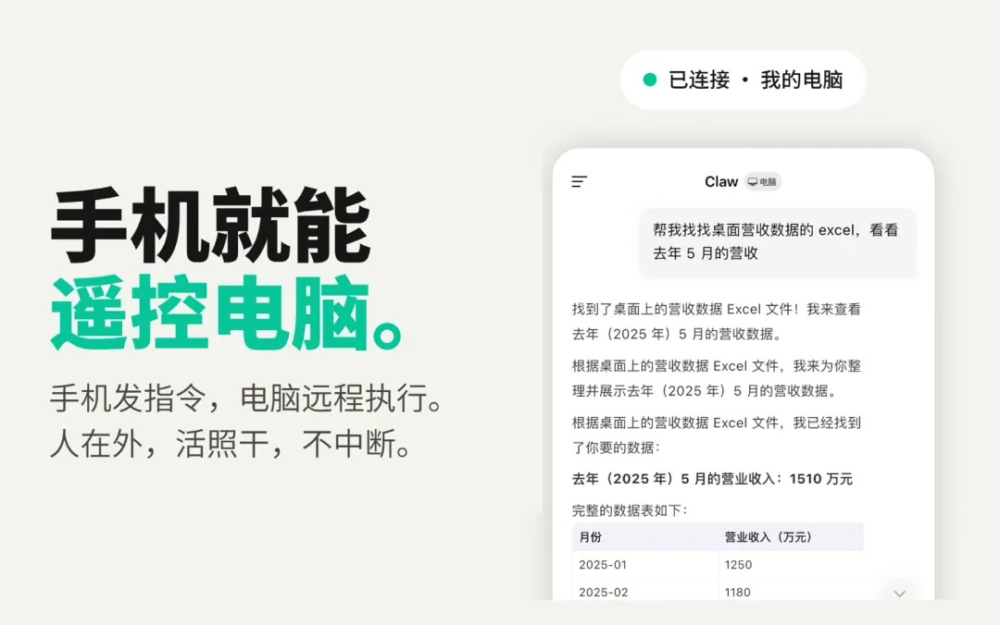
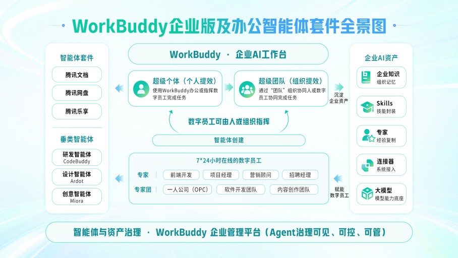
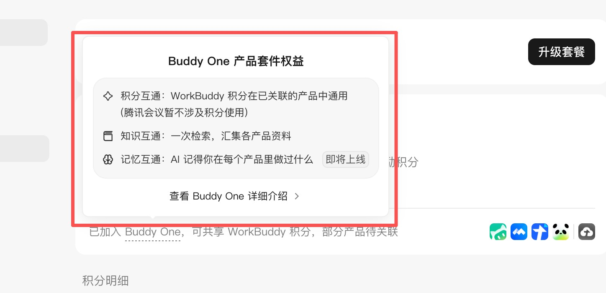
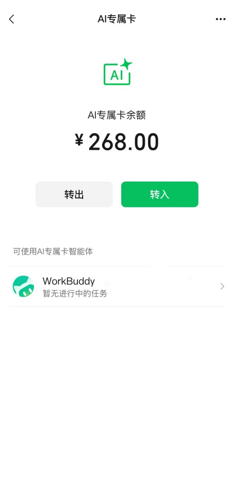
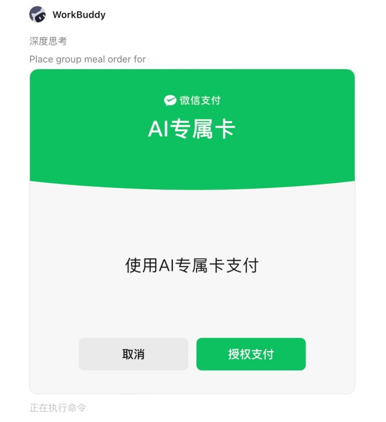

# 3分钟搞懂WorkBuddy

> ⭐入门 · 阅读时间 3分钟 · 更新于 2026-11-16
>
> WorkBuddy 是腾讯 3 月推出的桌面办公智能体，一句话派活，它自己读文件、拆步骤、交付文档和表格。半年多里它加了手机派活、企业版、开放平台和 AI 专属卡，正变成腾讯办公产品的总入口。本文讲清它能做什么、和同类的区别、用时注意什么。

## 一句话定义

**WorkBuddy** 是腾讯推出的**桌面办公智能体**：你在电脑上用一句话交代一件工作，它自己读你授权的文件、把任务拆成几步、调用工具一步步做完，最后交给你一份能直接用的 Word、Excel 或 PPT，而不是一段让你自己去照着做的建议。

举个例子，你把一个装着 12 个月销售流水的文件夹交给它，说「按季度汇总各区域销售额，做一页对比图表，再写一份 300 字的分析放进 PPT」。它大概会这样做：

```text
你的一句话
  ↓
拆任务: 读表格 → 清洗数据 → 按季度汇总 → 画图 → 写分析 → 排版 PPT
  ↓
动手做: 在你授权的文件夹里读文件、写代码算数、生成图表
  ↓
遇到删文件、跑脚本这类操作, 先停下来问你
  ↓
交付: 文件夹里多出一份 Excel 汇总表和一份 PPT
```

它是腾讯云 **CodeBuddy**（腾讯的 AI 编程工具）团队做的，3 月 9 日正式上线，支持 Windows 和 macOS。可以把它理解成把 AI 编程工具那套「自己规划、自己执行」的本事，搬到了写文档、做表格、整理文件这些普通办公任务上。


*图注：WorkBuddy 官网放出的桌面端界面。输入框下方的「选择工作空间」就是授权它读写的文件夹，「默认权限」对应后文讲的权限模式。顶部的「日常办公 / 代码开发 / 创意设计」三个模式，在 11 月的新版本里已经合并成统一的入口。*

这类产品现在通常叫**办公智能体**。它和你在 WPS、腾讯文档里点开的 AI 按钮不一样：那类 AI 只在一个文档里帮你写一段、改一段；WorkBuddy 站在所有软件外面，能同时碰好几个文件、好几个工具，把一整件事做完。



## 赶在「龙虾热」里提前一周上线

WorkBuddy 的起点很仓促。负责人汪晟杰接受采访时说，项目是 1 月 17 日一个周末启动的，三四个人通宵做出了第一个能用的版本。1 月 19 日开始在腾讯内部试用，2 月 6 日开放外部内测。

当时正赶上 **OpenClaw** 爆火。OpenClaw 是一个开源的个人 AI 助手，装在自己电脑上，能通过聊天软件远程指挥它干活，因为图标是一只龙虾，国内用户把用它叫作「养龙虾」。WorkBuddy 原定 3 月 16 日发布，看到这股热潮后提前了一周，3 月 9 日上线。同一天，腾讯电脑管家团队做的 **QClaw** 也开始内测。

两款产品出自同一家公司，路线却不一样：

- **QClaw** 直接基于 OpenClaw 开发，主打普通用户微信扫码就能用；
- **WorkBuddy** 说自己是完全自研的，没有用 OpenClaw 的源码，但兼容 OpenClaw 的技能。它强调的是「安全可控、企业能放心用」，关键操作要用户确认，也避开了 OpenClaw 那种可能把信息暴露在公网上的风险。

这一步决定了 WorkBuddy 后来的方向：先把个人用户吸引进来，再往企业卖。内部试用阶段，腾讯人力、行政、运营、销售等岗位有超过 1.2 万名员工在用它。

模型方面，国内版可以在混元、DeepSeek、GLM、Kimi、MiniMax 等模型之间切换，后来也支持接入自定义模型。腾讯自家的混元每出新模型，基本都会先在 WorkBuddy 上线，11 月 4 日发布的 Hy4 也是当天接入。腾讯在二季度披露，换上 Hy3 之后，WorkBuddy 的任务解决率从 72% 提升到了 90%，自己选模型的用户里有 60% 选了 Hy3。

## 人不在电脑前，怎么派活？

桌面智能体有一个天然的限制：它跑在你的电脑上，你得坐在电脑前才能给它派活。WorkBuddy 用了三步来解决这件事。

**第一步，用聊天软件派活。** 从上线起，WorkBuddy 就能连上微信、企业微信、QQ、飞书、钉钉。你在手机上给它发一句话，家里或公司的电脑接到任务后开始干，做完把结果发回聊天窗口。海外版还支持 Slack、Telegram、Discord。

**第二步，出独立的手机 App。** 7 月 18 日，WorkBuddy 的 iOS、安卓、鸿蒙版同时上线，有两种用法：

- **连接电脑**：手机只是遥控器，任务还是在你的电脑上跑，能用到桌面端的全部能力；
- **云端工作**：任务在腾讯的服务器上跑，电脑关着也能用，技能、专家、定时任务这些主要功能都有。


*图注：WorkBuddy App 发布时的官方宣传图，演示的是「连接电脑」模式：在手机上说一句「帮我找找桌面营收数据的 excel」，电脑上的 WorkBuddy 找到文件、读出数据，再把结果发回手机。*

**第三步，直接远程操作电脑。** 10 月 28 日上线的「远程控制」功能，可以在手机上实时看到电脑桌面，手指点哪里就相当于在电脑上点哪里。智能体卡住了、要你手动点一下确认，不用跑回电脑前。为了安全，同一时间只允许一部认证过的手机连接，画面走加密通道。

这三步加起来，WorkBuddy 就从「坐在电脑前用的软件」变成了「随时能派活的助手」。如果你需要它在你下班后继续跑，比如每天早上 8 点自动汇总前一天的数据，可以用它的**定时任务**，选云端模式就不用一直开着电脑。

## 从个人工具到企业的数字员工

6 月 5 日，腾讯云发布了 **WorkBuddy 企业版**，和个人版相比主要多了三样东西：

- **数字员工**：在云端 7×24 小时运行，能连上企业的知识库和业务系统，员工可以自己创建、发布给同事用；
- **项目**：人和多个智能体在同一个项目里协作，共用资料、技能和工具；
- **管理后台**：管理员可以管成员权限、看审计记录、统计每个人用了多少额度。


*图注：腾讯云 6 月 5 日发布会上的企业版全景图。中间的「专家」「专家团」就是数字员工，可以由个人指挥，也可以由团队一起指挥；最下面一层是管理后台，负责让管理员看得见、管得住这些智能体。*

企业版可以用腾讯的公有云，也可以部署在企业自己的专有网络或私有服务器上。价格方面，企业旗舰版每人每月 198 元，每人每月送 2000 积分，团队内共享；100 个席位起买的企业专享版每人每月 316 元；私有化部署需要单独询价。

同一天腾讯还发布了**办公智能体套件**，把腾讯文档、腾讯网盘、腾讯乐享（企业知识库）接进来。这为后面的 Buddy One 埋下了伏笔。

## 把别人的软件也装进 WorkBuddy

9 月和 10 月，WorkBuddy 做了两件事，让它的定位从「一个智能体」变成了「装智能体的工作台」。

**第一件是 9 月推出的开放平台。** 腾讯把 WorkBuddy 底层的能力开放给行业软件厂商、硬件厂商和独立开发者，开放的东西包括 Buddy 应用、专家、技能、连接器和硬件接入。其中最关键的是 **Buddy 应用**：一家做证券行情软件的公司，可以在 WorkBuddy 里做一个专属的「炒股助手」，带自己的首页、专家和数据，用户不用另外下载一个 AI 软件。首批合作方包括通达信、北大法宝、北森、帆软、微盟等。

这里有几个词需要解释一下：

- **技能（Skills）**：一套写好的做事方法，比如「按公司模板写周报」，智能体需要时自动调用；
- **专家**：预先配好角色、技能和工具的智能体，比如「财务分析专家」，可以多个专家组成专家团一起干活；
- **连接器**：让智能体能读写外部系统的接口，比如企业的 OA、CRM、邮箱，背后用的主要是 **MCP**（让 AI 连接外部工具的通用协议）。

**第二件是 10 月 29 日发布的 Buddy One。** 腾讯把腾讯文档、腾讯会议、ima（腾讯的 AI 知识库工具）和同天推出的腾讯网盘接进 WorkBuddy，几款产品共用一个账号和一个积分池。原来的 WorkBuddy 积分自动变成 Buddy One 积分，可以在腾讯文档、ima、腾讯网盘里通用，腾讯会议暂时不用积分。官方还说之后会让这些产品共享「记忆」，也就是你在一个产品里告诉过 AI 的偏好，换到另一个产品里它也知道，不过这项功能还没上线。


*图注：WorkBuddy 设置页里的 Buddy One 权益说明。三项权益里，积分互通和知识互通（一次检索、汇集各产品的资料）已经能用，记忆互通还标着「即将上线」。截图来自凤凰网科技的上手报道。*

这两件事放在一起看，WorkBuddy 的思路就很清楚了：它不想只做腾讯众多 AI 产品里的一个，而是想成为所有这些产品的**总入口**。11 月初的首页改版也印证了这一点，原来首页上「办公」「开发」「设计」三个分开的入口被去掉，换成了统一的任务栏。

对普通用户来说，这样做的好处是不用在五六个 App 之间来回切换；需要注意的是，你用得越深，资料、技能、积分都放在腾讯的体系里，以后想换别家的成本也会越高。

## 让 AI 帮你花钱：微信支付 AI 专属卡

智能体能帮你订餐厅、买团购，最后一步总要付钱。你肯定不想把整个微信钱包的支付权限都交给 AI，所以 6 月 17 日，微信支付推出了 **AI 专属卡**，WorkBuddy 是第一个接入的。

它的设计思路是「给 AI 一个零花钱钱包」：

- 专属卡在微信零钱里，和你的主账户是**隔开**的，AI 只能花卡里的钱；
- 卡里放多少钱你自己定，可以随时转进转出；
- 每一笔付款都要你在手机上**亲自确认**才会真正扣款。


*图注：微信支付 AI 专属卡页面。专属卡有自己单独的余额，和微信零钱主账户分开，下方列出了哪些智能体能用这张卡。*


*图注：WorkBuddy 准备付款时弹出的授权窗口。只有点了「授权支付」，再在手机上确认，钱才会从专属卡里扣出去。两张图均来自量子位的报道。*


刚上线时能做的事情很有限：只支持 Mac 版 WorkBuddy，只能通过 WorkBuddy 里的「美团生活助手」买到店团购，外卖不支持，也不是所有团购商品都能用。这件事真正的意义不在于现在能买什么，而在于它给「AI 替人付钱」划了一条安全线：钱包隔离加上每笔确认，就算 AI 理解错了，最多也只是在卡里的余额范围内出错。

## 它和 AI 办公助手、OpenClaw、海外同类有什么区别？

办公场景的 AI 产品现在很多，主要差别在三个地方：AI 在哪里干活、能碰多少东西、出了问题谁来兜底。

| | 代表产品 | 在哪里干活 | 能做什么 | 适合谁 |
| --- | --- | --- | --- | --- |
| 嵌在套件里的 AI 办公助手 | WPS AI、腾讯文档 AI、飞书 AI | 某一个文档或表格里 | 写一段、改一段、分析一张表 | 只想在现有软件里提效的人 |
| 桌面办公智能体 | **WorkBuddy**、豆包工作、千问办公 | 你的电脑上，或厂商的云端 | 跨多个文件和工具，把一整件事做完 | 普通上班族、企业团队 |
| 海外桌面智能体 | Claude Cowork | 你的电脑上 | 和 WorkBuddy 类似 | 能用海外服务、付费订阅 Claude 的人 |
| 开源自部署 | OpenClaw | 你自己的电脑或服务器 | 想怎么改就怎么改 | 懂技术、愿意自己折腾和负责安全的人 |

国内的三家办公智能体背后，是三家公司各自的办公生态：

- **WorkBuddy** 和微信、企业微信、腾讯文档、腾讯会议打通最深，模型可以选别家的；
- 字节的**豆包工作** 8 月 25 日正式上线，由豆包里的「工作任务」模式独立出来，和飞书配合得最顺；
- 阿里的**千问办公** 8 月 3 日开始公测，由 QoderWork、悟空等几款产品整合而来，和钉钉打通，更偏企业客户。

如果你的公司用飞书，豆包工作用起来会更顺手；用企业微信和腾讯文档，WorkBuddy 更合适；用钉钉，可以先试千问办公。

海外最接近的产品是 Anthropic 的 **Claude Cowork**，1 月先在 macOS 上推出，2 月支持 Windows，4 月结束测试，所有 Claude 付费订阅用户都能用，免费用户不能用。它和 WorkBuddy 都是「在你授权的文件夹里自己干活」的思路，不过 Claude Cowork 只能用 Claude 模型，在国内也无法直接使用。

热度方面，易观的统计显示，WorkBuddy 6 月的 PC 端访问量是 2097 万次，在国内同类产品里排第一，比第二、三名加起来还多。腾讯一季度财报也称，按日活跃账户数计算，WorkBuddy 是国内最受欢迎的效率类 AI 智能体。

## 怎么收费？

WorkBuddy 按**积分**收费，积分和腾讯的 CodeBuddy 共用，Buddy One 推出后也能在腾讯文档、ima、腾讯网盘里用。一个任务扣多少积分，取决于用的是哪个模型、消耗了多少 Token（模型处理文字的计量单位）和任务有多复杂，所以同样一句话，换个模型扣的积分可能差很多。

国内个人版有一个免费的体验档，付费档从 7 月 1 日起分成三档，按月购买分别是标准版每月 99 元、高级版 199 元、旗舰版 999 元，对应每月 2000、4000、20000 基础积分，连续包月和包年更便宜，活动期间还会加赠积分。海外版的 Pro 档是每月 10 美元（约合人民币 70 元）。企业版价格见上文。

需要注意的是，腾讯新模型刚上线时经常有限时免费，但也容易排队。Hy4 上线第一天就有大量用户碰到额度限制，腾讯随后对 WorkBuddy 做了十倍扩容。如果你遇到排队，可以先换一个模型。

## 用 WorkBuddy 时，需要注意哪些问题？

**别直接把重要文件夹交给它。** WorkBuddy 有两种权限模式：默认模式下，碰到敏感路径、删除重要文件、运行脚本时会先问你；完全访问模式会少问很多次，官方建议只在可以恢复的隔离环境里用。官方的建议是，处理重要资料前先新建一个文件夹，只把需要处理的文件**副本**放进去。权限确认能减少误操作，但代替不了备份。

**它交的东西一定要核对，尤其是数字。** 9 月有媒体让 WorkBuddy、豆包工作、千问办公处理同一份销售流水，三家算出的季度总额最高的比最低的多出 57.7%。智能体会自己写代码算数，但读表格时漏了一列、把退款当成收入，这类错误它不一定发现得了。报给领导、发给客户的东西，关键数字最好自己抽查几个，仔细检查一下。

**连得越多，越要小心「被骗」。** WorkBuddy 能读邮件、读网页、连企业系统，也就意味着有人可以在文档或网页里藏一段写给 AI 看的指令，骗它把资料发出去，这类攻击叫**提示词注入**。给它配连接器时只开当前任务需要的，涉及发消息、改数据、付钱的操作，保留人工确认这一步。

**本地模式要电脑开着。** 用手机派活给本地电脑时，电脑必须开机而且 WorkBuddy 在线。如果你希望下班后它还能继续干活，又不想开着电脑，要么用云端模式，要么在设置里打开「允许锁屏运行」。

**公司的资料能不能交给它，先问清楚。** 个人版的任务会调用云端的大模型，你给它看的文件内容会发到模型服务那里处理。涉及客户隐私、未公开财务数据的资料，最好先确认公司有没有相关规定，有条件的公司可以考虑企业版的私有部署。

## 时效性提醒

WorkBuddy 平均两三天就更新一个版本，下面这些信息最容易变：

- 套餐价格、积分规则和限时活动；
- 支持的模型列表，尤其是混元新模型的免费期；
- AI 专属卡支持的平台和能买的商品范围；
- Buddy One 里的「记忆共享」什么时候上线，后续会接入哪些产品。

动手之前，建议先看一眼 WorkBuddy 官网的更新日志和应用里的「订阅和用量」页面。

💬 **互动话题**：WorkBuddy 能在你下班后接着替你干活，也能用一张专属卡替你付钱。你最愿意先交给它哪件事？哪件事你觉得无论如何都要自己来做？

📖 **相关阅读**：

- [3分钟搞懂AI办公助手](../../06-applications/02-ai-office-assistant/README.md) - 嵌在 WPS、腾讯文档里的 AI，和 WorkBuddy 是两类产品
- [3分钟搞懂OpenClaw](../01-openclaw/README.md) - 开源自部署的「龙虾」，WorkBuddy 兼容它的技能
- [3分钟搞懂AI Agent](../../02-core-capabilities/05-ai-agent/README.md) - 智能体为什么能自己拆任务、自己动手
- [3分钟搞懂Computer Use](../../02-core-capabilities/07-computer-use/README.md) - AI 直接操作电脑界面的原理
- [3分钟搞懂Skills](../../09-agent-engineering/04-skills/README.md) - WorkBuddy 里的技能是什么
- [3分钟搞懂MCP](../../01-basics/08-mcp/README.md) - 连接器背后用的工具连接协议
- 3分钟搞懂混元 - WorkBuddy 默认首发接入的腾讯大模型
- 3分钟搞懂腾讯AI - WorkBuddy 在腾讯 AI 版图里的位置
- [3分钟搞懂Prompt注入攻击](../../04-advanced/13-prompt-injection/README.md) - 为什么连接器开得越多越要小心

**资料来源**：

- WorkBuddy 官网首页（文中桌面端界面图出处）：https://www.workbuddy.cn/
- WorkBuddy 官方文档，产品介绍（腾讯内部 1 月 19 日开始试用、超过 1.2 万名员工使用）：https://www.workbuddy.cn/docs/workbuddy/From-Beginner-to-Expert-Guide/Product-Guide
- WorkBuddy 官方文档，更新日志（9 月至 11 月版本、首页改版、定时任务、锁屏运行）：https://www.workbuddy.cn/docs/workbuddy/Changelog
- WorkBuddy 官方文档，权限模式（默认权限与完全访问）：https://www.workbuddy.ai/docs/workbuddy/From-Beginner-to-Expert-Guide/Function-Description/Permission-Modes
- 腾讯云文档，WorkBuddy 企业版计费（企业旗舰版、专享版价格与积分）：https://cloud.tencent.com/document/product/1831/134333
- ToolNavs，WorkBuddy 套餐和积分怎么选（按 2026-09-13 官方购买页整理的国内个人版价格）：https://toolnavs.com/zh/article/1989-workbuddy-mian-fei-ma-tao-can-he-ji-fen-zhe-yang-xuan-geng-sheng-qian
- WorkBuddy 海外版文档，订阅说明（Pro 每月 10 美元）：https://www.workbuddy.ai/docs/workbuddy/Subscription
- 界面新闻，腾讯 WorkBuddy 上线（3 月 9 日上线、CodeBuddy 团队、兼容 OpenClaw 技能、可切换模型）：https://www.jiemian.com/article/14087972.html
- 爱范儿，QClaw 与 WorkBuddy 的诞生（项目启动时间、原定发布日期、自研路线）：https://www.ifanr.com/1660138
- 香港新闻社，腾讯正式发布 WorkBuddy 智能体（海外版远程渠道、MCP、可接入任意模型）：https://www.hkong.cn/2026/0528/63570.shtml
- 量子位，腾讯云发布 WorkBuddy 企业版（2026-06-05，数字员工、项目、管理后台、交付方式，文中企业版全景图出处）：https://www.qbitai.com/2026/06/430758.html
- 量子位，微信支付发布 AI 专属卡 WorkBuddy 率先接入（2026-06-17，文中两张专属卡截图出处）：https://www.qbitai.com/2026/06/436160.html
- 新京报，微信支付 AI 专属卡实测（支持的商品范围）：https://www.bjnews.com.cn/detail/1781685392129872.html
- IT之家，腾讯 WorkBuddy App 正式发布（2026-07-18，连接电脑与云端工作两种模式，文中手机 App 宣传图出处）：https://www.ithome.com/0/978/468.htm
- 新华网，腾讯 AI 全线推进（2026-08-12，易观 6 月访问量、Hy3 任务解决率、二季度业绩会表述）：https://www.xinhuanet.com/tech/20260812/37804148ec2648639fc85fc1139d7ae6/c.html
- 第一财经 Yicai Global，Tencent Opens WorkBuddy Platform to More Than 100 Partners（开放平台）：https://www2.yicaiglobal.com/news/tencent-launches-workbuddy-open-platform-with-access-to-underlying-agent-capabilities
- AIbase，WorkBuddy 上线远程控制功能（2026-10-28）：https://www.aibase.com/zh/news/31926
- 凤凰网科技，腾讯发布 Buddy One（2026-10-29，积分互通、记忆共享未上线，文中 Buddy One 权益截图出处）：https://tech.ifeng.com/c/8xcIZbYeWgz
- 凤凰网科技，腾讯推出跨应用 AI 协同体系 Buddy One：https://tech.ifeng.com/c/8xcDyuHJjcb
- 量子位，腾讯 Hy4 调用激增已十倍扩容（2026-11）：https://www.qbitai.com/2026/11/507967.html
- 财联社，豆包工作发布上线（2026-08-25）：https://www.cls.cn/detail/2463325
- 投资界转载雷峰网，三款办公 Agent 处理同一份销售流水的实测（2026-09，季度总额相差 57.7%）：https://news.pedaily.cn/202609/569263.shtml
- 每日经济新闻，阿里千问办公开启公测（2026-08-03）：https://www.mrjjxw.com/articles/2026-08-03/4530556.html
- The Decoder，Anthropic brings its AI agent software Claude Cowork to Windows：https://the-decoder.com/anthropic-brings-its-ai-agent-software-claude-cowork-to-windows/
- eWeek，Anthropic Opens Claude Cowork to All Paid Plans on macOS, Windows（2026-04）：https://www.eweek.com/news/claude-cowork-general-availability-enterprise-controls/

---

⬅️ 上一篇：[3分钟搞懂OpenClaw](../01-openclaw/README.md) ｜ [📚 返回目录](../README.md) ｜ 下一篇：[3分钟搞懂Hermes Agent](../03-hermes-agent/README.md) ➡️
