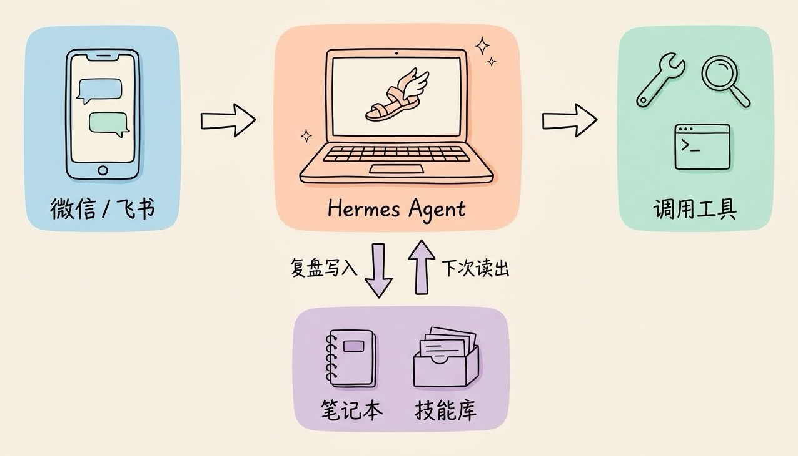
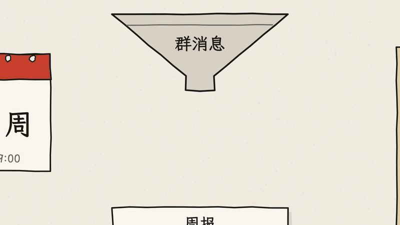
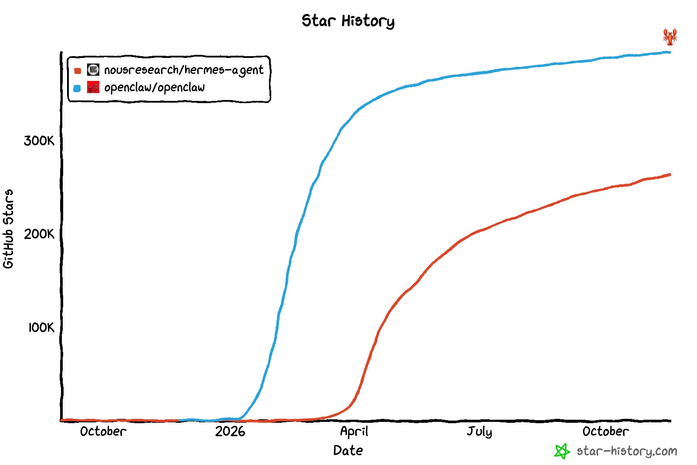
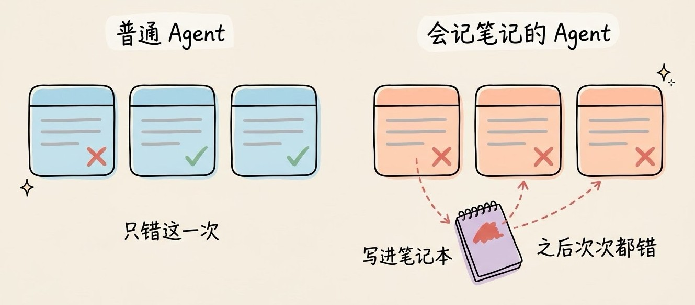

# 3分钟搞懂Hermes Agent

> ⭐⭐中级 · 阅读时间 3分钟 · 更新于 2026-11-16
>
> Hermes Agent 是 Nous Research 开源的个人智能体，主打越用越聪明。其实模型没变，变的是它自己记的小笔记和自己写的技能文档。本文讲清这套学习循环、和 OpenClaw 的区别、国内怎么用，以及自己写技能的风险。

## 一句话定义

**Hermes Agent** 是 AI 实验室 Nous Research 开源的**个人智能体**：你把它装在自己的电脑或一台云服务器上，通过微信、飞书、Telegram 或命令行给它派活，它会调用工具把事情做完。和同类相比，它多做了一件事：每做完一件有点复杂的事，它会回头总结经验，写成一份**技能文档**存下来，下次遇到类似的任务直接照着做。

它在 2026 年 2 月以 MIT 协议开源，代码、技能和记忆都在你自己手里，模型可以自己选。截至目前，它在 GitHub 上有 26 万多个星标，是继 OpenClaw 之后最受关注的开源个人智能体。

举个例子，你在飞书里跟它说「每周一早上 9 点，把上周的工作群消息整理成周报发给我」。第一次它可能要摸索：消息从哪里读、周报按什么格式写、哪些闲聊要过滤掉，中间你还纠正了它一次「别把表情包和接龙算进去」。做完以后，它会把这套流程连同你的纠正写进一份技能文档，第二周再跑这个定时任务时，就不用再走一遍弯路。



## 「越用越聪明」，到底是哪里变聪明了？

很多介绍会说 Hermes Agent 能「自我进化」，听起来像模型自己在训练自己。需要注意的是，**它背后的大模型一点都没变**，模型的参数不会因为你用得多而更新。变的是模型每次开工前能看到的东西，一共有三样：

| | 存在哪里 | 放什么 | 怎么用 |
| --- | --- | --- | --- |
| **笔记本** | `MEMORY.md`，约 2200 个字符 | 环境信息、项目约定、踩过的坑 | 每次开新会话时整份塞进提示词 |
| **用户档案** | `USER.md`，约 1375 个字符 | 你是谁、喜欢怎么沟通、讨厌什么 | 同上 |
| **技能库** | `~/.hermes/skills/` 下的一堆 `SKILL.md` | 某类任务的做法、坑和检查步骤 | 平时只看目录，用到时才打开全文 |
| **历史会话** | 本地 SQLite 数据库 | 你和它说过的所有话 | 需要时按关键词全文搜索 |

所以更准确的说法是：Hermes Agent **越用越会记笔记**。你可以把它想成一个新来的同事，他的脑子没有变好，但他有一本随身的小本子，记着你的习惯；还有一个文件夹，放着他自己整理的各种操作手册。时间一长，他做你交代的事自然越来越顺。

这也意味着，换一个更强的模型，Hermes Agent 会立刻变强；而它攒下的笔记和技能，换了模型也还能继续用。

## 做完一件事，它会多做哪一步？

普通的 Agent 做完任务就结束了。Hermes Agent 在每轮对话结束后，会在后台做一次**复盘**，判断这次有没有值得留下来的东西：

```text
你派活
  ↓
它调用工具干活 (读文件、跑命令、搜网页……)
  ↓
交付结果
  ↓
后台复盘: 这次有没有值得记下来的?
  ├─ 学到了你的偏好 → 写进 USER.md
  ├─ 发现了环境里的坑 → 写进 MEMORY.md
  └─ 走通了一套多步骤流程 → 新建或修改一份 SKILL.md
  ↓
下次开工时, 这些内容会自动出现在它眼前
```



官方文档写明了三种值得写成技能的情况：一套值得重复使用的多步骤流程；中间出过错、绕过弯路，最后才找到能走通的办法；用户纠正过它的做法。文档还特别强调，技能要记「经验」，不要记「日志」，也就是写「下次该怎么做」，而不是「那天发生了什么」。

一份技能文档大概长这样（示意，内容是虚构的）：

```markdown
---
name: weekly-report-from-feishu
description: 把飞书工作群上周的消息整理成周报
version: 3
---

## When to Use
用户要求整理周报、汇总群消息时

## Procedure
1. 读取上周一 00:00 到周日 24:00 的群消息
2. 过滤表情包、接龙和"收到"这类回复
3. 按"已完成 / 进行中 / 风险"三栏归类

## Pitfalls
- 用户明确说过: 接龙消息不算工作内容
```

技能文档用的是 Agent Skills 开放标准，和 Claude Code、OpenClaw 用的是同一种格式。这意味着别人写的技能你可以直接装进来，Hermes Agent 自己总结的技能也能拿到其他 Agent 里用。

已有的技能，它也会在使用中修改。比如周报技能第一次没考虑到节假日，第二次你提醒了，它会只改动文档里相关的那一段，把版本号往上加。

## 为什么笔记本只有 2200 个字符？

2200 个字符大约是一千多个汉字，看起来少得有点吝啬。这是有意为之的设计。

笔记本和用户档案每次开会话都会**整份放进提示词**，放得越多，每次对话越费钱，模型的注意力也越分散。所以 Hermes Agent 给它们设了上限：写满了，新内容就写不进去，它必须自己先把旧条目合并或者删掉。这相当于逼着它定期整理笔记本，只留下最有用的东西。

那些不需要每次都看的内容，就交给另外两个地方：技能平时只把名字和一句话简介放进提示词，真正用到时才打开全文；历史会话全部存在本地数据库里，需要时再去搜索。经常要用的放在手边，偶尔用的放进柜子，这也是现在很多 Agent 在管理上下文时的共同思路。

如果你希望它记得更多，还可以接入 Honcho 这类外部记忆服务，让它建立更完整的用户画像，不过这一步需要你自己配置。

## 它和 OpenClaw 有什么不一样？

**OpenClaw** 是今年年初爆火的开源个人智能体，国内常叫它「龙虾」。它的作者 Peter Steinberger 在 2 月加入了 OpenAI，项目转交给独立的基金会维护。两者的定位非常接近，都是装在自己机器上、从聊天软件里派活的智能体，差别主要在下面几个地方：

| | OpenClaw | Hermes Agent |
| --- | --- | --- |
| 背后是谁 | 个人项目起家，现由基金会维护 | AI 实验室 Nous Research |
| 技能从哪来 | 主要从技能市场安装；你开口要求时，AI 也能帮你写 | 能从技能市场安装；它还会在后台主动复盘，自己新建和修改技能 |
| 记忆怎么管 | 记忆文件由你和 AI 一起维护 | 笔记本有字数上限，逼它自己整理；历史会话另存、可搜索 |
| 生态规模 | 更大，GitHub 星标约 39 万 | 较小，约 26 万，但增长很快 |
| 从对方迁移 | — | 首次安装时可以导入 OpenClaw 的配置，也能从 ClawHub 安装技能 |


*图注：star-history.com 根据 GitHub 数据生成的星标历史，蓝线是 OpenClaw，红线是 Hermes Agent。从曲线看，OpenClaw 的热度集中在年初；Hermes Agent 2 月开源，4 月前后才真正火起来，7 月以后每个月新增的星标比 OpenClaw 还多。截至写这篇时，两者分别约 39 万和 26 万。*

差别最大的是第二行。OpenClaw 也能写技能，但通常要你明确告诉它来做这件事才行；Hermes Agent 把「做完回头总结」做成了默认流程，不用你提醒，它自己就会判断哪些经验值得留下来。

如果你已经在用 OpenClaw，并且对现有技能很满意，没必要急着换。如果你发现自己经常在不同对话里重复交代同样的要求，Hermes Agent 的学习循环会更适合你。

## Nous Research 为什么要做它？

**Nous Research** 成立于 2023 年，原来以开源模型出名。它的 **Hermes 系列模型**，是在 Meta 的 Llama 等开源模型基础上微调出来的，在开源社区很有名气。Hermes Agent 借用了这个名字，但它**不绑定 Hermes 模型**，接 OpenAI、Claude，还是国内的模型都可以。

Hermes Agent 让这家公司的重心从「做模型」转向了「做智能体」。10 月 7 日，Nous Research 宣布完成 9000 万美元融资，投资方包括英伟达、微软旗下的 M12、三星等；《华尔街日报》报道的估值是 15 亿美元，公司自己没有公布估值。同一份报道称，Hermes Agent 自 2 月以来的下载量超过 2200 万次。Nous Research 自己估算，Hermes Agent 带来的模型调用量约占全球 Token 用量的 2.5%，这个数字目前没有第三方核实。

这笔钱主要用来做企业版 **Hermes for Businesses**：企业可以按价格和效果自己挑模型，数据和公司知识留在自己手里。截至目前，企业版还没有公布上线时间和价格。

开源版本身免费，钱主要从 **Nous Portal** 赚。这是 Nous Research 的模型和托管平台，免费档只能用免费模型；付费档每月 20 美元、100 美元、200 美元三种，包含 200 多个模型的调用、网页搜索和画图等托管工具，还送一个云端托管的 Agent。如果你自己有模型的 API Key，也可以完全不用 Nous Portal。

## 在国内怎么用？

Hermes Agent 在国内用起来门槛并不高，主要有三条路：

**自己部署。** 在 Mac、Linux 或 Windows 的 WSL2 里，一条安装命令就能装好；现在也有了 macOS 和 Windows 的桌面应用。它的消息网关官方支持 20 多个平台，国内常用的**微信、飞书、钉钉、企业微信、QQ** 都在里面，所以你可以直接在微信里给它派活。模型方面，它支持任何兼容 OpenAI 格式的接口，DeepSeek、千问、智谱、Kimi、MiniMax 这些国内模型的 API 都能接，在国内就能直接使用。

**用云厂商的一键部署。** 腾讯云轻量应用服务器上架了 Hermes Agent 的一键部署镜像，适合不想让自己电脑一直开着的人。

**用托管版。** MiniMax 在 4 月推出了云端托管的 **MaxHermes**，是和 Nous Research 合作做的，不用自己准备服务器，可以直接接入飞书、钉钉、企业微信，底层用 MiniMax 自家的模型。不过它需要订阅 MiniMax 的付费套餐。

如果你只是想先试一试，建议用托管版或云服务器，别一上来就装在存着重要资料的主力电脑上，原因下一节会讲。

## 用 Hermes Agent 时，需要注意哪些问题？

**它自己写的技能，也可能把错误固定下来。** 学习循环的另一面是：如果某次它总结错了，比如把一次偶然成功的做法当成了标准流程，这个错误会被写进技能文档，以后每次都照着错。默认情况下，它写笔记、写技能都不需要你确认。如果你很在意，可以在配置里打开 `memory.write_approval` 和 `skills.write_approval`，让它每次修改前先交给你审核；重要的技能也可以锁定，不让它再改。

**记忆可能被「投毒」。** Hermes Agent 会读网页、读邮件、读群消息，有人可以在这些内容里藏一段写给 AI 看的指令，诱导它把错误的信息写进笔记本或技能里，这类攻击叫**提示词注入**。普通 Agent 被骗一次，影响通常只有这一次对话；会记笔记的 Agent 被骗以后，影响可能延续到之后的每一次对话。官方给记忆写入加了扫描，会拦截可疑的指令和隐藏字符，但扫描只能降低风险。



**扫描器本身也出过漏洞。** 它的技能安全扫描模块曾被披露过一个高危漏洞（CVE-2026-9353，评分 7.3），已在后续版本中修复。官方的安全建议是：别把程序内部的检查当成唯一防线，真正可靠的是隔离。所以最好让它跑在 Docker 容器或单独的云服务器里，只给它当前任务需要的权限。

**更新很快，升级前先看说明。** Hermes Agent 几乎每天都会发测试版，正式版也经常带不兼容的改动。比如 11 月的 v0.23 版删掉了旧的浏览器工具，之前写着这个工具名的提示词都要改；10 月还出过一个用错代码打包的版本。如果你用它跑定时任务这类重要的事，升级前一定要看一下更新说明。

**一些便利功能绑在 Nous 的服务上。** 免费试用的模型、托管的连接器和插件目录，都要经过 Nous 的服务器或审核。如果你希望完全自己掌控，可以在配置里关掉这些功能，全部换成自己的模型和工具。

## 时效性提醒

Hermes Agent 的版本更新非常频繁，下面这些信息最容易变：

- 版本号、支持的消息平台和执行环境；
- Nous Portal 的套餐价格和免费模型；
- Hermes for Businesses 的上线时间和价格；
- 记忆和技能相关的默认设置，比如后台复盘、自动清理会话这类功能，之前就出现过默认打开又改回默认关闭的情况。

动手之前，建议先看一眼 GitHub 上的 Releases 页面和官方文档。

💬 **互动话题**：如果你的 Agent 会自己总结经验、自己改操作手册，你会让它自动改，还是每次改之前都要先给你看一眼？哪类任务你最放心交给它自己去「学」？

📖 **相关阅读**：

- [3分钟搞懂OpenClaw](../01-openclaw/README.md) - Hermes Agent 最直接的对手，开源个人智能体的起点
- [3分钟搞懂WorkBuddy](../02-workbuddy/README.md) - 大厂做的桌面办公智能体，可以和自部署的 Hermes Agent 对照着看
- [3分钟搞懂Skills](../../09-agent-engineering/04-skills/README.md) - Hermes Agent 自己写的技能文档，用的就是这套格式
- [3分钟搞懂Agent记忆系统](../../09-agent-engineering/06-agent-memory/README.md) - 笔记本、用户档案、历史会话分别解决什么问题
- [3分钟搞懂上下文工程](../../09-agent-engineering/03-context-engineering/README.md) - 为什么笔记本要设上限、技能要按需加载
- [3分钟搞懂Agent沙箱与权限](../../09-agent-engineering/08-sandbox-and-permissions/README.md) - 为什么建议把它放进容器里跑
- [3分钟搞懂Prompt注入攻击](../../04-advanced/13-prompt-injection/README.md) - 会记笔记的 Agent 为什么更怕被注入
- 3分钟搞懂MiniMax模型 - 托管版 MaxHermes 背后的模型

**资料来源**：

- Hermes Agent GitHub 仓库（MIT 协议、功能介绍、执行环境、星标数）：https://github.com/NousResearch/hermes-agent
- Hermes Agent GitHub Releases（v0.23.0 至 v0.23.2 及测试版发布记录）：https://github.com/NousResearch/hermes-agent/releases
- Hermes Agent 官网（功能、桌面应用、Nous Portal 套餐价格）：https://hermes-agent.nousresearch.com/
- Hermes Agent 官方文档，首页（支持的消息平台列表）：https://hermes-agent.nousresearch.com/docs/
- Hermes Agent 官方文档，Memory（MEMORY.md 与 USER.md 字符上限、后台复盘、写入审核、记忆扫描）：https://hermes-agent.nousresearch.com/docs/user-guide/features/memory
- Hermes Agent 官方文档，Skills（技能格式、创建技能的三种情况、按需加载、技能来源与安全扫描）：https://hermes-agent.nousresearch.com/docs/user-guide/features/skills
- The Next Web，Nous Research raises $90M to take its Hermes AI agent to businesses（2026-10-07，转引《华尔街日报》的估值和下载量、投资方、Hermes for Businesses、公司自估的 Token 占比）：https://thenextweb.com/news/nous-research-90m-1-5bn-hermes-agent-wsj
- Hermes Atlas，The State of Hermes Agent — November 2026（社区项目，与 Nous Research 无关；版本事故、默认设置变更、对 Nous 服务的依赖）：https://hermesatlas.com/reports/state-of-hermes-november-2026
- 爱范儿，卸载龙虾后，我找到了更香的爱马仕 Agent（2026-04-16，国内消息平台配置、腾讯云一键部署、MaxHermes 订阅要求）：https://www.ifanr.com/1662529
- 品玩，MiniMax 发布 MaxHermes（2026-04）：https://www.pingwest.com/w/312990
- GitLab Advisory Database，CVE-2026-9353（技能扫描模块注入漏洞，CVSS 7.3）：https://advisories.gitlab.com/pypi/hermes-agent/CVE-2026-9353/
- Fortune，OpenClaw 创始人 Peter Steinberger 加入 OpenAI（2026-02-19）：https://fortune.com/2026/02/19/openclaw-who-is-peter-steinberger-openai-sam-altman-anthropic-moltbook
- OpenClaw GitHub 仓库（星标数）：https://github.com/openclaw/openclaw
- star-history.com，Hermes Agent 与 OpenClaw 星标历史（文中星标曲线图出处）：https://www.star-history.com/#NousResearch/hermes-agent&openclaw/openclaw&Date

---

⬅️ 上一篇：[3分钟搞懂WorkBuddy](../02-workbuddy/README.md) ｜ [📚 返回目录](../README.md) ｜ 下一篇：[3分钟搞懂个人智能体](../04-personal-agent/README.md) ➡️
