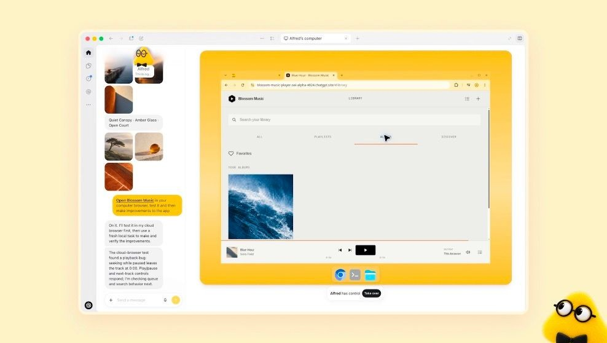
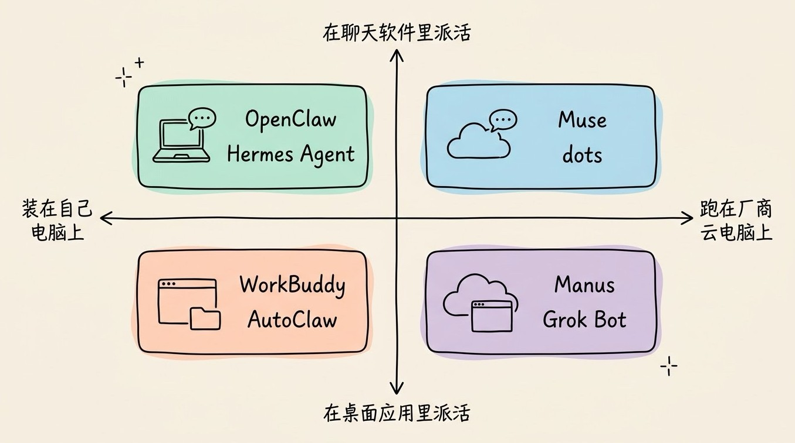
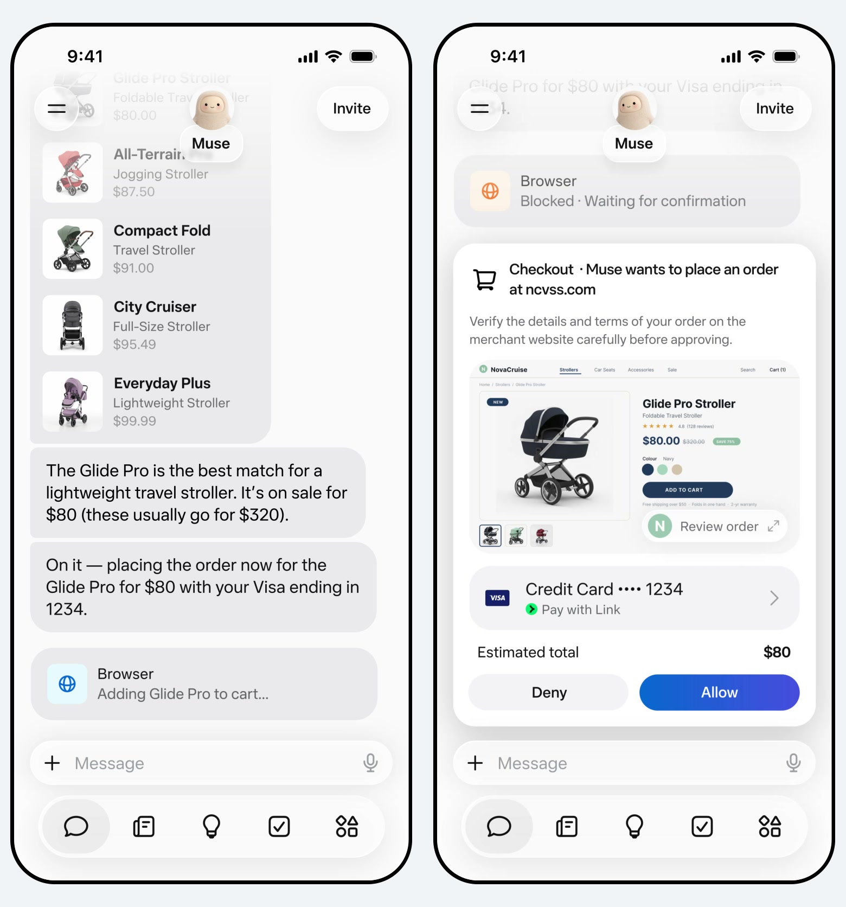

# 3分钟搞懂个人智能体

> ⭐⭐中级 · 阅读时间 3分钟 · 更新于 2026-11-17
>
> 个人智能体是一直在线、有自己的电脑、记得你习惯的 AI 助理。今年先是开源的 OpenClaw 火了，9 月起 Meta、OpenAI 等大厂也推出了托管版。本文讲清它和普通 Agent 的区别，按装在哪、在哪派活两个问题分类，以及国内怎么选。

## 一句话定义

**个人智能体**是一种长期为你一个人工作的 AI 助理：它一直在线，有一台自己干活用的电脑，记得你的习惯；你在聊天软件或桌面应用里交代一件事，它会自己调用工具把事情办完，中途需要你拍板时再回来找你。

举个例子，你周五晚上在微信里跟它说「下周三之前把这个月的报销整理好，缺发票的列出来提醒我」。你关掉手机去睡觉，它还在继续干：翻邮箱找电子发票、对照行程算金额、填好报销表。周一早上，它给你发来一条消息：「还差两张打车发票，要我去打车软件里补开吗？」

## 它和普通 Agent 有什么不一样？

**AI Agent** 是能自己拆任务、调用工具、根据执行结果再进行调整的 AI，个人智能体也是 Agent 的一种。区别在于，大多数 Agent 是「一次性」的：你打开 ChatGPT 的 Agent 模式或者深度研究，交代一件事，它做完就结束了，下次再用，还要从头跟它交代。

打个比方，普通 Agent 像你临时请来帮忙的人，每次都要重新说明情况，活干完人就走了；个人智能体更像一个长期跟着你的助理，有自己的工位，知道你的习惯，事情办到一半还会主动给你发消息。

具体来说，个人智能体多了下面这几样东西：

| | 聊天助手 | 一次性 Agent | 个人智能体 |
| --- | --- | --- | --- |
| 一件事做完以后 | 回答完就结束 | 任务结束，环境收回 | 继续在线，等你的下一件事，或者自己找事做 |
| 在哪里干活 | 只在对话框里回答 | 临时开一个环境，做完就收回 | 有一台长期属于它的电脑，文件和登录状态都留着 |
| 记不记得你 | 有的会记一点偏好 | 基本不记 | 记得你的习惯和之前做过的事 |
| 谁先开口 | 你问它才答 | 你派活它才动 | 定时任务到点了，或者发现有事要处理，会主动找你 |

表里的第二行最关键。现在几乎所有的个人智能体，都会给每个 Agent 配一台专属的**云电脑**，也就是厂商在机房里给你分配的一台虚拟电脑。有了这台电脑，它才能在你关机以后继续工作，也能把登录好的网站、下载的文件留到下一次接着用。开源的 OpenClaw 和 Hermes Agent 没有厂商的云电脑，就由你自己的电脑或服务器来扮演这个角色。

*图注：OpenAI 发布 dots 时的官方演示图。窗口标签写着「Alfred's computer」，也就是这个 dot 自己的云电脑；你可以随时打开看它在做什么，底部的「Take over」按钮可以让你接管。*

## 个人智能体是怎么火起来的？

个人智能体这个说法早就有了，真正变成大家都在讨论的产品，是 2026 年的事。

年初先火的是开源项目 **OpenClaw**，国内叫它「龙虾」。它装在你自己的电脑上，你在微信、飞书里给它派活。很多人第一次发现，AI 可以不待在网页里，而是一直在后台替自己干活。随后腾讯、百度、阿里、字节等大厂都推出了一键部署版或云端托管版，「养龙虾」成了上半年的热词。2 月开源的 **Hermes Agent** 在此基础上又加了自己总结经验的能力，4 月前后也火了起来。

下半年，海外大厂开始推出自己的版本：xAI 的 **Grok Bot** 在 8 月开放测试，Meta 的 **Muse** 在 9 月 8 日上线，OpenAI 在 9 月 29 日的开发者大会上发布了 **dots**。和 OpenClaw 不同，这几款都不用你自己装，每个 Agent 都跑在厂商提供的云电脑上，打开应用就能用。

所以，现在市面上的个人智能体，大致可以按两个问题来分：**装在哪里**，以及**在哪里派活**。

## 第一个问题：装在自己机器上，还是交给厂商托管？

| | 自己部署 | 厂商托管 |
| --- | --- | --- |
| 代表产品 | OpenClaw、Hermes Agent | 海外：dots、Muse、Grok Bot、Manus；国内：Kimi Claw、MaxClaw、ArkClaw 等 |
| 它在哪台电脑上干活 | 你自己的电脑，或你租的云服务器 | 厂商给你分配的云电脑 |
| 门槛 | 要会一点命令行，或者用一键安装版 | 注册账号就能用 |
| 模型 | 想接哪家就接哪家，国内模型也行 | 基本用厂商自家的模型 |
| 出了安全问题谁负责 | 你自己 | 厂商负责一部分，但数据也放在厂商那里 |
| 花费 | 软件免费，模型调用和服务器另算 | 订阅费，大多数要付费才能用全功能 |

这两条路中间，还有一条折中的路：腾讯的 QClaw、智谱的 AutoClaw 这类一键安装版，装在你自己的电脑上，但不用碰命令行；云厂商也提供了 OpenClaw、Hermes Agent 的一键部署服务器。

需要注意的是，**装在自己电脑上，不等于数据完全不出门**。自部署的智能体还是要调用大模型的接口，你让它处理的文件内容，照样会发到模型厂商的服务器上。自部署真正带来的好处，是你自己能决定用哪家的模型、它能碰哪些文件、哪些数据留在本地。

如果你看重的是省心，托管版更合适；如果你很在意能不能自己掌控，或者想用国内的模型，自己部署更合适。

## 第二个问题：在聊天软件里派活，还是在桌面应用里派活？

另一个区别，是你通过什么地方跟它说话。

**聊天软件型**的智能体就像你通讯录里的一个联系人。OpenClaw、Hermes Agent 可以接进微信、飞书、钉钉，Muse 可以直接在 WhatsApp 里聊，dots 除了 ChatGPT 应用，还能在 Slack、Teams 这类办公聊天软件里用。这种方式最适合随手派一些小事，比如「明早提醒我交房租」「帮我盯一下这个快递」，派完就去忙别的，等它回消息就行。

**桌面应用型**的智能体有自己的工作界面，能直接打开你授权的文件夹，你也能看到它一步步在做什么。腾讯的 WorkBuddy、Manus 的桌面应用都属于这一类。如果你要它处理一堆文档、做一份表格，或者你想在它做到一半时插手改方向，桌面应用会更方便。

不过，这两类产品正在互相靠拢。WorkBuddy 加了手机派活，人不在电脑前也能交代任务；Anthropic 的 Claude Cowork 原本是桌面应用，后来支持了网页和手机，现在已经和 Claude 的聊天功能合并成了一个产品。所以真正选的时候，不用太纠结它属于哪一类，看两件事就够了：**你的文件放在哪里，你平时习惯在哪里派活**。

## 海外三家大厂，分别做成了什么样？

dots、Muse、Grok Bot 都是给每个 Agent 配一台云电脑，但定位差别不小：

| | OpenAI dots | Meta Muse | Grok Bot |
| --- | --- | --- | --- |
| 偏向 | 工作 | 日常生活 | 工作，能直接操作各种软件 |
| 在哪里派活 | ChatGPT 的电脑版、网页版和手机版，以及 Slack、Teams | Muse 应用、WhatsApp | Mac、Windows、Linux、iPhone 应用 |
| 典型任务 | 排查 Slack 里反馈的 Bug、准备发票等你批准后再发 | 订餐厅、发邮件、网上购物 | 登录你的账号，在没有接口的网站和软件里操作 |
| 谁能用 | ChatGPT Pro 和 Business Premium 订阅用户，每人先送一个 | 美国 18 岁以上用户，有免费档 | SuperGrok Heavy 或 Cursor 的高价套餐用户 |

**dots** 最大的特点是会主动找事做：你没派活的时候，它会自己看看有什么能帮上忙的，不过这段时间它对你的应用只有只读权限。企业还可以给某个 dot 一个固定的岗位，比如专门负责采购或者处理发票。

**Muse** 面向的是普通人的日常生活，大部分功能免费，用得多的人再订阅。它在设计上把干活的 Agent 和保管密码的模块分开，付款时用的是一次性的虚拟卡，买东西、分享敏感信息之前都要先问你。

*图注：截自 Meta 发布 Muse 时的官方演示视频。Muse 挑好商品、准备下单时，浏览器显示「已暂停，等待确认」，要你核对订单后点「Allow」才会真正付款。*

**Grok Bot** 的思路是像人一样登录你的各种账号，直接在界面上操作，所以那些没有开放接口的软件它也能用。它的门槛最高，个人用户要订阅每月 200 美元的 Cursor Ultra，或者每月 300 美元（约合人民币 2100 元）的 SuperGrok Heavy。

另外，由中国团队创立的 **Manus** 也在做同样的事。它的收购案经历了一番波折：2025 年 12 月 Meta 宣布收购，2026 年 4 月被中国国家发改委叫停，9 月 1 日 Manus 宣布恢复独立运营，9 月 28 日发布了带云电脑和自动化任务的 Manus 2.0。

这几款产品在国内都无法直接使用。Manus 早在 2025 年就搁置了中国大陆的服务，截至目前还没有恢复。

## 在国内，现在可以怎么选？

国内暂时还没有大厂推出 dots、Muse 这样的原生个人智能体。据字母榜 9 月底报道，腾讯元宝正在做一款跑在专属云电脑上的个人智能体，不过产品形态和上线时间都还没确定。

在此之前，可以按你的需求和愿意折腾的程度来选：

- **只想在微信里有个随叫随到的助手，不想折腾**：选云端托管版。月之暗面的 Kimi Claw、MiniMax 的 MaxClaw、火山引擎的 ArkClaw 都是基于 OpenClaw 做的；腾讯轻量云的 LightVela 托管的是 Hermes Agent，能接微信、QQ、飞书和企业微信。
- **主要用来处理办公文件**：选桌面办公智能体。腾讯的 WorkBuddy、字节的豆包工作、阿里的千问办公，分别和企业微信、飞书、钉钉打通得最好，看你公司用哪一套。
- **懂技术，想自己完全掌控**：自己部署 OpenClaw 或 Hermes Agent，模型接 DeepSeek、千问、Kimi、智谱这些国内模型的接口，在国内就能直接使用。

## 用个人智能体时，需要注意哪些问题？

**给的权限越多，出事的代价越大。** 个人智能体有用，是因为它能登录你的邮箱、日历、聊天软件，甚至替你付钱；但一旦它理解错了，或者被人骗了，这些权限也会变成风险。刚开始用时，建议先给只读权限，让它从查资料、整理信息这类低风险的事做起，确认它靠谱以后，再慢慢放开。

**藏在内容里的指令，目前还防不住。** 个人智能体会读网页、邮件和群消息，有人可以在这些内容里藏一段写给 AI 看的指令，诱导它做你没让它做的事，这类攻击叫**提示词注入**。Meta 在介绍 Muse 时也承认，提示词注入问题「仍未解决」。所以涉及付款、发消息给别人、删除文件的操作，一定要设置成先经过你确认。

**托管版的数据放在厂商那里。** 以 Muse 为例，Meta 表示在运营和保障服务需要时可以访问你的数据，去掉个人信息后的交互记录默认会用于训练模型，除非你主动关闭。用托管版之前，建议先看一下它的隐私设置，尤其是你打算让它处理工作资料时。

**一直在线，也意味着一直在花钱。** Agent 在后台每多干一步，都在消耗算力。海外几家要么只对高价订阅用户开放，要么第一个月不计用量、之后的计费方式还没公布；国内的托管版也大多按会员或积分收费。如果你让它跑很多定时任务，最好隔一段时间看一下用量。

## 时效性提醒

个人智能体是 2026 年变化最快的一类 AI 产品，下面这些信息最容易变：

- dots、Muse、Grok Bot 的开放范围和价格，三家都还在逐步扩大用户群；
- 元宝等国内大厂的个人智能体什么时候上线、长什么样；
- 国内各家托管版的名字、价格和支持的聊天软件，调整得很频繁；
- Manus 能不能重新在中国大陆提供服务。

动手之前，建议先看一下各家官网上的最新说明。

💬 **互动话题**：如果你有一个一直在线的个人智能体，你最想先交给它哪件事？哪些权限你说什么都不会给它，比如付款、替你回复消息，还是读你的聊天记录？

📖 **相关阅读**：

- [3分钟搞懂OpenClaw](../01-openclaw/README.md) - 开源个人智能体的起点，国内各种「龙虾」都是基于它做的
- [3分钟搞懂Hermes Agent](../03-hermes-agent/README.md) - 会自己总结经验的开源个人智能体
- [3分钟搞懂WorkBuddy](../02-workbuddy/README.md) - 腾讯的桌面办公智能体，桌面应用型的代表
- [3分钟搞懂AI Agent](../../02-core-capabilities/05-ai-agent/README.md) - 个人智能体背后的基础概念
- [3分钟搞懂Computer Use](../../02-core-capabilities/07-computer-use/README.md) - Grok Bot 这类产品在界面上点鼠标、敲键盘的原理
- [3分钟搞懂Agent记忆系统](../../09-agent-engineering/06-agent-memory/README.md) - 个人智能体怎么记住你的习惯
- [3分钟搞懂Agent沙箱与权限](../../09-agent-engineering/08-sandbox-and-permissions/README.md) - 权限该怎么给、什么操作要先问你
- [3分钟搞懂Prompt注入攻击](../../04-advanced/13-prompt-injection/README.md) - 为什么藏在网页和邮件里的指令这么难防

**资料来源**：

- SiliconANGLE，OpenAI launches dots, always-on AI agents in ChatGPT with their own cloud computers（2026-09-29，dots 的云电脑、派活渠道、主动工作时只读、自动审核、开放范围）：https://siliconangle.com/2026/09/29/openai-launches-dots-always-on-ai-agents-in-chatgpt-with-their-own-cloud-computers/
- The Rundown AI，Meta introduces Muse as personal AI agents face growing competition（2026-09，Muse 的入口、开放范围、凭证隔离、一次性付款卡、数据访问与训练、提示词注入仍未解决）：https://www.therundown.ai/news/meta-muse-personal-ai-agent
- VentureBeat，SpaceXAI's Grok Bot turns agents into persistent digital coworkers（2026-08，Grok Bot 测试版发布日期、支持的平台、开放套餐与价格）：https://venturebeat.com/orchestration/spacexais-grok-bot-turns-agents-into-persistent-digital-coworkers-that-can-operate-your-apps-for-120-per-month
- Manus 官方博客，Manus Resumes Independent Operations（2026-09-01）、Introducing Manus 2.0（2026-09-28）：https://www.manus.im/blog?kind=PRODUCT
- South China Morning Post，China blocks Meta's Manus deal after months-long probe（2026-04）：https://www.scmp.com/tech/big-tech/article/3351552/china-blocks-metas-manus-deal-after-months-long-probe-thwarting-purchase
- South China Morning Post，Manus AI lays off China staff, scrubs social media, shelves mainland service（2025）：https://www.scmp.com/tech/tech-trends/article/3318310/manus-ai-lays-china-staff-scrubs-social-media-shelves-mainland-service
- 虎嗅转载字母榜，元宝个人智能体相关报道（2026-09-30）：https://www.huxiu.com/article/4894871.html
- 腾讯云开发者社区，LightVela 介绍（2026-07-14，基于 Hermes Agent、支持的聊天软件）：https://cloud.tencent.com/developer/article/2709109
- 澎湃新闻，豆包、千问，智能体功能即将下线（2026-07-07，下线范围、时间与《人工智能拟人化互动服务管理暂行办法》）：https://m.thepaper.cn/newsDetail_forward_33526597
- 新浪财经，大厂“养虾”，从狂欢到分化（2026-03-18，国内大厂的龙虾类产品布局）：https://t.cj.sina.com.cn/articles/view/5580298122/14c9c978a00101cwhg
- Anthropic，Claude Cowork and chat are now one Claude：https://claude.com/resources/articles/cowork-is-now-claude
- TechCrunch，OpenAI launches dots（2026-09-29，文中 dots 界面图出处，图片版权归 OpenAI）：https://techcrunch.com/2026/09/29/openai-launches-dots-its-bubbly-agentic-avatar/
- Meta，Introducing Muse: The World's First Personal AI Agent Built for Everyone（文中 Muse 下单确认截图出自页面里的官方演示视频）：https://about.fb.com/news/2026/09/introducing-muse-personal-ai-agent/

---

⬅️ 上一篇：[3分钟搞懂Hermes Agent](../03-hermes-agent/README.md) ｜ [📚 返回目录](../README.md) ｜ 下一篇：[3分钟搞懂Manus](../05-manus/README.md) ➡️
