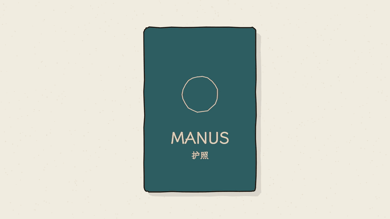
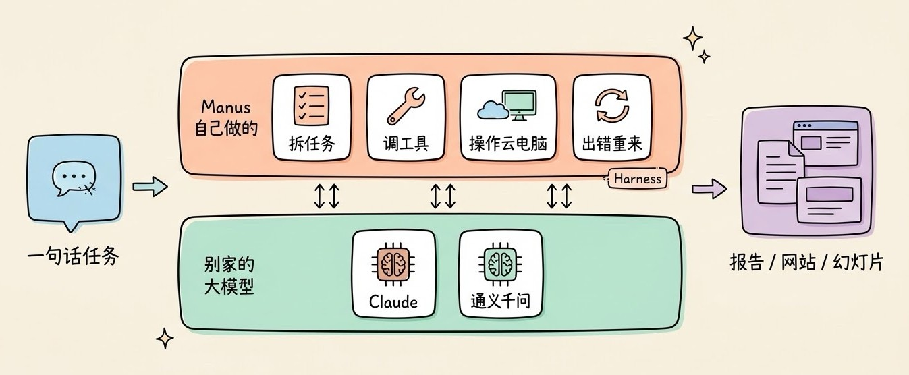
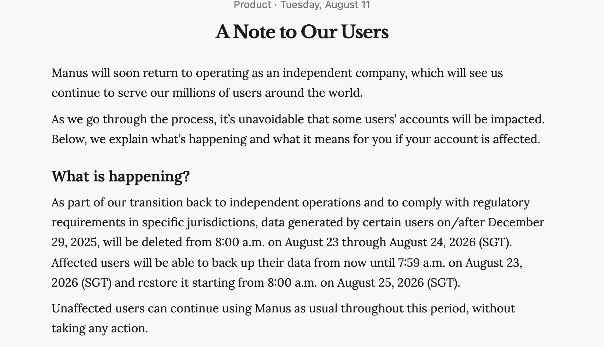
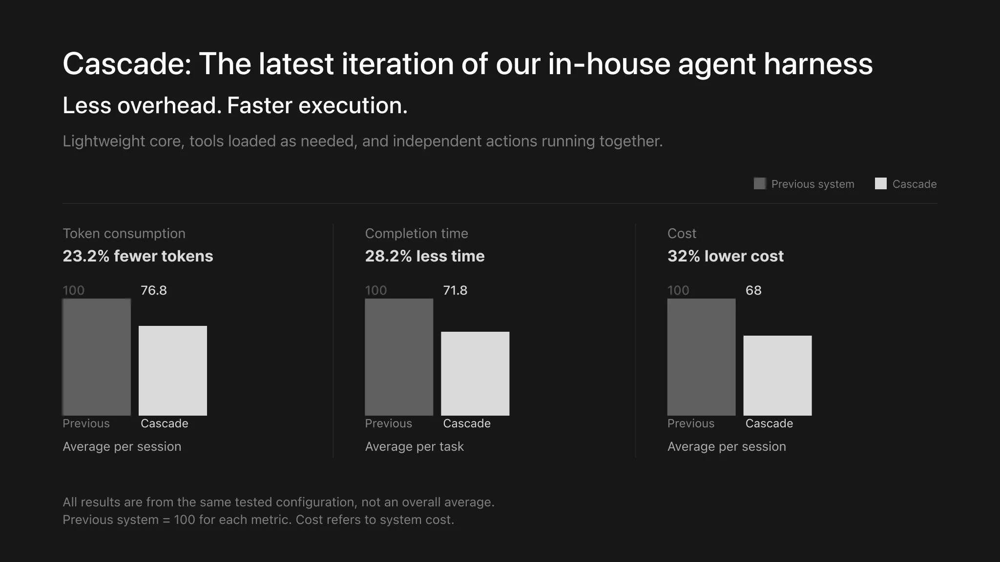
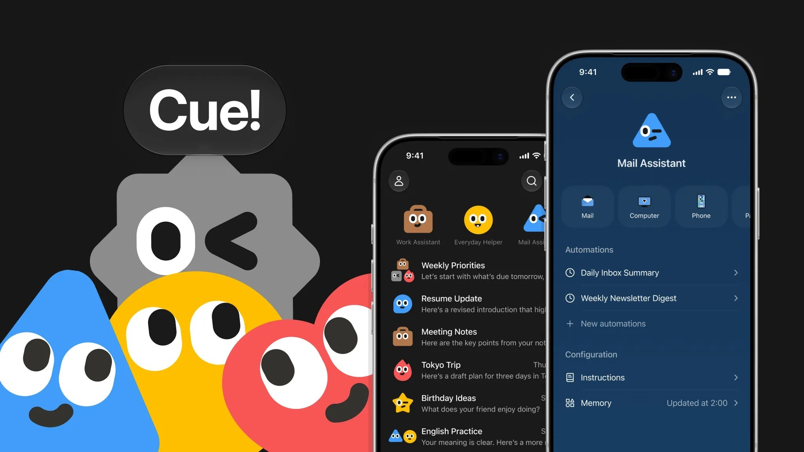

# 3分钟搞懂Manus

> ⭐⭐中级 · 阅读时间 3分钟 · 更新于 2026-11-17
>
> Manus 是中国团队做的通用智能体，交代一件事，它在自己的云电脑里把报告、网站、幻灯片做出来。一年半里它搬去新加坡、卖给 Meta、被发改委叫停又恢复独立。本文按这几次转折讲清它是什么、为什么一直卷在风波里，以及国内现在能不能用。

## 一句话定义

**Manus** 是一款**通用智能体**：你用一句话交代一件事，它会在一台属于自己的云电脑里打开浏览器查资料、写代码、整理数据，最后交给你一份报告、一个网站或者一套幻灯片。它由中国团队创立的公司**蝴蝶效应**开发，创始人是此前做过浏览器 AI 插件 Monica 的**肖弘**，公司现在的总部在新加坡。

举个例子，你跟它说「帮我对比一下国内五款桌面办公智能体，做成一份带表格的 PPT」。它会自己列出要查的产品，一家家去官网和新闻里找资料，把信息填进表格，再生成幻灯片。整个过程你可以在旁边看着它开了哪些网页、写了哪些文件，也可以直接去做别的事，等它做完。

和它同时出名的，是它的经历：一年半里，它从国内爆火，到搬去新加坡、被 Meta 收购，再到被中国国家发改委叫停、重新独立。下面按时间顺序，看看它每一步是怎么走过来的。

## 一段演示视频，让「Agent」第一次出圈

2025 年 3 月初，Manus 发布了一段演示视频：它自己筛选简历、研究房产、分析股票，全程不需要人插手。当时大多数人用的 AI 还停留在聊天阶段，看到 AI 能自己把一整件事做完，Manus 一下子火了。它只开放邀请注册，邀请码一度在二手平台上被炒到很高的价格。

蝴蝶效应宣称，Manus 在通用助理能力测试 **GAIA** 上超过了 OpenAI 的深度研究。不过这是公司自己公布的成绩，当时没有第三方复现；也有不少从业者认为它的宣传过热。

需要注意的是，**Manus 没有自己训练的大模型**。它背后调用的是 Claude、通义千问等别家的模型，Manus 自己做的是外面那一层：怎么拆任务、调用哪些工具、在云电脑里怎么操作、出了错怎么重来。这一层现在常被叫作 Agent 的「**Harness**」（任务框架）。当时有人批评它是「套壳」，但这也说明，同样的模型，框架做得好不好，最后完成任务的效果可以差很多。

## 拿了美元融资，就放弃了国内版

Manus 火了以后，面临一个选择：做国内市场，还是做海外市场。

一开始它两边都想要。2025 年 3 月，Manus 宣布和阿里的通义千问合作，计划基于千问的开源模型做一个中文版。可是没过多久，美国风投 Benchmark 领投了它 7500 万美元，按报道的估值约 5 亿美元。这笔钱随即引来美国财政部的审查，因为美国当时刚出台限制美国资本投资中国 AI 企业的规定。

2025 年 7 月，Manus 把总部搬到新加坡，核心技术人员跟着过去，国内团队被裁减，官方微博和小红书账号的内容也被清空。据前员工说，和通义千问合作的中文版不会再推进。从这时起，Manus 就基本不再面向国内用户了。

## 卖给 Meta，又被叫停

在新加坡，Manus 的收入涨得很快。2025 年 12 月 17 日，Manus 宣布它的年度经常性收入（ARR，按当前订阅收入折算的一年收入）超过 1 亿美元，距离发布只有 8 个月。这是公司自己公布的数字，统计口径也只覆盖了 10 月到 12 月。

十几天后的 12 月 29 日，Meta 宣布收购 Manus，《华尔街日报》报道的价格超过 20 亿美元。Meta 当时表示，Manus 会继续单独运营，技术会逐步接入 Meta AI；交易完成后，Manus 不再有中国股东，也会停止在中国的服务和运营。

事情没有就此结束。2026 年 1 月，商务部宣布审查这笔交易是否符合出口管制和技术出口的规定；4 月底，国家发改委宣布禁止外资收购 Manus 项目，要求各方撤销交易。监管部门的理由是，Manus 虽然搬到了新加坡，但它的技术和团队起源于中国，这次收购属于未经批准的外商投资。

接下来的几个月，Meta 开始和 Manus 切割。据《金融时报》7 月报道，腾讯牵头、Manus 早期的几家投资方组成财团，准备按大约 20 亿美元的原价从 Meta 手里买回 Manus，腾讯持股不超过一半。截至目前，交易的最终细节没有正式公布。

切割直接影响到了用户。Manus 在 8 月 11 日发布通知：部分用户在 2025 年 12 月 29 日之后创建的数据，会在 8 月 23 日到 24 日被删除，这两天里账号无法使用，用户要先自己备份，8 月 25 日以后再恢复。Manus 的解释是，这是和 Meta 分离以及满足部分地区合规要求的一部分，不是安全事故。9 月 1 日，Manus 正式宣布恢复独立运营。

*图注：Manus 官方博客 8 月 11 日的通知《A Note to Our Users》。它写明删除是为了恢复独立运营、满足特定地区的监管要求，时间都按新加坡时间（SGT）计算；没受影响的用户可以照常使用。*

## 恢复独立后，Manus 做了哪些事？

恢复独立不到一个月，9 月 28 日，Manus 发布了 **Manus 2.0**。官方说这不是一次普通的版本更新，而是换了一套新架构：

- **Cascade**：Manus 自己做的新任务框架，只在任务需要时才加载对应的工具。官方给出的测试结果是，和旧系统相比，Token（模型处理文字的计量单位）用量少了 23.2%，完成速度快了 28.2%，成本低了 32%。
- **Manus Studio**：桌面应用变成了一个人和 AI 一起干活的工作台，能做文档、表格、网站、视频和小游戏；你也能在手机上远程让它操作你的电脑。
- **Automations**：以前只能定时运行任务，现在收到新邮件、日历有新事件、Slack 或 Notion 有更新时，都能自动触发任务。
- **Cloud Computer**：可以额外购买一台长期运行的云电脑，你关掉笔记本以后，它还能继续跑。

*图注：Manus 2.0 发布文章里的 Cascade 测试图。深灰柱是旧系统，浅灰柱是 Cascade，每项都以旧系统为 100。图下方的小字写明，这些结果来自同一套测试配置，不是所有任务的平均值。*

同一天，Manus 还推出了一款独立的 App：**Cue**。它是一个个人智能体，每个 Agent 都有自己的邮箱、电话号码、钱包和电脑，能在你设定的预算内替你付钱，还能接电话，再把通话总结发给你。它的定位很明显，就是对标 Meta 3 周前刚上线的 Muse。截至目前，Cue 还在早期体验阶段，凭邀请码免费使用。

*图注：Manus 2.0 发布文章里的 Cue 产品图。每个 Agent 都有自己的邮箱（Mail）、电脑（Computer）和电话（Phone），还能设置定时自动任务（Automations）和记忆（Memory）。*

之后的几周里，Manus 推出了 **Manus Flex**，允许用户在 Manus 里用自己的模型 API Key；10 月 13 日，它宣布和 OPPO 合作，把智能体能力放进 OPPO Find X10 系列的 ColorOS 17 里，帮你在手机上把散落在各个 App 里的机票、酒店订单汇总起来，或者按内容整理照片和文件。

10 月初，蝴蝶效应确认完成一轮超过 5 亿美元的融资，由博裕资本和 IDG 资本领投，腾讯、HSG（原红杉中国）、真格基金跟投。彭博社此前报道这轮融资后估值会翻倍到 40 亿美元，不过 Manus 没有确认这个数字。

## 在国内能用吗？

截至目前，**Manus 和 Cue 都没有面向中国大陆提供服务**。这是 2025 年搬去新加坡时就定下来的，被 Meta 收购时也写进了交易条件里。

不过，风向正在变。恢复独立后，Manus 表示正在组建团队，为中国市场开发产品，也在和国内的模型厂商、生态伙伴洽谈；据报道，它 10 月发布的招聘岗位全部在北京。和 OPPO 的合作会在哪些市场上线，官方说要等手机发布时再公布。所以，Manus 会不会、以什么形式回到国内，还要再等等看。

如果你现在就想在国内用上同类产品，可以先看国内大厂的桌面办公智能体，比如腾讯的 WorkBuddy、字节的豆包工作、阿里的千问办公；想在微信、飞书里派活，可以用 Kimi Claw、MaxClaw 这类基于 OpenClaw 的托管版。

## 用 Manus 时，需要注意哪些问题？

**积分消耗很难提前估算。** Manus 有免费档，付费档按积分订阅，每个任务扣多少积分，取决于任务复杂度和它实际调用了多少步。同样一句话，它多查几轮、多改几次，扣的积分就可能翻倍。刚开始用时，建议先用小任务试一试，看一下每类任务大概要花多少积分。

**公司变动会直接影响你的数据。** 8 月那次数据删除就是一个例子：用户没做错任何事，只因为公司股权变了，部分数据就要先备份、再恢复。如果你用 Manus 做重要的工作，最好定期把成果导出来，存一份在自己手里。

**云电脑里的东西，在厂商的服务器上。** Manus 替你干活的那台电脑在厂商的机房里，你上传的文件、让它登录的账号都会经过它的服务器。官方说数据存放在美国和新加坡。涉及公司机密或个人隐私的资料，一定要先想清楚再交给它。

**很多亮眼的数字是公司自己公布的。** GAIA 跑分、1 亿美元 ARR、Cascade 省下的成本，都来自 Manus 自己；被 Meta 收购期间营收涨到 4 亿到 5 亿美元，则来自 The Information 的报道，同样没有得到公司确认。把这些数字当作参考就好，真正好不好用，还是要看你自己的任务能不能做成。

## 时效性提醒

Manus 是这两年变化最多的 AI 公司之一，下面这些信息最容易变：

- 腾讯牵头的回购和后续股权结构；
- 面向中国市场的产品会不会推出、什么时候推出；
- Cue 什么时候结束早期体验，之后怎么收费；
- 和 OPPO 合作的功能在哪些市场上线。

动手之前，建议先看一下 Manus 官方博客上的最新公告。

💬 **互动话题**：一个产品因为股权变动，要求部分用户先备份数据、过几天再恢复。如果这事发生在你常用的 AI 工具上，你还会继续用它吗？你平时会把 AI 帮你做的成果另存一份吗？

📖 **相关阅读**：

- [3分钟搞懂个人智能体](../04-personal-agent/README.md) - Cue 所在的这一类产品，以及 dots、Muse 这些对手
- [3分钟搞懂OpenClaw](../01-openclaw/README.md) - 开源路线的个人智能体，可以和托管的 Manus 对照着看
- [3分钟搞懂WorkBuddy](../02-workbuddy/README.md) - 国内能直接用的桌面办公智能体
- [3分钟搞懂AI Agent](../../02-core-capabilities/05-ai-agent/README.md) - Manus 背后的基础概念
- [3分钟搞懂Harness](../../09-agent-engineering/07-harness/README.md) - Manus 自己做的「外面那一层」到底是什么
- [3分钟搞懂Computer Use](../../02-core-capabilities/07-computer-use/README.md) - Agent 在云电脑里点鼠标、敲键盘的原理
- 3分钟搞懂Meta AI - 收购 Manus 又被叫停的另一方

**资料来源**：

- Manus 官方博客，Introducing Manus 2.0（2026-09-28，Cascade 测试数据、Manus Studio、Automations、Cloud Computer、Cue）：https://manus.im/blog/introducing-manus-2-0
- Manus 官方博客，产品更新列表（Manus Resumes Independent Operations 2026-09-01、A Note to Our Users 2026-08-11、Manus Flex 2026-09-29）：https://www.manus.im/blog?kind=PRODUCT
- OPPO 新闻稿，OPPO Partners with Manus to Bring Agentic AI Experiences to Smartphones（2026-10-13）：https://www.oppo.com/en/newsroom/press/oppo-manus/
- 21世纪经济报道，Manus 与通义千问合作（2025-03-13）：https://www.sfccn.com/2025/3-13/yMMDE0MDdfMTk5OTAyMw.html
- TechNode，Manus trims China team, relocates core staff to Singapore headquarters（2025-07-10）：https://technode.com/2025/07/10/manus-trims-china-team-relocates-core-staff-to-singapore-headquarters/
- IT之家，Manus 官方微博和小红书账号内容清空（2025-07-11，前员工称中文版不再推进）：https://www.ithome.com/0/867/454.htm
- Malay Mail，Manus moves HQ to Singapore amid scrutiny over US chip curbs, national security review（2025-07-10，Benchmark 领投与美国财政部审查）：https://www.malaymail.com/news/singapore/2025/07/10/china-born-ai-firm-manus-moves-hq-to-singapore-amid-scrutiny-over-us-chip-curbs-national-security-review/183448
- SiliconANGLE，Manus 宣布 ARR 超过 1 亿美元（2025-12）：https://siliconangle.com/?p=726287
- 半岛电视台，Tech giant Meta buys Chinese-founded AI firm Manus（2025-12-30，Meta 关于无中国股东、停止在华服务的表态）：https://www.aljazeera.com/economy/2025/12/30/tech-giant-meta-buys-chinese-founded-ai-firm-manus
- Engadget，Meta buys startup known for its AI task automation agents（2025-12，《华尔街日报》报道的收购价格）：https://www.engadget.com/ai/meta-buys-startup-known-for-its-ai-task-automation-agents-140045275.html
- South China Morning Post，China blocks Meta's Manus deal after months-long probe（2026-04）：https://www.scmp.com/tech/big-tech/article/3351552/china-blocks-metas-manus-deal-after-months-long-probe-thwarting-purchase
- The Next Web，Tencent in talks to become Manus' largest shareholder（2026-07-10，转引《金融时报》）：https://thenextweb.com/news/tencent-in-talks-to-become-manus-largest-shareholder
- Trending Topics，Manus becomes independent again following $2B Meta deal and deletes user data（2026-08，数据删除和恢复的时间安排）：https://www.trendingtopics.eu/manus-becomes-independent-again-following-2b-meta-deal-and-deletes-user-data/
- The Next Web，Manus 2.0 and Cue give AI agents their own email, phone and wallet（2026-09，中国市场团队、与国内模型厂商洽谈、Muse 背景）：https://thenextweb.com/news/manus-2-0-cue-ai-agents-email-phone-wallet
- VKTR，Manus raises $500M in first round since China blocked Meta deal（2026-10-08，融资、北京招聘、彭博社估值报道）：https://www.vktr.com/ai-platforms/manus-raises-500m-in-first-round-since-china-blocked-meta-deal/
- Dealroom，Manus revenue soars to $400–500M as its original backers move to buy it back（2026-06-18，转引 The Information）：https://dealroom.co/news/135169-manus-revenue-soars-to-400-500m-as-its-original-backers-move-to-buy-it-b/
- Manus 官方文档，Plans（免费档、Pro、Team 按积分计费）：https://manus.im/docs/introduction/plans.md
- Manus 官方博客，A Note to Our Users（2026-08-11，文中数据删除通知截图出处）：https://manus.im/blog/a-note-to-our-users
- 文中 Cascade 测试图、Cue 产品图出自 Manus 官方博客 Introducing Manus 2.0（2026-09-28）：https://manus.im/blog/introducing-manus-2-0

---

⬅️ 上一篇：[3分钟搞懂个人智能体](../04-personal-agent/README.md) ｜ [📚 返回目录](../README.md)
